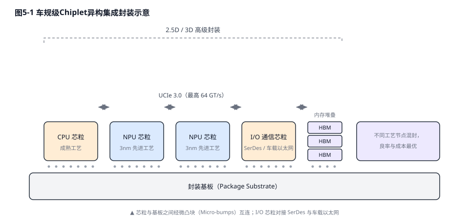

# 第六章：端侧计算底座——SoC微架构、芯粒与存算一体

物理AI模型向边缘侧的下沉，撞上了一系列严酷的物理极限：功耗墙、内存墙、散热墙与绝对的实时性约束——这四堵墙共同构成了端侧计算不可逾越的工程边界。云端数据中心可以通过堆砌机柜、液冷集群与不间断供电来换取算力，而一辆量产车的计算平台必须塞进手套箱大小的域控制器内，从低压车载电网中争夺数十到数百瓦的功率配额，并在宽温跨度与持续振动环境下保证全生命周期内的确定性实时响应。传统的衡量标准"理论TOPS"已经失效，业界正全面转向以真实算力利用率（MFU）、内存带宽吞吐量以及每瓦浮点运算能力（TFLOPS/W）来评估芯片的实际表现。本章首先重构端侧算力的评估体系，继而剖析三条设计哲学迥异的SoC架构路线及其代表性平台，随后深入存储介质的选择博弈，最后落到芯粒互连与存算一体这两项正在重塑硅片物理形态的底层技术。

## 6.1 性能评估体系重构：从名义TOPS到真实算力利用率

要理解车载芯片的一切设计取舍，首先要认清它与云端训练芯片面对的根本上不是同一个问题，差异同时体现在商业逻辑与计算形态两个层面。商业层面，云端训练是典型的重资产投资（CapEx）：车企与AI公司投入巨资建设超算集群，赌的是基础模型的泛化能力足以覆盖长尾场景，最终通过软件订阅或Robotaxi网络收回成本，硬件可以随技术迭代随时淘汰升级；车端推理芯片则直接计入整车物料清单（BOM），追求的是极致的全生命周期性价比——汽车的设计寿命长达十余年，而车载AI模型的参数量可能每半年就翻一倍，芯片必须在受限的功耗包络内，为未来三到五年的算法预留足够的算力与内存冗余。计算形态层面，核心差异在于算术强度（Arithmetic Intensity）与批处理规模（Batch Size）：云端训练拥有海量离线数据，可以通过数据并行、张量并行与流水线并行维持极大的Batch Size，让乘加阵列长期处于满载的计算受限（Compute-bound）状态；而车端推理运行在严格的闭环控制之中，车辆以每秒数十米的速度在物理世界移动，从感知到执行的端到端预算通常只有百毫秒量级，系统无法像云端推理服务那样"攒"出大批次来摊薄权重读取成本，只能以逐帧、逐传感器流（Batch Size为1）的形态实时推理——特斯拉在设计HW3芯片时，就把"支持Batch Size为1的低延迟推理"列为明确的架构目标[55]。

这种约束在端到端大模型上车后被进一步放大，可以借用大语言模型推理中"预填充（Prefill）/解码（Decode）"的经典分野来理解。感知与特征提取阶段类似Prefill：多路高分辨率摄像头以每秒数十帧的频率注入视频流，卷积网络或视觉Transformer对空间特征的提取可以高度并行，算力单元能够被相对充分地利用；而规划与轨迹生成阶段类似Decode：端到端模型在生成未来数秒的行驶轨迹时，需要反复检索历史状态记忆（相当于KV Cache）、通过注意力机制查询全局场景特征，每一次控制刷新都意味着庞大的模型权重被从外部存储器全量重读一遍。前者是算力受限，后者是带宽受限——这正是端到端时代内存带宽取代TOPS、成为决定车载系统智能水平第一性指标的深层原因。

在PC与移动时代延续下来的芯片评估指标，在物理AI负载面前几乎全体失效。CPU阵营沿用数十年的MIPS/DMIPS衡量的是标量整数流水线每秒执行的指令数，它假设负载是分支密集的控制流代码，而端到端智驾模型的本质是海量而规则的张量乘加运算，标量性能与推理吞吐之间几乎不存在线性关系。GPU阵营惯用的像素填充率、三角形吞吐率等指标脱胎于图形渲染管线，在车载SoC大幅裁剪图形单元、将晶体管预算让渡给张量阵列的今天，这些指标已然沦为历史遗迹。最具迷惑性的是NPU厂商竞相标榜的名义TOPS：这个数字通常在INT8精度、乘加阵列百分之百占空比、片上数据零等待的理想实验室条件下测得，相当于只标注发动机的红线转速，却不告知变速箱与传动轴的传动损耗。

真实负载下的算力兑现程度由MFU（Model FLOPs Utilization，模型算力利用率）刻画，即模型在给定时间内实际消耗的浮点运算量与芯片理论峰值算力的比值[57]。在车载与机器人推理场景中，MFU常常被三大制约压缩到三成甚至更低的水平。

第一道制约是内存墙，即片上SRAM容量、NoC（片上网络）带宽与外部DRAM带宽的联合瓶颈。Transformer类模型的权重与KV Cache复用度远低于CNN，乘加阵列每完成一次运算都需要新鲜的数据供给；当片上SRAM不足以容纳完整的算子分块、NoC交叉开关的仲裁引入排队延迟、外部DRAM带宽成为最终瓶颈时，再庞大的MAC阵列也只能空转等待。对于需要维护多帧历史的世界模型与随上下文长度线性膨胀的KV Cache而言，这一瓶颈还会被进一步放大。Roofline模型[56]的分析表明，在逐token生成这类算力密度极低的解码阶段，系统吞吐几乎完全由内存带宽决定，与标称TOPS数字无关。

第二道制约来自编译器与算子稀疏化。NPU的可编程性远逊于GPU，一旦模型中出现编译器尚不支持的新型算子（例如特殊的注意力变体或状态空间模型的扫描操作），该算子只能回退到CPU上慢速执行，在流水线中制造断点；算子融合与tiling（分块）划分的质量则直接决定数据在片上与片外之间的往返次数。至于厂商宣称的结构化稀疏加速（如2:4稀疏带来的算力翻倍），要求模型在训练阶段就配合剪枝并满足严格的稀疏模式约束，对车企直接部署的第三方或开源模型往往并不适用。

第三道制约是精度退回。名义TOPS几乎全部基于INT8整型精度标称，但端到端大模型中的部分敏感层——尤其是注意力分数计算与归一化层——在INT8量化下会出现可观的精度损失，工程上被迫退回FP16甚至FP32执行。一旦发生精度退回，同一块硅片的有效算力立刻减半乃至降至四分之一，标称TOPS瞬间失效。

三大制约之外，还有一个常被忽视的隐性变量：输入规模本身。工程实践中反复观察到，同一模型在越高的输入分辨率下，实测算力利用率往往越高——1080P输入下的乘加阵列占用率明显高于720P或更低分辨率。Roofline模型可以给出机制层面的解释：分辨率提高使卷积层的计算量近似按像素数增长，而权重加载量不变，算术强度随之上升，权重访存被更好地摊薄；同时更大的特征图能够填满乘加阵列的行与列，减少计算"气泡"，并稀释算子切换的固定调度开销。这也意味着，脱离具体模型与输入规模谈论芯片算力几乎没有意义——这正是经典模型长期充当芯片基准"标尺"的原因：自MLPerf推理基准设立以来，ResNet-50一直是提交数量最多的视觉模型[69]。然而工业界的模型谱系早已从VGG、ResNet一路演进到ViT/Swin与各类检测Transformer[70]，用单一经典模型的跑分去推断端到端大模型的实际表现，偏差只会越来越大。

评估方法的迁移还体现在测量口径本身。峰值算力只是一次理想条件下的冲刺，而车载场景真正关心的是持续性能：芯片在长时间满载下因热节流（Thermal Throttling）降频后还能维持多少有效算力；第99百分位（P99）帧延迟的抖动是否落在功能安全允许的窗口之内；多传感器时间戳对齐之后，从光子入射到控制指令发出的端到端流水线延迟是否确定可控。这些指标无法从数据手册的TOPS数字中读出来，必须在真实模型、真实温度与真实供电条件下实测。部分头部车企在芯片选型时，已开始要求供应商提交指定模型在额定环境温度下的持续FPS与MFU实测报告，而非纸面参数，这标志着评估体系从"比参数"向"比兑现"的根本转变。

正因如此，行业的评估坐标正在向三个新维度迁移。其一是面向低精度张量计算的TFLOPS：随着FP8乃至FP4量化训练与推理技术的成熟，芯片在FP8/FP4下的张量算力比INT8 TOPS更能反映其运行下一代大模型的真实潜力。其二是内存带宽：引脚速率达8533Mbps的LPDDR5X已成为车规大算力平台的主流配置，配合128位以上的总线宽度可提供约250GB/s级别的聚合带宽，这一指标对Transformer推理的实际吞吐具有近乎一票否决的影响力。其三是能效比：在车载散热与供电的硬约束下，FPS/W（每瓦帧率）与TFLOPS/W（每瓦浮点算力）取代绝对性能成为平台选型的首要门槛——毕竟，一颗无法在量产车热设计预算内持续满载运行的芯片，其峰值算力只是一纸空谈。

值得注意的是，这三个新维度并非彼此独立，而是被同一条物理链条串联：内存带宽决定数据供给速度，进而划定MFU的上限；MFU与精度策略共同决定有效TFLOPS；而有效TFLOPS除以系统功耗，才最终落为能效比。换言之，当代车载SoC的竞争力已无法用任何单一数字概括，它是微架构、存储子系统、编译器栈与热设计协同优化的复合产物——这也正是整车厂越来越倾向于以"每瓦每秒处理多少帧真实感知数据"作为评标基准的深层原因。

这条物理链条的尽头，是计算机体系结构领域一条被反复验证的设计哲学——局部性（Locality）。NVIDIA首席科学家Bill Dally在阐述领域专用架构的设计原则时反复强调，专用加速器的能效优势几乎全部来自数据的局部性：把数据留在离计算单元最近的地方，让每一次访存尽可能在片上完成[59]。端到端模型的全局注意力恰恰在算法层面抹平了传统卷积网络天然具备的空间局部性，因此硬件必须以更大的片上SRAM、更宽的NoC与更聪明的编译器调度把局部性"补偿"回来。与MFU相对应，业界还以MBU（Model Bandwidth Utilization，模型带宽利用率）衡量解码类负载对内存带宽的兑现程度[57][58]：在逐token生成阶段，MFU天然低下，MBU才是决定系统吞吐的真实标尺。从这个视角看，本章后续讨论的存储介质博弈与存算一体，本质上是同一场围绕局部性的战争在不同物理层面的打法。

## 6.2 三条架构路线与主流平台对比

面对相同的物理约束，全球芯片厂商分化出了三条设计哲学迥异的架构路线，彼此之间的博弈构成了当下车载SoC竞争的主线。三条路线并非单纯的技术优劣之争，而是对算力、能效、成本与灵活性四项约束的不同取舍排序，其分化深度折射出各厂商对自动驾驶算法演进速度与自身生态位的根本预判。

第一条是通用GPU主导型，以NVIDIA为代表。其核心逻辑是用极致的通用性与软件生态护城河来对冲定制化效率的损失：保留完整可编程的GPU阵列，辅以超高带宽的片内互连与海量内存，让任何形态的新模型——无论CNN、Transformer还是状态空间模型——都能在不修改硬件的前提下高效落地。这条路线的代价是功耗与成本居高不下，但在算法范式每十八个月就可能翻新的当下，"不为任何特定模型优化"反而成为最稳妥的长期主义。

第二条是DSA（领域特定架构）主导型，以特斯拉及小鹏、蔚来、地平线等自研阵营为代表。其设计哲学被业内概括为"重NPU、轻GPU"：大幅裁剪乃至彻底剔除通用图形渲染管线，将省下的晶体管与功耗预算全部转移给为神经网络数据流深度定制的NPU阵列与片上SRAM。这一转移的理论依据是"暗硅"（Dark Silicon）约束——在先进制程下，芯片的功耗密度早已超过封装散热能力，同一片硅上的晶体管不可能同时全开；既然总有一部分硅注定处于熄灭状态，不如主动熄灭那些对智驾负载无用的GPU逻辑，把有限的功耗预算集中灌注到张量计算单元上。DSA路线的能效与成本优势显著，但其命脉系于软硬协同的深度：芯片微架构与自家算法栈紧密绑定，一旦模型范式发生突变，专用硬件的沉没成本便会暴露无遗。值得注意的是，自研浪潮已从车企蔓延至Robotaxi运营商：Waymo于2026年官宣其自研定制ASIC正式量产上车，算力超1000 TOPS、由台积电5nm代工，专门承担激光雷达、毫米波雷达与摄像头原始数据流的前端处理，以替代此前外购的通用芯片方案[68]。

第三条是舱驾融合与弹性扩展型，以高通与瑞萨为代表。前者的思路是将智能座舱与智能驾驶合并到单颗SoC之上，通过硬件级虚拟化与混合关键性隔离机制，在同一片硅上同时承载ASIL-D级的智驾任务与QM级的信息娱乐负载，从整车层面砍掉一整套域控制器的成本、功耗与线束；后者则借助UCIe芯粒标准，把算力扩展从"重新流片"变为"增减芯粒"，用同一套基础设计覆盖从经济型到旗舰型的全系车型。这条路线的本质是拒绝在通用与专用之间做单选题，转而通过架构弹性来对冲需求的不确定性。

**表6-1 主流车载大算力SoC平台关键指标与设计哲学对比**

| **平台** | **核心微架构** | **标称算力与内存配置** | **功耗、制程与形态** | **设计哲学** |
| ---------------------------- | ------------------------------ | ------------------------------ | --------------------------- | ---------------------- |
| **NVIDIA DRIVE Orin** | Ampere GPU + 12核Cortex-A78AE | 254 TOPS（INT8），LPDDR5带宽204.8GB/s | 上一代量产主力，出货量最大的大算力平台 | 通用GPU路线的上一代基线 |
| **NVIDIA DRIVE Thor** | Blackwell GPU + Neoverse CPU集群，NVLink-C2C片内直连 | 官方口径1000 TOPS（INT8）/2000 TFLOPS（FP4），64GB LPDDR5X带宽273GB/s | 系统功耗传闻130–350W，需主动散热 | 通用GPU主导，舱驾融合，生态制胜 [15][61] |
| **Tesla AI5 (HW5)** | 深度定制双冗余NPU集群，剔除图形渲染流水线 | 供应链口径目标2000–2500 TOPS；内存从原计划144GB调整至96GB LPDDR5 | 台积电与三星双代工，外界推测功耗严格控制在车规散热允许区间 | 软硬一体的极致DSA定制 [16][62][63] |
| **小鹏图灵** | 40核ARM CPU + 双自研NPU | 单颗约750 TOPS（官方口径"一颗顶三颗Orin-X"），宣称算力密度4.2 TOPS/mm²；G7 Ultra搭载三颗、总算力超2200 TOPS | 7nm车规制程 | 全栈自研DSA，芯片与智驾大模型协同设计 [33][66] |
| **蔚来神玑NX9031** | 32核CPU，500亿+晶体管 | 官方未公布TOPS（"一颗顶四颗Orin-X"口径），LPDDR5X 8533Mbps，官方宣称处理延迟<5ms | 5nm车规制程，支持双芯热备冗余 | 高可靠自研DSA，冗余优先 [34] |
| **地平线征程6P** | 第三代BPU纳什架构，370亿晶体管 | 560 TOPS（1/2稀疏等效，稠密约280 TOPS），内存带宽205GB/s，图像处理带宽5.3Gpixel/s | 主流版本可被动散热 | 高能效DSA + 开放生态 [35][67] |
| **高通Snapdragon Ride Flex（SA8775P）** | Kryo CPU + Adreno GPU + Hexagon DSP三引擎异构 | 舱驾一体单SoC，算力按需动态分配 | 支持ASIL-D混合关键性硬件隔离 | 舱驾融合，一芯多域 [36] |
| **瑞萨R-Car X5H** | 32核Cortex-A720AE + 400 TOPS NPU（稀疏口径） | 支持UCIe芯粒扩展，算力可堆叠至3–4倍 | 3nm制程，面向Zonal架构的中央计算 | 芯粒弹性扩展，覆盖全系车型 [39] |

八款平台的参数分布还揭示了一个行业层面的结构性事实：算力数字的高低与方案的量产成功度并不正相关。对整车企业而言，选型决策本质上是在三条路线之间权衡自身的软件能力边界——拥有全栈算法团队、出货规模又足以摊薄流片成本的车企倾向DSA自研，以换取能效与差异化壁垒；算法依赖外部供应商、或需要在多代车型间复用软件资产的车企倾向通用GPU平台，以换取生态与灵活性；而追求整车电子电气架构极致简化的车企，则把舱驾融合或芯粒弹性扩展视为削减系统总成本的捷径。芯片路线图与车企技术战略的耦合度，已经取代单纯的性能参数，成为平台竞争的第一变量。

与上述动辄数百TOPS的算力军备竞赛形成鲜明对照的，是Mobileye的EyeQ6H——其标称算力仅为34 TOPS（INT8），却支撑起大规模量产的L2+乃至监督式高阶智驾方案[37]。EyeQ系列的设计哲学是把每一瓦功耗与每一字节带宽都榨取到极致：通过为视觉感知流水线深度定制的异构加速器集群（包括多线程处理器集群MPC、矢量微码处理器VMP、可编程宏阵列PMA与深度学习加速器XNN等）、打磨十余年的编译器工具链，以及针对车载电源瞬态跌落场景专门优化的供电与储能设计，它在被动散热的功耗包络内实现了确定性的实时性能[38]。这一对照恰恰印证了本章开篇的论断：在端侧计算的竞技场上，真实的算力利用率与能效工程远比标称TOPS数字更能决定胜负。

## 6.3 存储介质博弈：LPDDR、GDDR与片上SRAM

如果说算术强度决定了芯片需要多少带宽，那么"用什么存储介质来提供这些带宽"就是车载SoC设计中最具分歧的工程决策。车规场景下，存储介质的选择被成本、功耗、带宽构成的"不可能三角"牢牢约束：带宽最高的方案功耗与成本失控，功耗最优的方案带宽受限，三者不可兼得。围绕这一约束，当前量产与规划中的车载平台分化出了三条介质路线。

**表6-2 车端存储介质三条路线的权衡对比**

| **存储介质** | **物理属性** | **代表平台** | **核心优势** | **主要代价** |
| --- | --- | --- | --- | --- |
| LPDDR5/5X | 低功耗优先，总线位宽受限，容量易扩展 | NVIDIA DRIVE Thor（64GB LPDDR5X，带宽273GB/s）[61]；蔚来神玑、地平线征程6等主流平台 | 每比特能耗最优，对电动车续航友好，容量可扩展至百GB级 | 带宽天花板低，难以喂饱超大规模张量阵列 |
| GDDR6 | 高频率、宽总线，源自图形渲染血统 | 特斯拉HW4/AI4（16GB，拆解推算带宽约384GB/s）[63] | 以相对低廉的成本获得数倍于LPDDR的带宽，足以承载多路高分辨率视频流 | 功耗显著更高，低功耗休眠管理困难，加剧整车热设计压力 |
| 片上SRAM | 片内集成，纳秒级延迟，时序确定 | 特斯拉AI5/AI6（规划将约一半AI加速器专用于SRAM）[62] | 有效带宽较外部DRAM高出一个数量级，计算时序高度确定 | 容量密度极低，大量吞噬硅片面积，成本高昂 |

特斯拉的芯片迭代史是这场介质博弈最完整的样本。HW4（AI4）在量产车上弃用车规阵营惯用的LPDDR，转而搭载消费级显卡常用的GDDR6——这是一个"局部牺牲功耗、换取极致带宽"的典型决策：GDDR6的系统功耗更高、休眠管理更难，但它提供的约384GB/s带宽（拆解推算值，特斯拉官方从未公布）足以支撑8路高分辨率视频流直接灌入端到端网络。成本侧则是另一笔账：HW4选择三星7nm成熟制程而非尖端节点，以良率与成本红利对冲内存子系统的开支，马斯克曾透露整套AI4车载电脑的成本仅约650美元[64]。

存储介质博弈的约束甚至反过来重塑了产品定义。在全球存储产能持续紧缺的背景下，马斯克于2026年10月公开承认，特斯拉被迫压缩新一代芯片的内存配置：AI5从原计划的144GB先宣布削减至72GB，数日后又回调至96GB LPDDR5，理由是"这是获得足够供应量以支撑Optimus量产的唯一办法"[62][63]。而在面向2027年之后的AI6上，特斯拉的规划则推向另一个极致：外部内存升级为144GB LPDDR6，制程转向三星Taylor工厂的2nm节点（增强版AI6.5另由台积电亚利桑那工厂代工）[65]；更激进的在微架构层面——马斯克宣称AI5与AI6"约一半的AI计算加速器将专用于SRAM"，使片上缓存内的有效内存带宽比外部DRAM高出一个数量级[62]。宁可让计算核心让出面积，也要让数据留在离逻辑门最近的地方——这是6.1节所述局部性哲学最极端的产业表达。

三条介质路线的分野没有标准答案：LPDDR路线赌的是算法稀疏化与量化技术能持续压低带宽需求；GDDR路线赌的是多出的功耗可以靠整车热设计消化（其代价将在第七章展开）；SRAM路线赌的是硅片面积的经济性终将为带宽让路。但三者的共同指向是明确的——当外部引脚的带宽撞上物理天花板，把计算进一步推向存储阵列内部的存算一体（6.5节），便从学术设想变成了必然路径。

> **专栏6-1 云端推理芯片的三条路线：车端约束的镜像**
>
> 车端对带宽的饥渴并非孤例——在云端大模型推理市场，同样的物理约束催生了三条针锋相对的芯片路线。大模型推理的解码（Decode）阶段是公认的内存带宽受限负载：每生成一个token都要把模型权重完整读取一遍，推理成本因此可以清晰地分解为硬件折旧（CapEx）与能源运维（OpEx）两项，"每百万token的成本"成为云端算力的计价单位[95]。围绕带宽这一稀缺资源，业界分化出三条路线：Groq的LPU将权重分布于大量芯片的片上SRAM（单芯片约230MB），以编译器静态调度换取完全确定的时序，代价是大模型需要数百颗芯片组成集群共同承载[96]；Cerebras反其道而行，把整片晶圆做成一颗芯片（WSE-3集成44GB片上SRAM、21PB/s片上带宽），用冗余核心与可重构互连绕过晶圆制造缺陷[97]；而OpenAI与博通于2026年6月联合发布的Jalapeño推理芯片选择了HBM路线——6个HBM4堆栈提供216GB容量与15.4TB/s带宽，以通用性换取对更大模型的承载能力[98]。这场博弈的产业影响已经显现：2025年12月，NVIDIA以约200亿美元获得Groq的技术授权并吸纳其核心团队——官方明确否认这是对Groq公司的收购，但该交易因规避反垄断审查的嫌疑正受到美国国会调查[99]。三条云端路线与本节车端的LPDDR/GDDR/SRAM博弈共享同一套物理：SRAM给出数量级领先的带宽但容量昂贵，HBM与LPDDR以容量和成本折中——车端无非是这场战争在百瓦功耗包络内的极端版本。

## 6.4 顶级SoC对决与Chiplet架构重构

在厘清评估体系与架构路线之后，视线回到军备竞赛的最前沿：旗舰SoC的正面交锋，以及支撑其继续扩展的Chiplet封装革命。

在全维度的性能博弈中，各大巨头给出了截然不同的底层架构答案。NVIDIA的DRIVE Thor与Jetson Thor平台通过引入Blackwell GPU架构，官方规格按精度呈阶梯分布：FP4下达2000 TFLOPS，FP8与INT8为1000，FP16为500[61]；针对Transformer类负载，Thor集成了新一代推理Transformer引擎，官方宣称可为Transformer网络推理带来最高9倍的加速[60]。其核心杀手锏还在于采用NVLink-C2C芯片间直连互连技术，在CPU与GPU阵列之间提供高达1.8 TB/s的相干内存带宽，从根本上缓解了片间数据搬运瓶颈[15]。相反，特斯拉自研的AI5（HW5）芯片则走上了极致定制化的道路。根据供应链消息与马斯克的公开表态[16]，AI5采取台积电与三星双代工策略以保障产能，整体设计目标约为2000–2500 TOPS；其内存配置则受全球存储产能紧缺影响，从原计划的144GB几经调整至96GB LPDDR5——这一供应链妥协的始末已在6.3节展开[62][63]。AI5大幅削减了通用GPU逻辑，通过软硬高度耦合，追求与其智驾大模型极度匹配的数据流吞吐效率与能效比；外界推测其单芯片功耗将被严格控制在车规散热允许的数百瓦区间以内。

在更长的周期上，特斯拉试图颠覆的是芯片开发的节奏本身。马斯克多次公开提出以9个月为周期的芯片迭代目标——远快于传统半导体行业两到三年的开发节奏；为支撑这一目标，特斯拉与SpaceX、xAI合资推进Terafab项目，计划基于Intel 14A工艺，将逻辑、存储、封装与测试整合于单一园区，实现从设计到量产的垂直闭环[71]。9个月周期目前仍是目标而非既成事实，但它昭示的方向值得注意：一旦车企把芯片迭代节奏对齐到软件迭代节奏，"车辆十年生命周期与模型数月换代"这一端侧计算的结构性错位，才有被根本性缓解的可能。

对于更广泛的汽车和机器人工业而言，单片先进制程芯片的流片成本已变得不可承受。基于此，Chiplet（芯粒）技术成为了行业共识。日本ASRA联盟[1][17]与欧洲imec[18]紧密合作，致力于通过高级封装技术，将不同工艺节点的CPU、NPU与I/O通信芯粒像拼图一样组合在一个基板上。这一愿景的核心支撑是UCIe联盟于2025年8月发布的UCIe 3.0互连规范[19]。UCIe 3.0将单通道的裸片间传输速率从此前的32 GT/s提升至最高 64 GT/s（UCIe-S与UCIe-A封装均支持48/64 GT/s）。在高级封装（UCIe-A）极高密度的凸块阵列支持下，这种互连技术可以提供惊人的面带宽密度。然而，在如此高频的信号传输中，信号完整性（SI）和电源完整性（PI）面临巨大挑战。UCIe 3.0物理层通过引入复杂的连续时间线性均衡器（CTLE）与决策反馈均衡器（DFE），有效抑制了封装介质带来的信号衰减与串扰，以确保数据传输在严苛车载高温振动环境下的极低误码率（BER）。

## 6.5 存算一体（CIM）：硅片深处的效率革命

6.3节的介质博弈无论走向哪条路线，都难以绕开一个更根本的物理事实：即便有UCIe与巨量内存的加持，数据在存储器与计算核心之间的长距离搬移依然消耗了系统超过80%的动态功耗。为了从根本上解决这一问题，存算一体（CIM）电路设计异军突起。

CIM阵营内部又分化为模拟与数字两条支路。模拟CIM（ACIM）利用欧姆定律与基尔霍夫定律在模拟域直接完成乘加运算，理论能效极高，但模数/数模转换开销、器件非线性与温度漂移使其长期难以满足车规级可靠性要求；全数字CIM（DCIM）则以数字逻辑在存储阵列近旁完成运算，牺牲部分理论能效，换取确定性的计算结果与工艺鲁棒性。这一取舍在近年来的学术与产业演进轨迹中清晰可见。

CIM技术直接在存储阵列的物理电路层面完成矩阵乘加（MAC）运算。在车规级高可靠性要求的驱动下，全数字SRAM存算一体（DCIM）逐渐超越了对温度和工艺偏差敏感的模拟CIM架构[21]。早在ISSCC 2023上，台积电展示的4nm DCIM宏单元就通过并行MAC架构与位宽灵活配置，实现了6163 TOPS/W的峰值能效与4790 TOPS/mm²的计算密度[20]；而在ISSCC（国际固态电路会议）2026展示的前沿成果中，一款16nm全数字SRAM CIM宏单元在脉冲神经网络（SNN）模式下实现了444.21 TOPS/W的峰值能效（CNN模式下为62.84 TOPS/W），且不带来精度损失；采用Intel 18A工艺的全可综合DCIM加速器则实现了147 TOPS/W的能效与250 TOPS/mm²的计算密度。与此同时，基于22nm多电平ReRAM的存算一体宏单元已能实现50.6–90.2 TFLOPS/W的浮点能效，并原生支持Mamba、Transformer与CNN等主流网络结构，开始逼近车规级高温可靠性与长数据保持期的要求。这种将大模型权重直接凝固在存储阵列内部的微架构，不仅消除了模数转换器（ADC）带来的额外开销和精度损失，更为运行资源极度受限的机器人边缘控制器提供了极具潜力的低功耗推理方案。

当然，存算一体要真正登上量产车与机器人整机，仍需跨越可靠性、可制造性与工具链成熟度的多重门槛：SRAM-CIM面临面积开销与先进制程适配之间的权衡，ReRAM等新型存储介质则必须证明其在车规温度循环下的长期数据保持能力与良率一致性。但从技术演进的方向看，当内存墙的功耗占比持续攀升、制程微缩的红利日渐枯竭，把计算搬进存储阵列内部已不再是学术界的远期设想，而是端侧算力底座在"后摩尔时代"延续算力增长的必然路径，也是具身智能走向毫瓦级边缘节点的关键支点。
