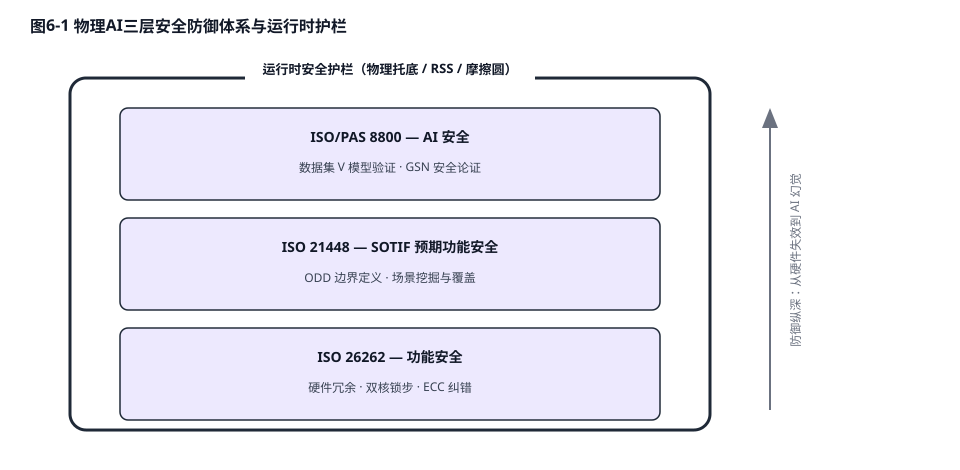
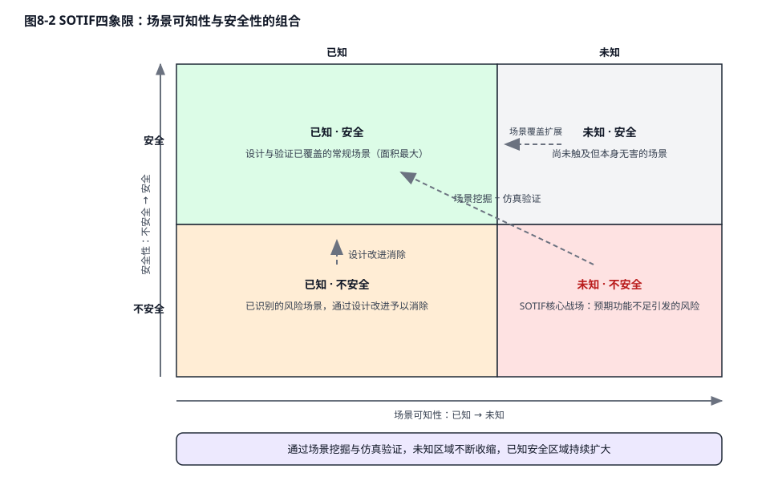

# 第八章：安全与验证体系——重铸AI黑盒的信任基石

将一台重达两吨、以极高动能行驶的汽车交由一个充满百亿参数矩阵的神经网络"黑盒"控制，不仅挑战了工程极限，更对现有的工业安全法规构成了前所未有的冲击。汽车功能安全体系过去数十年建立在"系统具备完全确定性因果逻辑"的假设之上：只要硬件不失效、代码无缺陷，系统的行为就可以被完整预测与验证。然而，端到端物理AI模型的失效往往并非源自硬件损坏或传感器失明，而是源于模型在遇到未见过的数据分布（OOD）时产生的内部特征坍塌或不可解释的常识幻觉。为了应对这种由深层神经网络带来的"AI功能不足（AI Insufficiency）"，全新的国际规范 ISO/PAS 8800（道路车辆——人工智能安全）应运而生[26][27]。本章将沿"功能安全——预期功能安全——人工智能安全"的三层递进结构，逐层剖析物理AI时代的安全工程机制，并延伸至具身智能机器人的安全标准前沿。

## 8.1 功能安全（ISO 26262）：硬件冗余的工程机制

ISO 26262《道路车辆功能安全》于2011年首次发布，并在2018年进行了全面修订——修订版将适用范围从乘用车扩展至摩托车、卡车与巴士，并新增了专门针对半导体器件的指南章节，正式承认"芯片本身即是安全生命周期的一环"。该标准的哲学基石是确定性：任何电子电气系统的失效都可被分解为随机硬件失效与系统性失效两类，前者用失效率统计与冗余设计来对冲，后者用严格的开发流程（V模型、静态代码分析、需求双向追溯）来根除。

标准核心概念之一是汽车安全完整性等级（ASIL），从A到D逐级递增，ASIL-D代表最高等级，适用于失效后果可能直接危及生命的功能（如制动、转向控制）。围绕失效发生后的系统行为，工程上区分两种根本不同的降级哲学：**Fail-safe（失效安全）**指系统一旦检测到故障便进入预先定义的安全状态——对汽车而言通常是降级运行或受控停车；**Fail-operational（失效运行）**则要求系统在单一故障发生后仍能维持完整功能继续运行，这对正在高速公路上以120 km/h行驶的自动驾驶系统至关重要——此时"立即停车"本身可能就是最危险的选项，系统必须带着故障撑到安全停车窗口出现。Fail-operational 的实现直接催生了芯片与系统层面的异构冗余设计浪潮。

在芯片微观层面，最具代表性的机制是双核锁步（Dual-Core Lockstep）：两颗完全相同的处理器内核执行一模一样的指令流，由硬件比较器在每一个时钟周期比对两核的输出信号，一旦出现分歧立即触发安全中断。以 Arm Cortex-R52 为代表的安全岛（Safety Island）内核即采用该设计，常作为大型智驾SoC内部独立于主计算集群的"安全监督者"，其自身即可达到 ASIL-D 认证要求。与之配合的还有两类硬件机制：其一是 ECC（纠错码）内存校验——高能宇宙射线与大气中子轰击会在SRAM/DRAM中诱发单比特翻转的"软错误（Soft Error）"，这类错误不留物理损伤、无法通过老化筛选排除，ECC通过冗余校验位实时纠正单比特错误并检测双比特错误，是防止瞬时辐射干扰演变为控制指令畸变的关键屏障；其二是 HSE（硬件安全引擎）等独立安全模块，在安全芯片内提供可信根、安全启动与密钥隔离，防止网络入侵篡改安全关键固件。

在系统宏观层面，中国车企近年给出了芯片级异构冗余的标志性案例。蔚来神玑NX9031智驾芯片采用双芯互为热备架构，官方宣称两颗芯片间可在5毫秒内完成控制权无缝切换，确保单芯失效时智驾功能不中断[34]；小鹏图灵AI芯片则采用"2+1"三芯异构冗余方案——两颗主算力芯片之外另配一颗独立安全芯片，三者架构异构、交叉监控，任意单一计算节点的失效或输出异常都可被其余节点即时识别与接管[33]。这类设计的本质是把 ASIL-D 的冗余要求从单芯片内部的双核比对，扩展到了板级、系统级的多芯交叉验证，为高阶智驾的 Fail-operational 能力提供了硬件底座。

## 8.2 预期功能安全（SOTIF）：未知不安全场景的系统性挖掘

即便硬件完好、代码无缺陷、模型未产生幻觉，自动驾驶系统仍可能伤害人类——原因仅仅是物理世界超出了传感器与算法的能力边界。ISO 26262 只管"故障（Malfunction）"，不管"功能不足（Insufficiency）"；填补这一空白的正是预期功能安全标准 ISO 21448（Safety of the Intended Functionality, SOTIF），其现行版本为 ISO 21448:2022[50]。

SOTIF 的方法论核心是将所有驾驶场景按两个维度——"已知/未知"与"安全/不安全"——划分为四象限。已知安全场景构成系统的能力主体；已知不安全场景是已被识别的危险（如特定逆光角度下的车道线误检），可通过设计修改、功能限制或告警策略逐一消除；未知安全场景无害但占用统计空间；真正的风险黑洞是**未知不安全（Unknown Unsafe）象限**——那些从未被工程团队想象过、却真实存在致命危险的场景组合。SOTIF 认证的本质不是证明系统绝对安全，而是证明企业建立了一套系统性的场景挖掘流程：通过大规模实车路测、仿真遍历、数据闭环回流与边缘场景（Corner Case）触发器，持续将未知不安全场景"挤压"转化为已知场景并加以处置，使未知不安全区域在统计上收敛到可接受的残余风险水平。

这一框架的工程起点是严格定义运行设计域（Operational Design Domain, ODD）——系统被允许运行的道路类型、速度区间、天气、光照、地理区域的完整参数化描述。ODD 之外的场景本就不在系统的安全承诺之内，因此 ODD 边界的实时自检（系统是否正在滑出设计域）成为 SOTIF 落地的第一道闸门。

传感器物理退化是未知不安全场景最密集的来源，两类经典案例足以揭示其隐蔽性。其一是大雾天气下的激光雷达衰减：浓雾中的水滴对905 nm与1550 nm激光产生强烈的米氏散射与吸收，点云有效探测距离可骤降至晴天的零头，而远端目标的回波则与雾噪混杂——系统若仍以晴天标定的距离模型做规划，等于在"近视"状态下全速行驶。其二是逆光导致的摄像头白板：低角度太阳直射镜头时，CMOS传感器大面积过曝饱和，前方画面沦为一片纯白，车道线、前车、红绿灯全部湮灭。这两类场景中硬件没有任何"故障"——激光雷达和摄像头都在严格按其物理规格工作——但功能输出已不再可信。SOTIF 要求系统具备传感器退化自诊断能力（如点云密度监测、图像曝光直方图分析），在探测置信度跌破阈值时主动降级车速或触发最小风险策略，而非盲目信任一份注定失真的感知结果。

## 8.3 数据即代码：ISO/PAS 8800 与数据集V模型

ISO/PAS 8800:2024 于2024年12月正式发布，是首个针对道路车辆人工智能安全的国际规范性文件，德国 Fraunhofer IKS 等机构深度参与了其起草与方法论证[51]。它颠覆了传统软件工程的认知，首次明确确立了"数据就是AI代码等价物"的核心法则，并引入了严密的"数据集生命周期V模型（Dataset V-model）"[28]。

在该框架下，大模型的训练集、验证集和测试集不再是普通的数字资产，而是必须接受极其严苛审计的"安全工程制品"。开发团队必须通过形式化方法证明数据的"代表性（Representativeness）"与"完整性（Completeness）"。如果一辆汽车在隧道出口因光线剧烈变化导致端到端模型输出错误的加速指令，安全审查不再去审查神经网络的C++部署代码，而是会深度追溯数据集生命周期：系统性地检查训练数据中是否包含了足够多关于高动态范围（HDR）光照突变的标注样本，以及数据采样的分布是否由于地理或气候偏差导致了严重的长尾盲区。任何数据分布上的缺失与不足，都必须通过可追溯的合成数据生成引擎（如利用Cosmos 3的生成能力）或主动的影子模式挖掘进行补全，确保模型在复杂工况下的认知边界被彻底锚定。

## 8.4 目标结构化表示法（GSN）构建坚不可摧的证据链

单纯依靠提高测试集上的统计学准确率无法证明AI的绝对安全。ISO/PAS 8800 强制要求利用目标结构化表示法（Goal Structuring Notation, GSN）来构建不可辩驳的"AI安全保证案例（Safety Assurance Case）"[29]。

GSN通过直观的图形化树状结构，将最高层级的抽象安全目标（如"车辆在任何情况下不得主动撞击行人"）层层向下拆解为具体的验证策略、上下文约束前提，并最终落地为底层具体的测试证据（如仿真测试覆盖率报告、边界值注入实验结果）。在评估复杂的视觉-语言-动作（VLA）模型时，GSN衍生出了两种至关重要的论证模式：

- **拒绝危险指令模式（Reject Instruction, RI）：** 当用户发出违反物理极限或交通法规的语义指令（如"立刻全油门冲过前方封锁的施工区"）时，系统必须提供确凿的逻辑与数据证据链，证明VLA模型不仅能够准确识别环境中的危险元素，还能正确拒绝执行该恶意或荒谬指令，确保底层执行机构不被劫持。

- **接受适当指令模式（Accept Adequate Instructions, AAI）：** 为了防止系统因过度防范风险而陷入"幽灵刹车"或在复杂路口永久性死锁，该模式要求证明模型具备在合法的动态安全包络内，流畅、自信且正确地执行驾驶任务的能力。

## 8.5 运行时安全监控器（Runtime Safety Monitor）：不可逾越的物理托底

既然神经网络在数学上永远无法提供100%的无缺陷证明，构建独立于AI黑盒之外的"运行时安全护栏（Safety Envelope）"就成了自动驾驶量产的最后一道防线[4][30]。

这套护栏系统部署在高安全等级的ASIL-D微控制器上，它依据纯粹的牛顿经典力学与车辆运动学构建。前沿的安全架构创新性地将大模型的语义理解能力与物理学极限界限进行了深度解耦与融合。在此架构中，VLM大模型不直接接管底层的力矩输出，而是以相对较低的频率持续推断当前的宏观环境上下文——例如路面材质的摩擦系数衰减、恶劣天气导致的前向能见度（Observability）下降等。基于这些动态感知的环境边界，安全护栏实时计算出车辆当前的"摩擦圆包络（Friction Circle Envelope）"以及符合责任敏感安全（RSS）的最小绝对安全跟车距离。

底层的控制模块以极高的频率（如20Hz）运行，它拦截并审查由端到端模型生成的所有轨迹和转向制动指令。一旦大模型产生幻觉，试图输出一个横向加速度要求超过当前路面摩擦力极限的转向指令，或者试图切入一个距离小于RSS安全公式计算得出的物理盲区空间内，运行时安全监控器会毫不犹豫地剥夺大模型的控制权，强行将指令截断、裁剪或触发系统的紧急降级停车机制。这种基于物理隔离的双模监控体系，完美兼顾了数据驱动大模型处理复杂路况的类人灵活性，以及经典控制论在生命安全边界上的绝对确定性保障。

## 8.6 机器人侧的安全标准：从围栏之内到开放环境

与汽车产业成熟的三层标准体系相比，具身智能机器人的安全规范体系仍处在追赶阶段。传统工业机器人安全依赖 ISO 10218-1/-2 构建的"物理隔离"哲学——机器人被围栏锁死在独立工作单元内，安全等同于禁止人机共处；该标准在沉寂十余年后于2025年发布了全面修订版（ISO 10218-1:2025 与 ISO 10218-2:2025），首次系统纳入了协作应用与网络安全等新时代议题[52]。协作机器人技术规范 ISO/TS 15066:2016 则首次引入了"功率与力限制（Power and Force Limiting, PFL）"，基于人体各部位的疼痛阈值给出了接触力与压力的准静态量化上限，使人机共线作业成为可能[53]。然而，当人形机器人走出工厂围栏、进入家庭与公共场所时，既有的标准都难以覆盖新的风险形态：双足动态平衡失稳导致的整机倾倒、灵巧手夹持中的动态接触伤害、以及VLA大模型语义误判引发的非预期动作，都不在传统标准的建模范围之内。面向个人护理与服务场景的 ISO 13482 提供了部分参考，但针对"大模型驱动的人形机器人"这一新物种，全球标准化组织仍处于空白填补与草案讨论阶段。这意味着具身智能厂商在相当长的窗口期内，必须自发借鉴汽车行业的SOTIF方法论与运行时护栏架构，先行构建企业级的安全论证体系，而非等待标准的救赎。

**表8-1 汽车AI安全防御三层体系对比**

| **汽车AI安全防御体系**                | **核心目标与防范痛点**                           | **核心技术与工程手段**                               | **适用对象与在系统中的角色**                        |
| ----------------------------- | --------------------------------------- | ------------------------------------------- | --------------------------------------- |
| **功能安全 (ISO 26262)**          | 防范硬件老化损坏与确定性软件代码Bug引发的系统瘫痪              | ASIL等级认证、芯片双核锁步、SRAM ECC内存校验、冗余异构计算架构       | 底层电子电气系统、执行器控制器、确定性中间件代码                |
| **预期功能安全 (SOTIF, ISO 21448)** | 防范因传感器物理性能受限或脱离运行设计域（ODD）导致的危险          | 严格定义ODD边界、已知与未知边缘场景（Corner Cases）挖掘、传感器降级策略 | 雷达/摄像头等感知硬件模组、模块化规划算法                   |
| **人工智能安全 (ISO/PAS 8800)**     | 约束端到端大模型黑盒不可解释的幻觉与"功能不足（Insufficiency）" | 数据集生命周期管理（V模型）、GSN安全论证案例、独立运行时物理安全护栏        | 基于深度学习的视觉-语言-动作（VLA）模型、Transformer端到端系统 |
