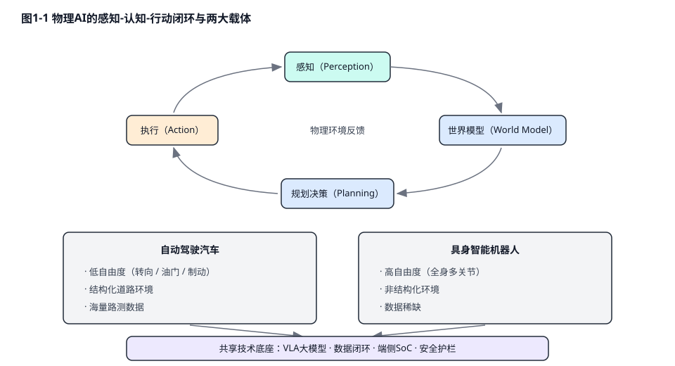
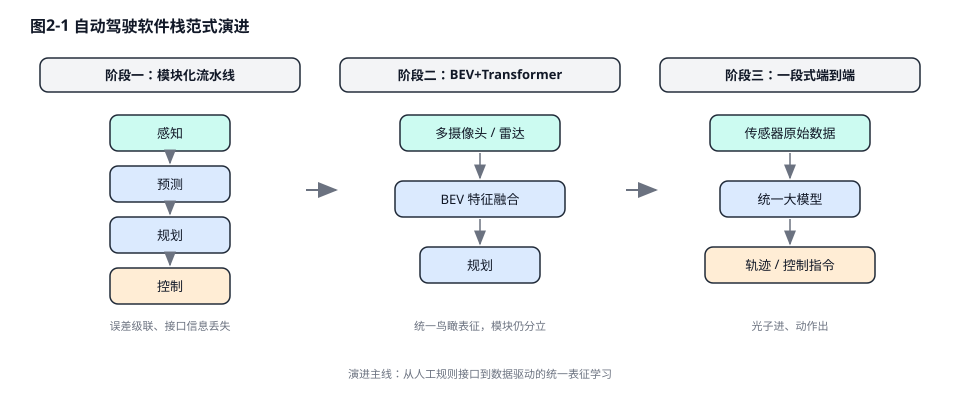
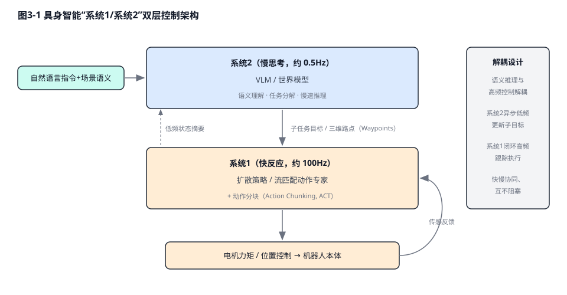
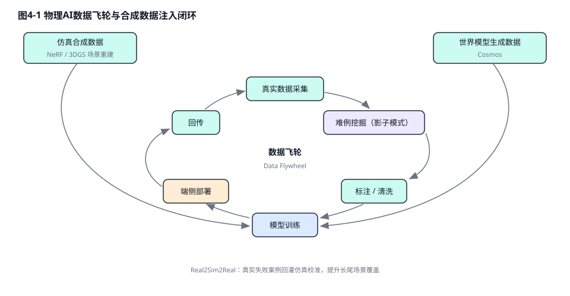

# 物理AI：从自动驾驶到具身智能

**版本：v1.1**

## 目录

- 前言
- 第一章：物理AI的范式革命——从数字智能到物理世界
- 第二章：自动驾驶的算法跃迁——从规则驱动到端到端大模型
- 第三章：具身智能的算法内核——世界模型与VLA的统一
- 第四章：数据引擎与仿真鸿沟——合成数据的爆发
- 第五章：端侧计算与硬件底座——算力、互连与机电躯体
- 第六章：安全与验证体系——重铸AI黑盒的信任基石
- 第七章：产业实践与未来展望——迈向通用物理智能
- 结语：在比特与原子之间
- 参考文献

## 前言

本书以"物理人工智能（Physical AI）"为统一视角，系统梳理自动驾驶与具身智能两大技术载体在算法范式、数据引擎、算力底座与安全体系四条主线上的协同演进。全书面向智能驾驶与机器人行业的工程师、研究者与技术管理者，力求在技术深度与产业广度之间取得平衡：既深入端到端大模型、世界模型、存算一体、芯粒封装等前沿技术细节，也关注量产落地、法规准入与商业模式的现实约束。文中关键概念首次出现时括注英文原词，重要技术路线辅以对比表格与结构示意图，供读者按章节独立阅读或整体通读。

## 第一章：物理AI的范式革命——从数字智能到物理世界

人工智能的演进正在经历一次深刻的跃迁，从受限于硅基服务器与虚拟网络的“数字智能”全面迈向能够直接干预现实环境的“物理人工智能（Physical AI）”。传统的生成式大语言模型（LLM）在封闭的数字空间内展现出了惊人的语义推理能力，但它们并不受制于牛顿力学、热力学定律或实时的物理延迟限制。物理人工智能则代表了一种全新的人工智能范式：它不仅需要理解和生成复杂的语义，更要在高度动态、充满未知变量且容错率极低的真实物理环境中进行感知、认知与实时交互。

莫拉维克悖论（Moravec's Paradox）精确地描绘了物理AI所面临的终极工程挑战。该悖论指出，让计算机在智力测试或下棋中表现出成人水平相对容易，但让其具备一岁幼儿般的感知和灵巧运动能力却极其困难。这种现象的本质在于，高阶逻辑推理在计算指令层面上是相对低维和廉价的，而逆向工程数百万年进化而来的物理直觉、手眼协调与感觉运动技能，则需要处理海量的高维连续物理信号，并进行极其复杂的非线性映射。随着大语言模型的常识推理能力向多模态领域的溢出、车载与机器人系统级芯片（SoC）算力成本的边际递减，以及高保真神经渲染仿真基础设施的成熟，这三重驱动力正在合力打破莫拉维克悖论的桎梏。

在这一技术浪潮中，自动驾驶汽车与具身智能机器人成为了承载物理AI范式的两大核心载体。尽管两者在形态上差异巨大，但它们共享着相同的底层技术逻辑，即感知环境、构建内部世界模型、进行长序列动作规划并驱动机电执行机构，从而在自动驾驶与通用机器人学之间形成了深度的技术合流。

**表1-1 自动驾驶汽车与具身智能机器人的特征对比**

| **维度特征**    | **自动驾驶汽车 (Autonomous Vehicles)** | **具身智能机器人 (Humanoid/Embodied Robots)** | **物理AI的底层共性**            |
| ----------- | -------------------------------- | -------------------------------------- | ------------------------ |
| **运行环境空间**  | 结构化至半结构化（道路网络、交通规则约束）            | 高度非结构化（开放式家庭、工业制造、复杂地形）                | 均需处理长尾分布的物理环境干扰与动态障碍物    |
| **自由度与执行器** | 低自由度（转向、加速、制动），二维平面运动为主          | 极高自由度（数十个关节、灵巧手），三维空间全身运动              | 均强依赖于高频、低延迟的底层机电闭环控制系统   |
| **数据规模与获取** | 数据海量（影子模式积累数十亿英里级真实路测数据）          | 数据极度稀缺（高度依赖遥操作与仿真合成数据）                 | 均需构建闭环数据引擎与高保真物理仿真器进行泛化  |
| **安全与容错约束** | 极高（高速动能，失控直接危及公共生命安全）            | 较高（物理交互密集，需防范碰撞与功率输出失控）                | 均面临黑盒大模型的验证困境，需构建运行时安全护栏 |

## 第二章：自动驾驶的算法跃迁——从规则驱动到端到端大模型

### 2.1 模块化流水线的崩溃与占用网络的兴起

在过去十余年中，自动驾驶软件栈主要遵循SAE（国际汽车工程师学会）J3016分级标准，并广泛采用模块化流水线（Pipeline）架构。SAE分级以"谁在驾驶、谁负责接管"为核心，将驾驶自动化划分为L0至L5六个等级，责任主体从人类驾驶员逐步移交至机器系统。

**表2-1 SAE J3016 自动驾驶分级速览**

| **等级** | **名称** | **动态驾驶任务执行者** | **接管责任主体** | **典型形态** |
| --- | --- | --- | --- | --- |
| L0–L2 | 驾驶辅助至部分自动化 | 人类为主，系统辅助 | 人类驾驶员 | ACC、NOA 领航辅助等量产功能 |
| L3 | 有条件自动化 | 系统（限定条件下） | 系统请求时人类接管 | 限定 ODD 的拥堵/高速自动驾驶 |
| L4 | 高度自动化 | 系统（限定 ODD 内） | 系统自主兜底 | Robotaxi、限定区域无人配送 |
| L5 | 完全自动化 | 系统（全域） | 无需接管 | 尚无商业化实例 |

该架构将驾驶任务生硬地拆分为感知、预测、规划和控制四个独立模块。然而，这种架构在向高阶自动驾驶演进时暴露出致命的缺陷：上游感知模块的微小分类误差会在下游预测和规划模块中被呈指数级放大，形成严重的误差级联（Error Cascading）；同时，模块间通过人工定义的规则接口传递信息，导致大量隐式的空间与上下文特征被永久性丢失。

感知范式的第一次革命是从2D图像空间的卷积神经网络（CNN）跨越至基于鸟瞰图（BEV）与Transformer的多模态特征融合。然而，为了彻底解决无类别标签的“长尾障碍物（Corner Cases）”检测问题，工业界进一步演进至占用网络（Occupancy Network）架构。占用网络摒弃了传统的边界框回归与目标分类，直接将车辆周围的3维连续物理世界离散化为体素（Voxel）网格，并预测每个体素的占用概率与运动流。虽然这种体素化建模赋予了系统识别任意未知障碍物的能力，但它引发了极其严峻的底层硬件挑战。处理海量的高分辨率3D体素特征需要频繁访问存储器，导致对系统静态随机存取存储器（SRAM）容量和外部动态随机存取存储器（DRAM）带宽的恐怖消耗，使得底层芯片极易陷入算力闲置而带宽枯竭的窘境[7][8]。

### 2.2 端到端重构与潜在对齐规划（LaPla）

为打破模块化瓶颈，自动驾驶正全面转向端到端（End-to-End）神经网络范式[5]。早期的端到端尝试多为两段式设计（如UniAD和VAD框架），在网络内部仍保留了显式的中间特征表达；而当前的最前沿趋势则是彻底的“光子进、动作出”的一段式端到端模型（如特斯拉FSD V12），直接将多模态传感器输入映射为底层转向与制动指令。

在端到端动作解码的过程中，系统面临着如何弥合离散的语义推理与连续的物理动力学约束之间的巨大鸿沟。传统的自回归解码机制往往引入严重的量化误差，导致生成的行驶轨迹出现剧烈抖动。最新的研究提出了潜在对齐规划（Latent-aligned Planning, LaPla）框架[6]，通过残差向量量化变分自编码器（VQ-VAE）构建动作分词器。LaPla并不执行会引发量化误差的离散码本查找，而是将VQ-VAE的解码器权重冻结，作为一种强大的物理动力学先验（Physical Prior）。在接收包含多视角图像、历史动作和文本指令的多模态上下文后，模型通过并发动作查询在单一前向传递中直接投射到连续的潜在空间，随后由冻结的解码器将其转化为符合车辆运动学的平滑轨迹。这种架构彻底绕过了耗时的自回归生成过程，在大幅降低推理延迟的同时，将长序列轨迹预测的误差降低了15.52%。

### 2.3 突破记忆墙：Transformer与Mamba的微架构博弈

端到端大模型（尤其是基于Transformer的架构）在车载神经处理单元（NPU）上部署时，遭遇了不可逾越的“记忆墙（Memory Wall）”。Transformer的全局自注意力机制导致其计算复杂度随序列长度呈 $O(n^2)$ 平方级增长。更致命的是，在自回归生成轨迹或动作时，模型必须为每一个Token频繁读写庞大的键值缓存（KV Cache），这种“预填充计算税（Prefill Compute Tax）”使得NPU的算术逻辑单元因等待内存数据搬运而陷入停滞，模型实际的算力利用率（MFU）大幅缩水[11]。

为了在算力与带宽严重受限的边缘端实现极低延迟的长序列推理，状态空间模型（State Space Models, SSM），特别是Mamba架构[9][10]，正在重塑底层算法生态。Mamba通过引入选择性机制（Selective State Spaces），使模型中的状态转移矩阵能够根据输入内容动态变化，从而决定记住或遗忘特定信息。这一突破性的数学构造使得序列建模的复杂度从二次方骤降至线性 $O(n)$，彻底消除了不断膨胀的KV Cache。在Mamba架构下，长视频流的时空特征提取不再受限于内存带宽，极大地释放了NPU的吞吐潜能。然而，完全抛弃注意力机制也会导致在处理需要极高精确度召回的局部细节时出现精度损失，因此，交织注意力层与SSM层的混合架构（Transformer-SSM）正在成为车载与机器人感知底座的最优妥协。

**表2-2 Transformer 与 Mamba 在物理AI端侧的架构特性对比**

| **算法架构特征**     | **传统 Transformer**           | **Mamba (选择性状态空间模型)** | **物理AI端的硬件影响与适用性**               |
| -------------- | ---------------------------- | --------------------- | -------------------------------- |
| **计算复杂度**      | $O(n^2)$ (随上下文长度平方级暴增)       | $O(n)$ (随上下文长度线性增长)   | Mamba使得在车规级SoC上处理高分辨率、长时序视频流成为可能 |
| **KV Cache依赖** | 极高 (导致严重的“记忆墙”与内存带宽瓶颈)       | 无需KV Cache (固定尺寸隐状态)  | 释放外部DRAM带宽，显著降低NPU推理延迟与系统整体功耗    |
| **并行预填充性能**    | 极佳 (高度适配GPU Tensor Core矩阵乘法) | 较弱 (序列依赖性高，需定制底层算子)   | 促使芯片厂商针对SSM算法开发专用的硬件指令集与DSA架构    |

## 第三章：具身智能的算法内核——世界模型与VLA的统一

具身智能机器人不仅需要移动，更需要理解并操作复杂的物理环境。传统机器人学习范式主要分为行为克隆（Behavioral Cloning, BC）与强化学习（Reinforcement Learning, RL）。行为克隆高度依赖专家演示，泛化能力极差；而强化学习在真实物理世界中进行试错的成本过于高昂，且极易导致硬件损坏。视觉-语言-动作（Vision-Language-Action, VLA）基础模型的崛起，彻底重构了机器人的大脑架构。从 Google DeepMind 的 RT-2 首次将互联网规模的视觉-语言知识迁移至机器人控制，到开源 OpenVLA 降低研究门槛，再到 Physical Intelligence 的 π0 引入流匹配动作专家，VLA 已在短短数年内形成清晰的谱系[2][3]。

**表3-1 代表性 VLA / 机器人基础模型谱系对比**

| **模型** | **研发机构** | **架构要点** | **动作生成方式** | **开放程度** |
| --- | --- | --- | --- | --- |
| RT-1 / RT-2 | Google DeepMind | ViT+Transformer，视觉语言知识向控制迁移 | 离散化动作 Token | 闭源 |
| OpenVLA | Stanford 等（开源社区） | 7B 开源 VLA，基于 Llama 系 VLM 微调 | 离散化动作 Token | 开源权重与代码 |
| π0 | Physical Intelligence | VLM 骨干 + 流匹配（Flow Matching）动作专家 | 连续动作流 | 开源权重 |
| Helix | Figure AI | 系统2（VLM）+ 系统1（高频策略）双系统全内置 | 连续控制 | 闭源 |
| GR00T N | NVIDIA | 双系统架构 + Eagle 视觉骨干，配套 Isaac 仿真栈 | 连续动作轨迹 | 开放权重 |

### 3.1 混合Transformer架构与NVIDIA Cosmos 3

在迈向通用物理AI的进程中，系统必须具备推演未来物理状态的能力，即构建世界模型（World Models）。NVIDIA于2026年COMPUTEX期间发布的 Cosmos 3 开放模型家族是这一技术路线的代表作，其旗舰版本 Cosmos 3 Super 拥有640亿参数（64B），与16B的Nano、4B的Edge版本共同覆盖从云端训练到端侧部署的全场景，原生支持语言、图像、视频、音频以及执行器动作的联合建模与生成[12]。

Cosmos 3 摒弃了拼接独立模块的传统思路，采用了一种极具开创性的混合Transformer（Mixture-of-Transformers, MoT）双塔架构[13]，将语义推理与物理世界生成在同一个神经网络骨干中实现了深度纠缠：
首先是**自回归推理塔（Autoregressive Tower）**。该塔专注于高阶语义推理，接收自然语言指令与经过视觉Transformer（ViT）编码的图像块。它利用因果自注意力机制（Causal Self-Attention），从左至右单向处理序列信息，逐步构建起对场景中三维几何关系、物体遮挡状态以及任务逻辑的深层认知表示。
其次是**扩散生成塔（Diffusion Tower）**。为了处理连续且高维的物理世界信号，连续的视频流、音频波形和机器人关节的动作轨迹首先通过一个被冻结的变分自编码器（VAE）压缩为紧凑的潜在特征（Latents）。扩散塔利用双向注意力机制全局处理这些特征，通过迭代去噪过程，生成具有高度物理连贯性的未来视频帧或控制动作。

Cosmos 3 架构的灵魂在于其跨塔联合注意力机制。在扩散塔生成未来的物理信号时，它会主动对自回归塔生成的推理特征进行交叉注意力查询。这意味着，模型所生成的每一个像素流动、每一段电机控制扭矩，都受到高阶语义推理与物理常识的强约束，从而显著缓解了传统视频生成模型中常见的物理法则崩溃（如物体穿模、不合理形变）现象。

### 3.2 具身控制架构：系统1与系统2的解耦与融合

尽管巨型VLA模型拥有强大的常识，但将其直接用于高频闭环控制会面临不可接受的推理延迟。因此，学术界与工业界（如NVIDIA GR00T平台、Figure Helix）普遍转向了灵感源自人类认知的“系统1 / 系统2”双层解耦架构。

系统2（慢思考）由庞大的VLM或VLA世界模型构成。它以极低的频率（如0.5Hz）运行在云端或强大的车载中央计算平台上，负责摄入自然语言指令，解析复杂的场景语义，并输出中间形态的子任务目标或三维空间路点（Waypoints）。系统1（快反应）则部署在靠近执行器的边缘控制器上。它由轻量级的动作策略网络组成，利用扩散策略（Diffusion Policy）或连续流匹配技术，在10毫秒级的极低延迟下，将系统2下发的路点转化为高频的电机力矩或位置控制指令。为解决连续动作生成中的时序断层与非平稳性问题，动作分块（Action Chunking, ACT）技术被广泛引入。它允许网络一次性预测未来一系列连贯的动作序列，并通过时间重叠平滑策略，使得机器人的双臂在进行复杂的灵巧操作（如穿针引线、动态抓取）时，表现出极为拟人化的流畅度与柔顺性。

## 第四章：数据引擎与仿真鸿沟——合成数据的爆发

物理人工智能的发展严重受制于真实世界数据的稀缺性。自动驾驶可以通过部署在大规模量产车上的“影子模式（Shadow Mode）”收集海量的人类驾驶轨迹，并通过边缘端的触发器被动挖掘长尾难例。但对于具备数十个自由度的人形机器人而言，收集包含精确多模态力反馈的真实物理交互数据极其昂贵，高度依赖人类穿戴外骨骼或VR设备进行的遥操作（Teleoperation）。由此，具身智能的数据供给形成了"三条腿走路"的格局，三者在成本、规模与质量上各有不可妥协的短板。

**表4-1 具身智能三大数据来源对比**

| **数据来源** | **单位成本** | **可扩展规模** | **数据质量** | **主要短板** | **适用阶段** |
| --- | --- | --- | --- | --- | --- |
| 真机遥操作数据 | 极高（设备+人力，单条轨迹分钟级） | 受限于遥操作员数量 | 最高（真实物理交互、力反馈完整） | 采集效率低、场景多样性不足 | 任务微调与能力对齐 |
| 仿真合成数据 | 低（边际成本趋近于零） | 近乎无限 | 中（存在物理与渲染失真） | Sim2Real 鸿沟 | 大规模预训练与策略预演 |
| 人类第一视角视频 | 极低（互联网存量） | 海量 | 低（缺少动作与力的标签） | 无法直接映射到机器人本体 | 语义与常识预训练 |

为了填补数据真空，产业界正在将重心转向神经渲染与世界模型驱动的合成数据生成（Synthetic Data Generation, SDG）。利用神经辐射场（NeRF）和3D高斯泼溅（3D Gaussian Splatting）等技术，系统可以从少量的真实2D图像中瞬间重建出具有极高照片级真实感的3D物理场景。在这一虚拟场景中，Cosmos 3 等世界模型充当了交互式神经模拟器的角色。例如，TIER IV等自动驾驶研发机构利用Cosmos架构[14]，通过改变文本或语义控制条件，在现有真实视频的基础上合成出雨雪交加、夜间逆光或罕见交通事故的变体视频。这种在物理和光学上高度一致的合成数据，被直接注入到自动驾驶算法的训练飞轮中，极大提升了模型在应对罕见边缘场景时的鲁棒性。

然而，仿真环境与真实世界之间始终横亘着一道难以跨越的“仿真到现实鸿沟（Sim2Real Gap）”。为了防止策略网络在仿真中过拟合虚拟的物理参数，域随机化（Domain Randomization）被广泛应用。通过在强化学习训练中疯狂扰动摩擦系数、重力加速度、传感器噪声分布以及光照条件，模型被迫学习到最具普适性的控制流形。进而，通过Real2Sim2Real闭环反馈机制，将在真实世界中发生的失败案例重新导入仿真环境中进行系统辨识与参数微调，最终实现具身智能能力的可持续涌现。

## 第五章：端侧计算与硬件底座——算力、互连与机电躯体

物理AI模型向边缘侧的下沉，撞上了一系列严酷的物理极限：功耗墙、内存墙、散热墙与绝对的实时性约束。传统的衡量标准“理论TOPS”已经失效，业界正全面转向以真实算力利用率（MFU）、内存带宽吞吐量以及每瓦浮点运算能力（TFLOPS/W）来评估芯片的实际表现。

### 5.1 顶级SoC对决与Chiplet架构重构

在全维度的性能博弈中，各大巨头给出了截然不同的底层架构答案。NVIDIA的DRIVE Thor与Jetson Thor平台通过引入Blackwell GPU架构，将AI计算能力推升至2000 TOPS以上（FP4精度），专门针对Transformer模型进行了底层算子优化。其核心杀手锏在于采用了NVLink-C2C芯片间直连互连技术，在CPU与GPU阵列之间提供高达1.8 TB/s的相干内存带宽，从根本上消除了数据搬运瓶颈[15]。相反，特斯拉自研的AI5（HW5）芯片则走上了极致定制化的道路。根据供应链消息与马斯克的公开表态[16]，AI5采取双代工策略以保障产能（台积电3nm与三星先进制程双线并行），整体设计目标约为2000–2500 TOPS；内存配置经历了从传闻中144GB统一内存到官宣削减至72GB LPDDR5X的调整（下一代AI6则规划144GB LPDDR6）。AI5大幅削减了通用GPU逻辑，通过软硬高度耦合，追求与其智驾大模型极度匹配的数据流吞吐效率与能效比；外界推测其单芯片功耗将被严格控制在车规散热允许的数百瓦区间以内。

对于更广泛的汽车和机器人工业而言，单片先进制程芯片的流片成本已变得不可承受。基于此，Chiplet（芯粒）技术成为了行业共识。日本ASRA联盟[1][17]与欧洲imec[18]紧密合作，致力于通过高级封装技术，将不同工艺节点的CPU、NPU与I/O通信芯粒像拼图一样组合在一个基板上。这一愿景的核心支撑是UCIe联盟于2025年8月发布的UCIe 3.0互连规范[19]。UCIe 3.0将单通道的裸片间传输速率从此前的32 GT/s提升至最高 64 GT/s（UCIe-S与UCIe-A封装均支持48/64 GT/s）。在高级封装（UCIe-A）极高密度的凸块阵列支持下，这种互连技术可以提供惊人的面带宽密度。然而，在如此高频的信号传输中，信号完整性（SI）和电源完整性（PI）面临巨大挑战。UCIe 3.0物理层通过引入复杂的连续时间线性均衡器（CTLE）与决策反馈均衡器（DFE），有效抑制了封装介质带来的信号衰减与串扰，以确保数据传输在严苛车载高温振动环境下的极低误码率（BER）。

**表5-1 车规级大算力SoC平台设计哲学对比**

| **车规级大算力SoC平台**              | **核心微架构特征**                    | **制程与互连技术**                    | **物理AI的工程意义与设计哲学**                      |
| ---------------------------- | ------------------------------ | ------------------------------ | --------------------------------------- |
| **NVIDIA DRIVE/Jetson Thor** | 融合Blackwell GPU与Neoverse CPU集群 | 采用NVLink-C2C实现1.8 TB/s超高带宽内部互连 | 通用性极强，生态完善，依托极致带宽强行突破端到端大模型的“记忆墙”       |
| **Tesla AI5 (HW5)**          | 深度定制双冗余NPU集群，剔除冗余图形渲染流水线       | 台积电与三星双代工，官宣72GB LPDDR5X统一内存（AI6规划144GB）   | DSA（领域特定架构）典范，芯片设计与FSD算法紧密绑定，追求极致能效与低延迟 |
| **车规级Chiplet架构 (ASRA体系)**    | 异构芯粒集成，灵活堆叠不同厂商与工艺节点的AI算力模块    | 依托UCIe 3.0标准，单通道数据率高达 64 GT/s  | 打破单片芯片良率瓶颈与成本天花板，实现从L2到L4智驾系统的算力弹性伸缩    |

### 5.2 存算一体（CIM）：硅片深处的效率革命

即便有UCIe与巨量内存的加持，数据在存储器与计算核心之间的长距离搬移依然消耗了系统超过80%的动态功耗。为了从根本上解决这一问题，存算一体（CIM）电路设计异军突起。

CIM技术直接在存储阵列的物理电路层面完成矩阵乘加（MAC）运算。在车规级高可靠性要求的驱动下，全数字SRAM存算一体（DCIM）逐渐超越了对温度和工艺偏差敏感的模拟CIM架构[21]。早在ISSCC 2023上，台积电展示的4nm DCIM宏单元就通过并行MAC架构与位宽灵活配置，实现了6163 TOPS/W的峰值能效与4790 TOPS/mm²的计算密度[20]；而在ISSCC（国际固态电路会议）2026展示的前沿成果中，一款16nm全数字SRAM CIM宏单元在脉冲神经网络（SNN）模式下实现了444.21 TOPS/W的峰值能效（CNN模式下为62.84 TOPS/W），且不带来精度损失；采用Intel 18A工艺的全可综合DCIM加速器则实现了147 TOPS/W的能效与250 TOPS/mm²的计算密度。与此同时，基于22nm多电平ReRAM的存算一体宏单元已能实现50.6–90.2 TFLOPS/W的浮点能效，并原生支持Mamba、Transformer与CNN等主流网络结构，开始逼近车规级高温可靠性与长数据保持期的要求。这种将大模型权重直接凝固在存储阵列内部的微架构，不仅消除了模数转换器（ADC）带来的额外开销和精度损失，更为运行资源极度受限的机器人边缘控制器提供了极具潜力的低功耗推理方案。

### 5.3 底层通信拓扑重塑：10BASE-T1S与TSN以太网骨干

在算力高度集中的同时，车辆与机器人的神经末梢通信网络也迎来了彻底的重构。由于传统的CAN、LIN总线已无法承受高精度传感器爆发的数据洪流，基于物理区域（Zonal）的新型电气架构开始全面普及。

在连接传感器和末端执行器的边缘接入层，10BASE-T1S 以太网（IEEE 802.3cg）展现出了颠覆性的工程价值[22]。它摒弃了传统以太网繁复的点对点连接与昂贵的交换机，允许通过单对非屏蔽双绞线在长达25米的距离上挂载至少8个节点，形成多点共享总线。为了避免多节点争抢带宽导致的碰撞延迟，10BASE-T1S 引入了物理层防冲突机制（PLCA, Physical Layer Collision Avoidance）。通过为主机和从机分配严格的循环传输时隙（Transmit Opportunities），PLCA将原生以太网的“尽力而为”机制转化为确定性的低延迟传输，大幅削减了车内线束的重量与装配成本。

在区域控制器与中央计算大脑之间，多千兆车载以太网结合时间敏感网络（TSN, IEEE 802.1标准集）构成了不可动摇的骨干网体系[23][24]。

- **全局时钟同步（gPTP, IEEE 802.1AS）：** 通过主从时钟的硬件级时间戳与延迟补偿，使得全车所有传感器曝光时间、计算节点与制动执行器被牢牢绑定在误差不超过亚微秒级的同一时间轴上[25]。

- **时间感知调度（TAS, IEEE 802.1Qbv）：** 在骨干网交换机内部强制执行基于时间的门控列表（Gate Control List）。当关键的VLA模型控制指令到达时，交换机瞬间关闭所有承载座舱娱乐等低优先级数据的队列闸门，为安全数据铺设毫无阻碍的“绿灯通道”，将端到端延迟的抖动压缩至极低水平。

- **报文抢占（Frame Preemption, IEEE 802.1Qbu）：** 当面对突发的紧急避险指令时，该协议允许高优先级帧瞬间打断正在物理线路上发送的巨型低优先级数据包，并在紧急指令传输完毕后，无缝拼接恢复原数据包的发送，彻底打破了传统以太网“最大帧阻塞时间”的限制。

[图表描述：此处可插入"TSN时间感知调度与报文抢占时序图"，展示门控列表周期、保护带以及高优先级帧抢占低优先级帧的时序细节。]

### 5.4 感知与执行硬件：机器人的躯体与末梢神经

如果说车载计算平台是物理AI的大脑，那么传感器与执行机构就是它的五官与四肢，而这一维度恰恰是具身智能区别于纯数字智能的物理边界。在感知侧，自动驾驶主要依赖摄像头、激光雷达、4D毫米波雷达与IMU构建外部环境认知；人形机器人除此之外，还必须依靠关节编码器、六维力/力矩传感器与阵列式触觉传感器（电子皮肤）来感知自身的本体状态与接触力学信息——后者是实现柔顺操作与安全人机交互的前提，也是当前成本与技术成熟度差距最大的环节。在执行侧，车载系统的执行对象仅有转向、驱动与制动三大通道，而人形机器人需要在紧凑的关节空间内集成无框力矩电机、谐波减速器或行星滚柱丝杠等高功率密度模组，并通过腱绳传动或连杆传动驱动拥有十余个自由度的灵巧手。行业的主流趋势是将电机、减速器、编码器、驱动器与力矩传感器封装为高度机电一体化的关节模组，以标准化的EtherCAT或CAN FD实时总线接入整机控制网络，从而摊薄成本、缩短装配工时并提升可靠性。感知与执行硬件的性能上限，最终决定了上层VLA大模型的能力能够在物理世界中兑现到何种程度。

## 第六章：安全与验证体系——重铸AI黑盒的信任基石

将一台重达两吨、以极高动能行驶的汽车交由一个充满百亿参数矩阵的神经网络“黑盒”控制，不仅挑战了工程极限，更对现有的工业安全法规构成了前所未有的冲击。传统的 ISO 26262 功能安全标准建立在“系统具备完全确定性因果逻辑”的假设之上，主要通过冗余设计和代码静态分析来防御硬件老化（如双核锁步、内存ECC校验）和软件架构缺陷。对于因物理传感器能力受限或运行设计域（ODD）超出预期而导致的事故，行业补充了预期功能安全（SOTIF, ISO 21448）标准。

然而，端到端物理AI模型的失效往往并非源自硬件损坏或传感器失明，而是源于模型在遇到未见过的数据分布（OOD）时产生的内部特征坍塌或不可解释的常识幻觉。为了应对这种由深层神经网络带来的“AI功能不足（AI Insufficiency）”，全新的国际规范 ISO/PAS 8800（道路车辆—人工智能安全）应运而生[26][27]。

### 6.1 数据即代码：ISO/PAS 8800 与数据集V模型

ISO/PAS 8800 颠覆了传统软件工程的认知，它首次明确确立了“数据就是AI代码等价物”的核心法则，并引入了严密的“数据集生命周期V模型（Dataset V-model）”[28]。

在该框架下，大模型的训练集、验证集和测试集不再是普通的数字资产，而是必须接受极其严苛审计的“安全工程制品”。开发团队必须通过形式化方法证明数据的“代表性（Representativeness）”与“完整性（Completeness）”。如果一辆汽车在隧道出口因光线剧烈变化导致端到端模型输出错误的加速指令，安全审查不再去审查神经网络的C++部署代码，而是会深度追溯数据集生命周期：系统性地检查训练数据中是否包含了足够多关于高动态范围（HDR）光照突变的标注样本，以及数据采样的分布是否由于地理或气候偏差导致了严重的长尾盲区。任何数据分布上的缺失与不足，都必须通过可追溯的合成数据生成引擎（如利用Cosmos 3的生成能力）或主动的影子模式挖掘进行补全，确保模型在复杂工况下的认知边界被彻底锚定。

### 6.2 目标结构化表示法（GSN）构建坚不可摧的证据链

单纯依靠提高测试集上的统计学准确率无法证明AI的绝对安全。ISO/PAS 8800 强制要求利用目标结构化表示法（Goal Structuring Notation, GSN）来构建不可辩驳的“AI安全保证案例（Safety Assurance Case）”[29]。

GSN通过直观的图形化树状结构，将最高层级的抽象安全目标（如“车辆在任何情况下不得主动撞击行人”）层层向下拆解为具体的验证策略、上下文约束前提，并最终落地为底层具体的测试证据（如仿真测试覆盖率报告、边界值注入实验结果）。在评估复杂的视觉-语言-动作（VLA）模型时，GSN衍生出了两种至关重要的论证模式：

- **拒绝危险指令模式（Reject Instruction, RI）：** 当用户发出违反物理极限或交通法规的语义指令（如“立刻全油门冲过前方封锁的施工区”）时，系统必须提供确凿的逻辑与数据证据链，证明VLA模型不仅能够准确识别环境中的危险元素，还能正确拒绝执行该恶意或荒谬指令，确保底层执行机构不被劫持。

- **接受适当指令模式（Accept Adequate Instructions, AAI）：** 为了防止系统因过度防范风险而陷入“幽灵刹车”或在复杂路口永久性死锁，该模式要求证明模型具备在合法的动态安全包络内，流畅、自信且正确地执行驾驶任务的能力。

### 6.3 运行时安全监控器（Runtime Safety Monitor）：不可逾越的物理托底

既然神经网络在数学上永远无法提供100%的无缺陷证明，构建独立于AI黑盒之外的“运行时安全护栏（Safety Envelope）”就成了自动驾驶量产的最后一道防线[4][30]。

这套护栏系统部署在高安全等级的ASIL-D微控制器上，它依据纯粹的牛顿经典力学与车辆运动学构建。前沿的安全架构创新性地将大模型的语义理解能力与物理学极限界限进行了深度解耦与融合。在此架构中，VLM大模型不直接接管底层的力矩输出，而是以相对较低的频率持续推断当前的宏观环境上下文——例如路面材质的摩擦系数衰减、恶劣天气导致的前向能见度（Observability）下降等。基于这些动态感知的环境边界，安全护栏实时计算出车辆当前的“摩擦圆包络（Friction Circle Envelope）”以及符合责任敏感安全（RSS）的最小绝对安全跟车距离。

底层的控制模块以极高的频率（如20Hz）运行，它拦截并审查由端到端模型生成的所有轨迹和转向制动指令。一旦大模型产生幻觉，试图输出一个横向加速度要求超过当前路面摩擦力极限的转向指令，或者试图切入一个距离小于RSS安全公式计算得出的物理盲区空间内，运行时安全监控器会毫不犹豫地剥夺大模型的控制权，强行将指令截断、裁剪或触发系统的紧急降级停车机制。这种基于物理隔离的双模监控体系，完美兼顾了数据驱动大模型处理复杂路况的类人灵活性，以及经典控制论在生命安全边界上的绝对确定性保障。

### 6.4 机器人侧的安全标准：从围栏之内到开放环境

与汽车产业成熟的三层标准体系相比，具身智能机器人的安全规范体系仍处在追赶阶段。传统工业机器人安全依赖 ISO 10218-1/-2 构建的"物理隔离"哲学——机器人被围栏锁死在独立工作单元内，安全等同于禁止人机共处；协作机器人标准 ISO/TS 15066 则首次引入了"功率与力限制（Power and Force Limiting, PFL）"，基于人体各部位的疼痛阈值给出了接触力与压力的准静态量化上限，使人机共线作业成为可能。然而，当人形机器人走出工厂围栏、进入家庭与公共场所时，既有的两份标准都难以覆盖新的风险形态：双足动态平衡失稳导致的整机倾倒、灵巧手夹持中的动态接触伤害、以及VLA大模型语义误判引发的非预期动作，都不在传统标准的建模范围之内。面向个人护理与服务场景的 ISO 13482 提供了部分参考，但针对"大模型驱动的人形机器人"这一新物种，全球标准化组织仍处于空白填补与草案讨论阶段。这意味着具身智能厂商在相当长的窗口期内，必须自发借鉴汽车行业的SOTIF方法论与运行时护栏架构，先行构建企业级的安全论证体系，而非等待标准的救赎。

**表6-1 汽车AI安全防御三层体系对比**

| **汽车AI安全防御体系**                | **核心目标与防范痛点**                           | **核心技术与工程手段**                               | **适用对象与在系统中的角色**                        |
| ----------------------------- | --------------------------------------- | ------------------------------------------- | --------------------------------------- |
| **功能安全 (ISO 26262)**          | 防范硬件老化损坏与确定性软件代码Bug引发的系统瘫痪              | ASIL等级认证、芯片双核锁步、SRAM ECC内存校验、冗余异构计算架构       | 底层电子电气系统、执行器控制器、确定性中间件代码                |
| **预期功能安全 (SOTIF, ISO 21448)** | 防范因传感器物理性能受限或脱离运行设计域（ODD）导致的危险          | 严格定义ODD边界、已知与未知边缘场景（Corner Cases）挖掘、传感器降级策略 | 雷达/摄像头等感知硬件模组、模块化规划算法                   |
| **人工智能安全 (ISO/PAS 8800)**     | 约束端到端大模型黑盒不可解释的幻觉与“功能不足（Insufficiency）” | 数据集生命周期管理（V模型）、GSN安全论证案例、独立运行时物理安全护栏        | 基于深度学习的视觉-语言-动作（VLA）模型、Transformer端到端系统 |

## 第七章：产业实践与未来展望——迈向通用物理智能

在自动驾驶与具身智能加速融合的历史节点上，全球科技产业正经历着前所未有的路线分化与重组。以特斯拉为代表的垂直整合阵营，正将其在FSD（完全自动驾驶）上积累的自研AI5高算力计算平台、数十亿英里级影子模式数据飞轮以及端到端视觉算法，毫无保留地复用至Optimus人形机器人的开发中，试图通过跨域的物理AI知识迁移，建立起算力与数据的极高护城河。而以Waymo为代表的阵营，则依然坚持基于高精度地图与多传感器前融合的限定区域（ODD）Robotaxi稳健运营路线。与此同时，中国企业在智驾量产化与低成本具身机器人的机电一体化制造上展现出了极高的工程迭代速度。

**表7-1 全球物理AI产业代表性阵营对比**

| **阵营** | **代表企业** | **技术路线特征** | **核心壁垒** | **主要商业化方向** |
| --- | --- | --- | --- | --- |
| 垂直整合型 | 特斯拉 | 自研芯片+端到端算法+影子模式数据，FSD与Optimus技术栈复用 | 数据规模与软硬件垂直整合 | 量产车智驾订阅、Robotaxi、人形机器人 |
| 限定ODD稳健型 | Waymo | 高精地图+多传感器冗余，渐进扩张运营区域 | 安全记录与运营经验 | 城市Robotaxi规模化运营 |
| 量产赋能型 | 华为、Momenta、地平线 | 智驾方案输出与生态合作，软硬协同 Tier 0.5/1 模式 | 量产上车规模与工程化能力 | L2+/L3 前装量产 |
| 具身智能新锐 | Figure、Physical Intelligence、宇树、智元、银河通用 | VLA大模型+低成本机电一体化整机 | 模型能力与整机成本控制 | 工厂搬运分拣、科研教育、商业服务 |

从商业化节奏来看，两条战线呈现出明显的时间差：自动驾驶已在限定区域Robotaxi与量产L2+/L3上跑通了收入闭环，行业竞争焦点转向单车成本下探与ODD边界的稳步扩张；具身智能则仍处于"进厂打工"的试点阶段，搬运、分拣、机床上下料等结构化任务成为率先落地的场景，而开放式家庭服务受制于操作泛化能力、整机BOM成本与安全标准的缺失，仍需数年乃至更长时间的积累。可以预判的中期技术趋势包括：VLA架构在车载与机器人端的进一步统一、世界模型从数据生成工具升级为闭环训练的基础设施、DSA定制芯片与Chiplet封装对端侧算力密度的持续释放，以及安全标准从汽车行业向机器人行业的跨域移植。

展望未来，随着计算架构进一步向定制化领域特定架构（DSA）演进、新型封装芯粒（Chiplet）技术与高频互连（UCIe 3.0）打破算力密度的物理枷锁，以及基于Transformer-SSM等混合架构对内存带宽墙的成功突围，端侧物理AI系统的能效比将迎来数量级的跨越。当不可解释的神经网络模型被ISO/PAS 8800的数据集生命周期标准与坚如磐石的运行时安全护栏彻底驯服时，汽车将真正摆脱“四个轮子上的智能手机”这一局促的定义，与具身智能机器人一道，化身为能够深刻理解物理世界因果法则、进行逻辑推演并安全执行复杂任务的“通用移动物理智能体”。在这场横跨比特与原子的宏大叙事中，软硬协同的演进没有终点，只有不断向着物理世界幽深未知处进发的不朽征程。

## 结语：在比特与原子之间

合上本书，回望来路，会发现物理人工智能（Physical AI）的演进并非沿着某一条技术路线单线推进，而是四条主线彼此缠绕、相互反哺的螺旋上升。算法范式、数据引擎、算力底座与安全体系，任何一条主线的突进都会迅速在其他三条上形成新的瓶颈，而每一次瓶颈的打破又反过来为其余主线打开空间。

算法范式从规则走向端到端与视觉-语言-动作模型（VLA），是这场变革最显性的标志。十年前，自动驾驶系统还是感知、预测、规划、控制各司其职的模块化流水线，机器人控制则依赖人工设计的状态机与动力学模型；今天，UniAD 式的端到端规划、BEV+Transformer 的统一感知、以及 RT-2、π0、GR00T N 等 VLA 模型，正在把"理解世界"与"采取行动"压缩进同一个可微分的计算图。但端到端模型的胃口是无止境的，它直接改写了数据引擎的形态：真实车队的数据闭环（Data Loop）不再够用，行业开始用神经渲染、世界模型（World Model）与生成式仿真大规模合成长尾场景，让数据从"采集而来"变为"生成而来"。而数据与模型规模的膨胀，又把压力传导至算力底座——通用 GPU 的能效比无法支撑车端与机器人端侧的实时推理，于是面向 Transformer 与 BEV 工作负载的领域专用架构（DSA）、存算一体与端云协同成为新的竞争焦点。最后，当决策权被交予一个不可解释的黑箱模型，安全体系也必须从传统的硬件冗余与故障诊断，升级为覆盖数据采集、模型训练、部署监控、在线回退的全生命周期治理，ISO 26262 与预期功能安全（SOTIF）的边界被持续向外推展。四条主线互为因果，缺一不可：没有数据引擎，端到端是空中楼阁；没有端侧算力，VLA 只是服务器里的演示；没有安全治理，一切能力都无法走出试验场。

更值得注意的是，自动驾驶与具身智能这两条看似分岔的赛道，正在同一套技术底座上合流。汽车是"在二维流形上高速运动的机器人"，人形机器人是"在三维空间中低速操作的生产工具"，二者共享着 BEV 表征、占用网络、扩散策略（Diffusion Policy）、仿真到现实（Sim2Real）迁移与端侧推理芯片的几乎全部方法论。特斯拉把 FSD 的视觉栈移植到 Optimus，英伟达用同一套 Omniverse 与 Isaac 平台同时服务车企与机器人公司，绝非偶然——它们押注的是同一个愿景：通用物理智能。当模型规模、数据多样性与本体形态足够丰富，"驾驶智能"与"操作智能"终将成为同一枚智能体在不同身体上的投影，正如大语言模型统一了文本任务，通用物理智能有望统一物理世界的感知与行动。

然而，越是接近这一愿景，越需要保持清醒与克制。实验室里的惊艳演示——一次流畅的叠衣、一段无接管的城区穿行——与规模化部署之间，隔着亿万次真实物理交互的统计学深渊。物理世界没有"重试"按钮：一次幻觉在对话框里是有趣的瑕疵，在刹车踏板上却是不可逆的事故；99% 的成功率在论文里是里程碑，在百万台设备上意味着每天成千上万次失败。Physical AI 的终极考验，不在于模型在榜单上超越了多少基线，而在于它能否在雨雪、逆光、异形障碍、人机混行的混沌现实中，以可验证、可追责、可持续进化的方式，赢得社会的信任。

比特世界的智能革命用了不到十年便席卷全球，原子世界的智能革命注定更慢、更重，也更深刻。在比特与原子之间，横亘着摩擦、惯性与生命的重量，也横亘着工程文明对可靠性最古老、最苛刻的要求。这条鸿沟无法靠单点技术奇袭跨越，只能靠算法、数据、算力与安全四条主线日复一日地交织推进。本书所记录的，正是这场长征的序章——而真正的正文，将由每一辆行驶在真实道路上的汽车、每一台走进工厂与家庭的机器人，在亿万次与物理世界的诚实交互中写就。

## 参考文献

以下为本书各章记述所依据的主要公开来源，按主题分组编号，正文中的 [n] 标注与此处一一对应。访问时间：2026 年 10 月。

### 物理AI、自动化与系统框架

- [1] Arm. ASRA, Toyota, and Automotive SoC. <https://www.arm.com/company/success-library/asra-toyota-automotive-soc>
- [2] VLA Models and Architectural Evolution. arXiv:2505.04769. <https://arxiv.org/html/2505.04769v2>
- [3] A Survey of Large VLM-based VLA Models. arXiv:2508.13073. <https://arxiv.org/html/2508.13073v3>

### 端到端自动驾驶与感知系统

- [4] End-to-End Urban Autonomous Driving With Safety Constraints. IEEE Access. <http://ieeexplore.ieee.org/iel8/6287639/10380310/10679712.pdf>
- [5] Survey of End-to-End Autonomous Driving. arXiv:2307.04370. <https://arxiv.org/html/2307.04370>
- [6] LaPla: Latent-aligned Planning. arXiv:2609.04070. <https://arxiv.org/pdf/2609.04070>
- [7] Occupancy Network and SRAM Hardware Acceleration. arXiv:2402.00028. <https://arxiv.org/html/2402.00028v1>
- [8] VoxelCache: Hardware Acceleration for 3D Voxel Maps. arXiv:2210.08729. <https://arxiv.org/pdf/2210.08729>

### Mamba 与 Transformer 内存约束

- [9] Transformers vs Mamba vs Linear Attention: Who Wins Long Context? Medium. <https://machine-learning-made-simple.medium.com/transformers-vs-mamba-vs-linear-attention-who-wins-long-context-f1dc8ceb5ede>
- [10] Transformer-SSM Integration in Earth Observation and Beyond. MDPI Remote Sensing, 18(2):243. <https://www.mdpi.com/2072-4292/18/2/243>
- [11] Efficient KV Cache and NPU Architecture. IEEE COINS 2025. <https://www.computer.org/csdl/proceedings-article/coins/2025/11125797/29o5RcoLZw4>

### 生成式世界模型（NVIDIA Cosmos）

- [12] NVIDIA Cosmos 3 Technical Report. NVIDIA Research. <https://research.nvidia.com/labs/cosmos-lab/cosmos3/technical-report.pdf>
- [13] NVIDIA Cosmos 3 on AWS: Omnimodal World Models for Physical AI（Mixture-of-Transformers 架构解析）. AWS Blog. <https://aws.amazon.com/blogs/physical-ai/nvidia-cosmos-3-on-aws-omnimodal-world-models-for-physical-ai/>
- [14] TIER IV. CoMLOps Dataset Foundation for Autonomous Driving with NVIDIA Cosmos. <https://tier4.co.jp/en/updates/technology/20260807-comlops-dataset-foundation-for-autonomous-driving-with-nvidia-cosmos>

### 端侧车载 SoC 与算力底座

- [15] What You Should Know About NVIDIA Jetson Thor（NVLink-C2C 互连解析）. Engineers Garage. <https://www.engineersgarage.com/what-you-should-know-about-nvidia-jetson-thor/>
- [16] Tesla AI5 (HW5) Latest Update: Release Timeline, Specs, and Production Outlook. Black Scarab. <https://www.blackscarab.ai/insights/tesla-ai5-hw5-guide>

### 芯粒（Chiplet）与高速互连（UCIe）

- [17] ASRA — 汽车用先进 SoC 技术研究组合（官网）. <https://asra.jp/en/>
- [18] ASRA and imec Collaboration（ASRA 与 imec 合作通报）. <https://www.aba-j.or.jp/info/industry/25455/>
- [19] UCIe 3.0 Specification White Paper. UCIe Consortium. <https://www.scribd.com/document/906532227/UCIe-3-0-Specification-White-Paper-8-5-25-Compressed>

### 存算一体（CIM）

- [20] A 4nm 6163-TOPS/W, 4790-TOPS/mm² SRAM-Based Digital Computing-in-Memory Macro Supporting Bit-Width Flexibility and Simultaneous MAC and Weight Update. ISSCC 2023. <https://www.researchgate.net/publication/369499395_A_4nm_6163-TOPSWb_mathbf4790-TOPSmm2b_SRAM_Based_Digital-Computing-in-Memory_Macro_Supporting_Bit-Width_Flexibility_and_Simultaneous_MAC_and_Weight_Update>
- [21] DCIM vs ACIM Energy Efficiency Analysis. arXiv:2411.06079. <https://arxiv.org/html/2411.06079v1>

### 车载网络与 TSN 标准

- [22] Ethernet 10BASE-T1S for Automotive IoT. dLab. <https://dlab.ie/blog/ethernet-10base-t1s-automotive-iot>
- [23] Hitting the Moving Target with Time-Sensitive Networking（TSN 白皮书）. Wind River. <https://www.windriver.com/resource/hitting-the-moving-target-with-time-sensitive-networking-white-paper>
- [24] TSN vs Standard Ethernet for Factory Automation. PatSnap Eureka. <https://www.patsnap.com/resources/blog/rd-blog/tsn-vs-standard-ethernet-for-factory-automation-patsnap-eureka/>
- [25] Synchronization in Time-Sensitive Networking: An Introduction to IEEE Std 802.1AS. IEEE. <https://ieeemagnetics.org/files/ieeemagnetics/2023-06/Synchronization_in_Time-Sensitive_Networking_An_Introduction_to_IEEE_Std_8021AS.pdf>

### AI 与车辆安全验证体系

- [26] ISO/PAS 8800 Compliance and AI Safety. Parasoft Blog. <https://www.parasoft.com/blog/iso-pas-8800-compliance/>
- [27] Introducing ISO/PAS 8800: Functional Safety for AI in Road Vehicles. SGS. <https://www.sgs.com/en/news/2025/04/safeguards-04625-introducing-iso-pas-8800-functional-safety-for-ai-in-road-vehicles>
- [28] What Is ISO/PAS 8800? Dataset Lifecycle and Metrics. LHP Engineering Solutions. <https://www.lhpes.com/blog/what-is-iso-pas-8800>
- [29] Goal Structuring Notation (GSN) for VLA Systems. arXiv:2603.16013（AlphaXiv 镜像）. <https://www.alphaxiv.org/abs/2603.16013>
- [30] Safety Monitor & Safety Envelope in Autonomous Driving. arXiv:2607.05180. <https://arxiv.org/html/2607.05180v1>
