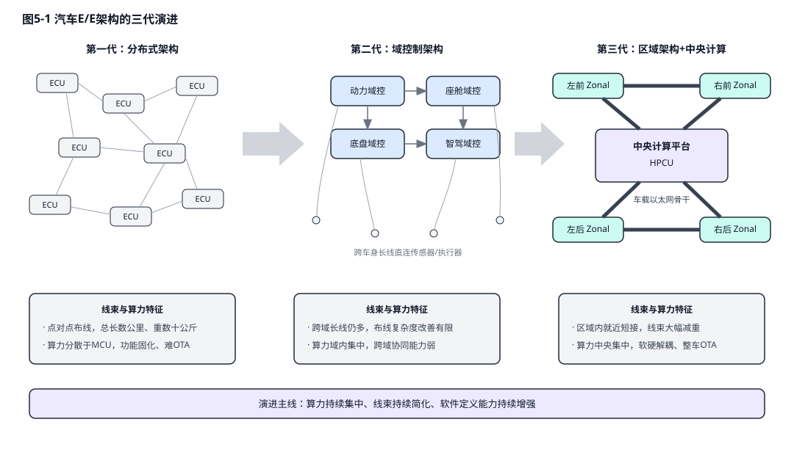
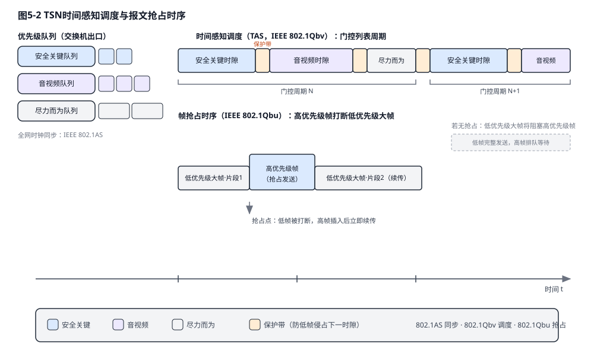
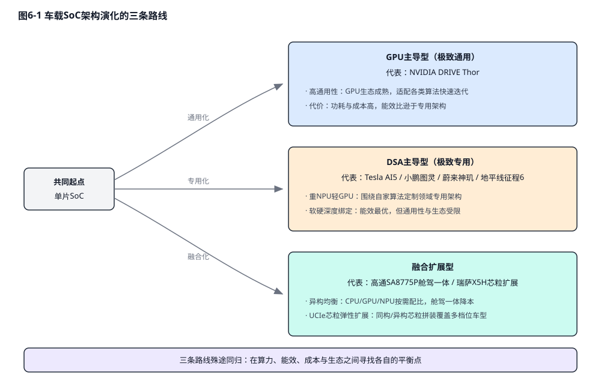

# 物理AI：从自动驾驶到具身智能

**版本：v2.0**

## 目录

- 前言
- 第一章：物理AI的范式革命——从数字智能到物理世界
- 第二章：自动驾驶的算法跃迁——从规则驱动到端到端大模型
- 第三章：具身智能的算法内核——世界模型与VLA的统一
- 第四章：数据引擎与仿真鸿沟——合成数据的爆发
- 第五章：电子电气架构与底层互联——智能机器的神经网络
- 第六章：端侧计算底座——SoC微架构、芯粒与存算一体
- 第七章：功率、热管理与机电躯体——物理AI的物理极限
- 第八章：安全与验证体系——重铸AI黑盒的信任基石
- 第七章：产业实践与未来展望——迈向通用物理智能
- 结语：在比特与原子之间
- 参考文献

## 前言

本书以"物理人工智能（Physical AI）"为统一视角，系统梳理自动驾驶与具身智能两大技术载体在算法范式、数据引擎、硬件底座（电子电气架构、计算芯片与机电躯体）与安全体系四条主线上的协同演进。全书面向智能驾驶与机器人行业的工程师、研究者与技术管理者，力求在技术深度与产业广度之间取得平衡：既深入端到端大模型、世界模型、存算一体、芯粒封装等前沿技术细节，也关注量产落地、法规准入与商业模式的现实约束。文中关键概念首次出现时括注英文原词，重要技术路线辅以对比表格与结构示意图，供读者按章节独立阅读或整体通读。

## 第一章：物理AI的范式革命——从数字智能到物理世界

人工智能的演进正在经历一次深刻的跃迁，从受限于硅基服务器与虚拟网络的“数字智能”全面迈向能够直接干预现实环境的“物理人工智能（Physical AI）”。传统的生成式大语言模型（LLM）在封闭的数字空间内展现出了惊人的语义推理能力，但它们并不受制于牛顿力学、热力学定律或实时的物理延迟限制。物理人工智能则代表了一种全新的人工智能范式：它不仅需要理解和生成复杂的语义，更要在高度动态、充满未知变量且容错率极低的真实物理环境中进行感知、认知与实时交互。

莫拉维克悖论（Moravec's Paradox）精确地描绘了物理AI所面临的终极工程挑战。该悖论指出，让计算机在智力测试或下棋中表现出成人水平相对容易，但让其具备一岁幼儿般的感知和灵巧运动能力却极其困难。这种现象的本质在于，高阶逻辑推理在计算指令层面上是相对低维和廉价的，而逆向工程数百万年进化而来的物理直觉、手眼协调与感觉运动技能，则需要处理海量的高维连续物理信号，并进行极其复杂的非线性映射。随着大语言模型的常识推理能力向多模态领域的溢出、车载与机器人系统级芯片（SoC）算力成本的边际递减，以及高保真神经渲染仿真基础设施的成熟，这三重驱动力正在合力打破莫拉维克悖论的桎梏。

在这一技术浪潮中，自动驾驶汽车与具身智能机器人成为了承载物理AI范式的两大核心载体。尽管两者在形态上差异巨大，但它们共享着相同的底层技术逻辑，即感知环境、构建内部世界模型、进行长序列动作规划并驱动机电执行机构，从而在自动驾驶与通用机器人学之间形成了深度的技术合流。

**表1-1 自动驾驶汽车与具身智能机器人的特征对比**

| **维度特征**    | **自动驾驶汽车 (Autonomous Vehicles)** | **具身智能机器人 (Humanoid/Embodied Robots)** | **物理AI的底层共性**            |
| ----------- | -------------------------------- | -------------------------------------- | ------------------------ |
| **运行环境空间**  | 结构化至半结构化（道路网络、交通规则约束）            | 高度非结构化（开放式家庭、工业制造、复杂地形）                | 均需处理长尾分布的物理环境干扰与动态障碍物    |
| **自由度与执行器** | 低自由度（转向、加速、制动），二维平面运动为主          | 极高自由度（数十个关节、灵巧手），三维空间全身运动              | 均强依赖于高频、低延迟的底层机电闭环控制系统   |
| **数据规模与获取** | 数据海量（影子模式积累数十亿英里级真实路测数据[54]）          | 数据极度稀缺（高度依赖遥操作与仿真合成数据）                 | 均需构建闭环数据引擎与高保真物理仿真器进行泛化  |
| **安全与容错约束** | 极高（高速动能，失控直接危及公共生命安全）            | 较高（物理交互密集，需防范碰撞与功率输出失控）                | 均面临黑盒大模型的验证困境，需构建运行时安全护栏 |

## 第二章：自动驾驶的算法跃迁——从规则驱动到端到端大模型

### 2.1 模块化流水线的崩溃与占用网络的兴起

在过去十余年中，自动驾驶软件栈主要遵循SAE（国际汽车工程师学会）J3016分级标准，并广泛采用模块化流水线（Pipeline）架构。SAE分级以"谁在驾驶、谁负责接管"为核心，将驾驶自动化划分为L0至L5六个等级，责任主体从人类驾驶员逐步移交至机器系统。

**表2-1 SAE J3016 自动驾驶分级速览**

| **等级** | **名称** | **动态驾驶任务执行者** | **接管责任主体** | **典型形态** |
| --- | --- | --- | --- | --- |
| L0–L2 | 驾驶辅助至部分自动化 | 人类为主，系统辅助 | 人类驾驶员 | ACC、NOA 领航辅助等量产功能 |
| L3 | 有条件自动化 | 系统（限定条件下） | 系统请求时人类接管 | 限定 ODD 的拥堵/高速自动驾驶 |
| L4 | 高度自动化 | 系统（限定 ODD 内） | 系统自主兜底 | Robotaxi、限定区域无人配送 |
| L5 | 完全自动化 | 系统（全域） | 无需接管 | 尚无商业化实例 |

该架构将驾驶任务生硬地拆分为感知、预测、规划和控制四个独立模块。然而，这种架构在向高阶自动驾驶演进时暴露出致命的缺陷：上游感知模块的微小分类误差会在下游预测和规划模块中被呈指数级放大，形成严重的误差级联（Error Cascading）；同时，模块间通过人工定义的规则接口传递信息，导致大量隐式的空间与上下文特征被永久性丢失。

感知范式的第一次革命是从2D图像空间的卷积神经网络（CNN）跨越至基于鸟瞰图（BEV）与Transformer的多模态特征融合[44]。然而，为了彻底解决无类别标签的“长尾障碍物（Corner Cases）”检测问题，工业界进一步演进至占用网络（Occupancy Network）架构[45]。占用网络摒弃了传统的边界框回归与目标分类，直接将车辆周围的3维连续物理世界离散化为体素（Voxel）网格，并预测每个体素的占用概率与运动流。虽然这种体素化建模赋予了系统识别任意未知障碍物的能力，但它引发了极其严峻的底层硬件挑战。处理海量的高分辨率3D体素特征需要频繁访问存储器，导致对系统静态随机存取存储器（SRAM）容量和外部动态随机存取存储器（DRAM）带宽的恐怖消耗，使得底层芯片极易陷入算力闲置而带宽枯竭的窘境[7][8]。

### 2.2 端到端重构与潜在对齐规划（LaPla）

为打破模块化瓶颈，自动驾驶正全面转向端到端（End-to-End）神经网络范式[5]。早期的端到端尝试多为两段式设计（如UniAD[42]和VAD[43]框架），在网络内部仍保留了显式的中间特征表达；而当前的最前沿趋势则是彻底的“光子进、动作出”的一段式端到端模型（如特斯拉FSD V12），直接将多模态传感器输入映射为底层转向与制动指令。

在端到端动作解码的过程中，系统面临着如何弥合离散的语义推理与连续的物理动力学约束之间的巨大鸿沟。传统的自回归解码机制往往引入严重的量化误差，导致生成的行驶轨迹出现剧烈抖动。最新的研究提出了潜在对齐规划（Latent-aligned Planning, LaPla）框架[6]，通过残差向量量化变分自编码器（VQ-VAE）构建动作分词器。LaPla并不执行会引发量化误差的离散码本查找，而是将VQ-VAE的解码器权重冻结，作为一种强大的物理动力学先验（Physical Prior）。在接收包含多视角图像、历史动作和文本指令的多模态上下文后，模型通过并发动作查询在单一前向传递中直接投射到连续的潜在空间，随后由冻结的解码器将其转化为符合车辆运动学的平滑轨迹。这种架构彻底绕过了耗时的自回归生成过程，在大幅降低推理延迟的同时，将长序列轨迹预测的误差降低了15.52%。

### 2.3 规划解码的三大范式博弈

当端到端大模型完成场景理解与意图推理后，如何将内部的语义表示“解码”为可执行的驾驶动作，成为决定系统性能上限的最后一块拼图。当前学术界与工业界围绕规划解码形成了三条相互博弈的技术路线。其一是**自回归（Autoregressive, AR）解码**：将连续行驶轨迹离散化为动作Token，沿用大语言模型“逐Token预测”的成熟范式依次生成。其二是**扩散（Diffusion）解码**：从高斯噪声出发，通过多步迭代去噪逐步还原出完整轨迹，天然避免了离散化带来的量化误差。其三是**流匹配（Flow Matching）解码**：直接学习从噪声分布到数据分布的连续向量场，仅需少量常微分方程（ODE）求解步数即可沿近似直线的路径完成采样，被视为扩散模型的高效演进形态。

**表2-2 端到端规划解码三大范式对比**

| **解码范式** | **多样性** | **帧间一致性** | **推理延迟** | **技术特征与硬件痛点** |
| --- | --- | --- | --- | --- |
| 自回归（AR） | 高（采样天然覆盖多模态分布） | 较低，轨迹易出现帧间抖动 | 单次前向极快，但逐Token串行生成拉长端到端延迟 | 轨迹离散化引入量化误差，长序列累积误差大；依赖KV Cache，推理呈内存带宽受限，加剧车载NPU的“记忆墙”压力 |
| 扩散（Diffusion） | 中 | 中（去噪过程提供一定的时序平滑约束） | 多步降噪迭代导致延迟高，难满足毫秒级实时性要求 | 从噪声分布迭代还原连续轨迹，避免离散量化误差；但多步采样成倍放大端侧算力与能耗开销 |
| 流匹配（Flow Matching） | 较低，复杂路口的多模态候选轨迹易发生模式崩溃 | 最高，生成轨迹极为平滑 | 少量ODE步数即可完成采样，推理较快 | 学习噪声到数据的连续向量场，直线路径采样高效；但对多峰分布的建模能力不足，需混合机制补偿 |

三种范式各有所长，纯粹的单一路线均难以同时满足车载场景对多样性、平滑性与实时性的苛刻要求，因此**混合架构**正成为产业演进的主流趋势。其基本思路是“分工解耦”：由自回归 Transformer 承担语义推理、意图决策与高层任务分解，充分发挥其在离散符号与因果推理上的优势；再由扩散或流匹配动作专家负责连续轨迹的精细生成，保证物理层面的平滑与可执行性。将思维链（Chain-of-Thought, CoT）推理引入潜在世界模型的端到端驾驶框架 LCDrive[40]，通过显式的中间推理步骤增强复杂场景下的决策可解释性，再由连续解码器输出轨迹；而基于开源大语言模型构建的驾驶VLA框架 OpenDriveVLA[41]，则验证了“开源LLM语义骨干 + 专用动作解码头”这一混合范式在驾驶任务上的可行性。从更宏观的视角看，这种“离散语义推理 + 连续动作生成”的混合解码思路，与2.2节介绍的 LaPla 借助冻结VQ-VAE解码器向连续潜在空间注入物理动力学先验的做法同属一脉，都是在离散与连续的鸿沟之间架设桥梁的混合解码探索。

### 2.4 突破记忆墙：Transformer与Mamba的微架构博弈

端到端大模型（尤其是基于Transformer的架构）在车载神经处理单元（NPU）上部署时，遭遇了不可逾越的“记忆墙（Memory Wall）”。Transformer的全局自注意力机制导致其计算复杂度随序列长度呈 $O(n^2)$ 平方级增长。更致命的是，在自回归生成轨迹或动作时，模型必须为每一个Token频繁读写庞大的键值缓存（KV Cache），这种“预填充计算税（Prefill Compute Tax）”使得NPU的算术逻辑单元因等待内存数据搬运而陷入停滞，模型实际的算力利用率（MFU）大幅缩水[11]。

为了在算力与带宽严重受限的边缘端实现极低延迟的长序列推理，状态空间模型（State Space Models, SSM），特别是Mamba架构[9][10]，正在重塑底层算法生态。Mamba通过引入选择性机制（Selective State Spaces），使模型中的状态转移矩阵能够根据输入内容动态变化，从而决定记住或遗忘特定信息。这一突破性的数学构造使得序列建模的复杂度从二次方骤降至线性 $O(n)$，彻底消除了不断膨胀的KV Cache。在Mamba架构下，长视频流的时空特征提取不再受限于内存带宽，极大地释放了NPU的吞吐潜能。然而，完全抛弃注意力机制也会导致在处理需要极高精确度召回的局部细节时出现精度损失，因此，交织注意力层与SSM层的混合架构（Transformer-SSM）正在成为车载与机器人感知底座的最优妥协。

**表2-3 Transformer 与 Mamba 在物理AI端侧的架构特性对比**

| **算法架构特征**     | **传统 Transformer**           | **Mamba (选择性状态空间模型)** | **物理AI端的硬件影响与适用性**               |
| -------------- | ---------------------------- | --------------------- | -------------------------------- |
| **计算复杂度**      | $O(n^2)$ (随上下文长度平方级暴增)       | $O(n)$ (随上下文长度线性增长)   | Mamba使得在车规级SoC上处理高分辨率、长时序视频流成为可能 |
| **KV Cache依赖** | 极高 (导致严重的“记忆墙”与内存带宽瓶颈)       | 无需KV Cache (固定尺寸隐状态)  | 释放外部DRAM带宽，显著降低NPU推理延迟与系统整体功耗    |
| **并行预填充性能**    | 极佳 (高度适配GPU Tensor Core矩阵乘法) | 较弱 (序列依赖性高，需定制底层算子)   | 促使芯片厂商针对SSM算法开发专用的硬件指令集与DSA架构    |

## 第三章：具身智能的算法内核——世界模型与VLA的统一

具身智能机器人不仅需要移动，更需要理解并操作复杂的物理环境。传统机器人学习范式主要分为行为克隆（Behavioral Cloning, BC）与强化学习（Reinforcement Learning, RL）。行为克隆高度依赖专家演示，泛化能力极差；而强化学习在真实物理世界中进行试错的成本过于高昂，且极易导致硬件损坏。视觉-语言-动作（Vision-Language-Action, VLA）基础模型的崛起，彻底重构了机器人的大脑架构。从 Google DeepMind 的 RT-2[46] 首次将互联网规模的视觉-语言知识迁移至机器人控制，到开源 OpenVLA 降低研究门槛，再到 Physical Intelligence 的 π0[47] 引入流匹配动作专家，VLA 已在短短数年内形成清晰的谱系[2][3]。

**表3-1 代表性 VLA / 机器人基础模型谱系对比**

| **模型** | **研发机构** | **架构要点** | **动作生成方式** | **开放程度** |
| --- | --- | --- | --- | --- |
| RT-1 / RT-2 | Google DeepMind | ViT+Transformer，视觉语言知识向控制迁移 | 离散化动作 Token | 闭源 |
| OpenVLA | Stanford 等（开源社区） | 7B 开源 VLA，基于 Llama 系 VLM 微调 | 离散化动作 Token | 开源权重与代码 |
| π0 | Physical Intelligence | VLM 骨干 + 流匹配（Flow Matching）动作专家 | 连续动作流 | 开源权重 |
| Helix | Figure AI | 系统2（VLM）+ 系统1（高频策略）双系统全内置 | 连续控制 | 闭源 |
| GR00T N | NVIDIA | 双系统架构 + Eagle 视觉骨干，配套 Isaac 仿真栈 | 连续动作轨迹 | 开放权重 |

### 3.1 混合Transformer架构与NVIDIA Cosmos 3

在迈向通用物理AI的进程中，系统必须具备推演未来物理状态的能力，即构建世界模型（World Models）。NVIDIA于2026年COMPUTEX期间发布的 Cosmos 3 开放模型家族是这一技术路线的代表作，其旗舰版本 Cosmos 3 Super 拥有640亿参数（64B），与16B的Nano、4B的Edge版本共同覆盖从云端训练到端侧部署的全场景，原生支持语言、图像、视频、音频以及执行器动作的联合建模与生成[12]。

Cosmos 3 摒弃了拼接独立模块的传统思路，采用了一种极具开创性的混合Transformer（Mixture-of-Transformers, MoT）双塔架构[13]，将语义推理与物理世界生成在同一个神经网络骨干中实现了深度纠缠：
首先是**自回归推理塔（Autoregressive Tower）**。该塔专注于高阶语义推理，接收自然语言指令与经过视觉Transformer（ViT）编码的图像块。它利用因果自注意力机制（Causal Self-Attention），从左至右单向处理序列信息，逐步构建起对场景中三维几何关系、物体遮挡状态以及任务逻辑的深层认知表示。
其次是**扩散生成塔（Diffusion Tower）**。为了处理连续且高维的物理世界信号，连续的视频流、音频波形和机器人关节的动作轨迹首先通过一个被冻结的变分自编码器（VAE）压缩为紧凑的潜在特征（Latents）。扩散塔利用双向注意力机制全局处理这些特征，通过迭代去噪过程，生成具有高度物理连贯性的未来视频帧或控制动作。

Cosmos 3 架构的灵魂在于其跨塔联合注意力机制。在扩散塔生成未来的物理信号时，它会主动对自回归塔生成的推理特征进行交叉注意力查询。这意味着，模型所生成的每一个像素流动、每一段电机控制扭矩，都受到高阶语义推理与物理常识的强约束，从而显著缓解了传统视频生成模型中常见的物理法则崩溃（如物体穿模、不合理形变）现象。

### 3.2 具身控制架构：系统1与系统2的解耦与融合

尽管巨型VLA模型拥有强大的常识，但将其直接用于高频闭环控制会面临不可接受的推理延迟。因此，学术界与工业界（如NVIDIA GR00T平台[48]、Figure Helix）普遍转向了灵感源自人类认知的“系统1 / 系统2”双层解耦架构。

系统2（慢思考）由庞大的VLM或VLA世界模型构成。它以极低的频率（如0.5Hz）运行在云端或强大的车载中央计算平台上，负责摄入自然语言指令，解析复杂的场景语义，并输出中间形态的子任务目标或三维空间路点（Waypoints）。系统1（快反应）则部署在靠近执行器的边缘控制器上。它由轻量级的动作策略网络组成，利用扩散策略（Diffusion Policy）或连续流匹配技术，在10毫秒级的极低延迟下，将系统2下发的路点转化为高频的电机力矩或位置控制指令。为解决连续动作生成中的时序断层与非平稳性问题，动作分块（Action Chunking, ACT）技术被广泛引入。它允许网络一次性预测未来一系列连贯的动作序列，并通过时间重叠平滑策略，使得机器人的双臂在进行复杂的灵巧操作（如穿针引线、动态抓取）时，表现出极为拟人化的流畅度与柔顺性。

### 3.3 运动控制与灵巧操作：从模型预测控制到学习型全身控制

如果说VLA模型赋予了机器人“思考”的能力，那么将高层意图转化为稳定、灵巧的物理运动，则依赖底层的运动控制栈。经典机器人控制以精确动力学建模为基石：模型预测控制（Model Predictive Control, MPC）在滚动时域内求解最优控制序列，在工业机械臂等结构化场景中取得了巨大成功。然而当机器人进入非结构化环境，这类方法的局限暴露无遗：接触动力学（摩擦、碰撞、柔顺形变）本质上非光滑且高度非线性，任何参数化模型都只是对真实物理的粗糙近似；MPC的在线优化在高自由度人形机器人上难以维持百赫兹级控制频率；且控制器泛化脆弱，地面材质与负载的微小变化即可导致性能急剧退化。

强化学习在腿足运动控制上的突破改写了这一局面。以ETH Zurich与ANYbotics联合研发的ANYmal四足机器人为标志，“大规模并行仿真训练 + 域随机化 + 仿真到现实（Sim2Real）迁移”的路线可习得远超手工设计的鲁棒步态：策略网络在仿真中经历数百万次跌倒与爬起，无需显式动力学方程即可在湿滑、台阶、碎石等极端地形上自主恢复平衡。该范式随后被平移至人形领域——以宇树科技（Unitree）为代表的厂商将学习型步态控制推向量产，其人形机器人在公开演示中完成奔跑、跳跃与受冲击后自主起身，供应链口径普遍认为其底层策略高度依赖仿真强化学习与真实数据的迭代闭环。

学习型控制的崛起并未淘汰模型方法，而是催生了新的分层架构，其核心是全身控制（Whole-Body Control, WBC）与上层VLA策略的接口设计：VLA或系统2策略以低频输出语义层目标（末端路点、期望躯干姿态、质心轨迹）；中间WBC层以百赫兹级频率将高层目标与全身动力学约束（关节限位、力矩饱和、接触力锥、动量守恒）统一建模为二次规划问题，实时求解数十个关节的力矩分配；最底层伺服环以千赫兹级频率执行闭环。这种“语义低频—优化中频—伺服高频”的三层频率解耦，使昂贵的VLA推理与苛刻的实时控制得以共存，也为3.2节的系统1/系统2架构提供了工程骨架。

灵巧操作对控制栈的要求比运动更为苛刻。灵巧手自由度动辄超过二十个，而操作的本质是建立并调控接触——仅凭视觉无法判断抓取是否滑动、施力是否恰当，高分辨率触觉反馈因此成为刚需：光学视触觉传感器可提供亚毫米级接触形变场重建，压阻与电容阵列则以更低成本覆盖指腹掌面。控制侧普遍采用阻抗控制（Impedance Control）框架，以千赫兹级高频力控闭环调节接触刚度与阻尼，完成插拔、旋拧、捏取易碎品等视觉盲区内的高精度作业；触觉信号与VLA视觉-语言表征的对齐融合，正是当前的研究前沿。

最后必须正视：学习型策略本质上是难以形式化验证的黑盒，分布外扰动可能触发灾难性失稳。产业界的对策是为其叠加“安全包线（Safety Envelope）”：由经验证的底层控制器或控制屏障函数（Control Barrier Function）构成运行时护栏，对策略输出的力矩、速度与工作空间实时裁剪投影，确保物理状态永不越界。这种“学习策略负责性能、护栏机制负责安全”的责任分离设计，与本书第八章将讨论的运行时护栏体系一脉相承，是学习型控制走向安全攸关场景的必经路径。

## 第四章：数据引擎与仿真鸿沟——合成数据的爆发

物理人工智能的发展严重受制于真实世界数据的稀缺性。自动驾驶可以通过部署在大规模量产车上的“影子模式（Shadow Mode）”收集海量的人类驾驶轨迹，并通过边缘端的触发器被动挖掘长尾难例。但对于具备数十个自由度的人形机器人而言，收集包含精确多模态力反馈的真实物理交互数据极其昂贵，高度依赖人类穿戴外骨骼或VR设备进行的遥操作（Teleoperation）。由此，具身智能的数据供给形成了"三条腿走路"的格局，三者在成本、规模与质量上各有不可妥协的短板。

**表4-1 具身智能三大数据来源对比**

| **数据来源** | **单位成本** | **可扩展规模** | **数据质量** | **主要短板** | **适用阶段** |
| --- | --- | --- | --- | --- | --- |
| 真机遥操作数据 | 极高（设备+人力，单条轨迹分钟级） | 受限于遥操作员数量 | 最高（真实物理交互、力反馈完整） | 采集效率低、场景多样性不足 | 任务微调与能力对齐 |
| 仿真合成数据 | 低（边际成本趋近于零） | 近乎无限 | 中（存在物理与渲染失真） | Sim2Real 鸿沟 | 大规模预训练与策略预演 |
| 人类第一视角视频 | 极低（互联网存量） | 海量 | 低（缺少动作与力的标签） | 无法直接映射到机器人本体 | 语义与常识预训练 |

为了填补数据真空，产业界正在将重心转向神经渲染与世界模型驱动的合成数据生成（Synthetic Data Generation, SDG）。利用神经辐射场（NeRF）和3D高斯泼溅（3D Gaussian Splatting）等技术，系统可以从少量的真实2D图像中瞬间重建出具有极高照片级真实感的3D物理场景。在这一虚拟场景中，Cosmos 3 等世界模型充当了交互式神经模拟器的角色。例如，TIER IV等自动驾驶研发机构利用Cosmos架构[14]，通过改变文本或语义控制条件，在现有真实视频的基础上合成出雨雪交加、夜间逆光或罕见交通事故的变体视频。这种在物理和光学上高度一致的合成数据，被直接注入到自动驾驶算法的训练飞轮中，极大提升了模型在应对罕见边缘场景时的鲁棒性。

然而，仿真环境与真实世界之间始终横亘着一道难以跨越的“仿真到现实鸿沟（Sim2Real Gap）”。为了防止策略网络在仿真中过拟合虚拟的物理参数，域随机化（Domain Randomization）被广泛应用。通过在强化学习训练中疯狂扰动摩擦系数、重力加速度、传感器噪声分布以及光照条件，模型被迫学习到最具普适性的控制流形。进而，通过Real2Sim2Real闭环反馈机制，将在真实世界中发生的失败案例重新导入仿真环境中进行系统辨识与参数微调，最终实现具身智能能力的可持续涌现。

## 第五章：电子电气架构与底层互联——智能机器的神经网络

如果说大模型与端侧算力芯片构成了物理人工智能（Physical AI）的大脑与小脑，那么电子电气架构（E/E Architecture）与底层通信网络就是连接感官与肢体的神经网络。无论是自动驾驶汽车还是人形机器人，当感知传感器数量、执行器自由度与算力集中度同步飙升时，决定系统实时性、可靠性与可进化能力的，不再是单点芯片的峰值算力，而是数据在整机体内的流动方式。本章沿着汽车E/E架构三代演进的主线，剖析区域架构（Zonal）与软件定义汽车的工程要义，深入车载以太网与时间敏感网络（TSN）构成的确定性骨干网，进而讨论集中化带来的拓扑冗余与验证范式变革，最后将视野延伸至机器人整机的实时通信总线，揭示两大物理AI载体在架构思想上的深层同构。

### 5.1 E/E架构的三代演进

汽车电子电气架构的演进，本质上是一部"算力集中度"与"线束复杂度"相互博弈的历史。其背后的驱动力有二：一是高阶自动驾驶带来的传感器数据量爆炸，摄像头、毫米波雷达与激光雷达的原始数据流以Gbit/s计，远超传统CAN总线的承载极限；二是整车功能软件化的诉求，要求功能的增删改不再伴随硬件变更。这两条线索共同把E/E架构推向中央集中。

第一代是分布式架构（Distributed Architecture）。在功能电子化早期，整车厂奉行"一个功能一个ECU"的加法式开发逻辑：每新增一项舒适、安全或底盘功能，就塞进一个独立的电子控制单元（ECU），配上专属的供电线束、传感器与连接器。这种解耦开发的模式在功能数量较少时运转良好，但随着豪华车型的功能膨胀，单车ECU数量迅速突破上百个，整车线束长度达到数公里，线束重量跃升为整车中仅次于白车身与动力总成的重资产部件。更严重的是，上百个由不同供应商黑盒交付的ECU各自为政，软件无法统一升级，跨域功能（如感知与制动的联动）只能依靠脆弱的网关信号转发，形成了业内公认的"线束危机"与"软件碎片化"双重困局。当一次功能变更需要协调数家供应商、重新标定数十个ECU时，分布式架构的开发成本与周期便彻底失控。

第二代是域控制架构（Domain Centralized Architecture）。其思想是按功能域归并算力：将动力总成、底盘、车身、座舱、自动驾驶各设一个域控制器（DCU），域内ECU被大量裁撤，域间通过中央网关互联。域控架构显著削减了ECU数量，并首次为自动驾驶这样算力饥渴的功能提供了集中式算力底座。然而它的局限同样明显：域的划分依据是功能逻辑而非物理空间，一个自动驾驶域控制器仍需将线束从车头拉到车尾，去连接分布在车身四角、分属不同物理位置的摄像头与雷达——物理布线依旧跨越整个车身，线束减重的效果十分有限，且功能域之间的交叉功能（如舱驾融合）依然受制于域间网关的带宽瓶颈。作为过渡形态，部分厂商进一步将座舱与智驾域融合为"舱驾一体"控制器，但物理布线的根本矛盾并未解决。

第三代是区域架构与中央计算（Zonal Architecture + Central Computing）。这一范式彻底放弃了按功能划分的思路，转而按物理空间将整车划分为前、后、左、右等若干区域，每个区域设置一个区域控制器（Zonal Controller, ZCU）。区域控制器不再承载复杂的业务逻辑，而是退化为纯粹的供电枢纽与数据网关：它就近接入本物理区域内所有的传感器与执行器，将模拟信号与传统总线信号就地数字化，汇聚封装后通过高速骨干网送往上方的中央高性能计算单元（HPCU）。所有核心逻辑——感知、决策、车身控制乃至座舱交互——全部上移至中央大脑。这一架构使线束被压缩在区域内部的短距离连接中，整车线束长度与重量得以大幅下降，同时为软件定义汽车铺平了道路。

### 5.2 区域架构与软件定义汽车

区域架构的深层价值并不止于省线，而在于它第一次实现了整车"逻辑与硬件的彻底解耦"。在分布式与域控时代，每一项功能都与特定的硬件盒子绑定：雨刮逻辑住在车身控制器里，巡航逻辑住在动力ECU里，硬件即功能。而在区域架构下，区域控制器只是标准化的I/O汇聚节点，真正的功能被抽象为运行在中央计算平台上的软件微服务（Microservice）。当"雨刮控制"变成一段可以随时替换的代码，当"自动泊车"变成感知服务、规划服务与执行服务的编排组合，车辆才真正具备了全生命周期OTA（Over-the-Air）迭代进化的能力——这正是软件定义汽车（SDV, Software-Defined Vehicle）的要义所在。

作为供电枢纽，区域控制器还推动了整车配电的电子化转型：传统保险丝盒中不可复位、不可编程的熔断式保险丝，被半导体电子保险丝（eFuse）与智能高边开关取代，配电策略由此成为可由软件定义的变量。中央平台可以按场景动态调配各区域的供电优先级——例如自动驾驶激活时优先保障感知与计算回路，驻车露营时切断非必要负载——供电、通信与计算三张网络在区域控制器上实现了交汇。

当然，微服务化并不意味着可以无约束地随意编排。车身控制、底盘执行等安全关键服务仍须部署在经过认证的实时操作系统与安全分区之内，与座舱娱乐等非安全服务严格隔离；OTA升级也必须遵循分区刷写、回滚保护与签名校验的工程纪律。逻辑与硬件解耦解放的是功能的迭代速度，而非豁免安全的底线——软件定义汽车的前提是"安全不被软件定义"。

这种架构迁移还带来了供应链与开发流程的重塑。传统模式下，Tier 1供应商交付的是软硬件捆绑的黑盒ECU，整车厂难以触及底层实现；区域架构则强制推行软硬件分离采购，整车厂或其主导的平台公司掌握中央计算平台的操作系统、中间件与服务接口，供应商退化为提供标准化区域控制器与执行器硬件。信号与服务之间通过面向服务的通信中间件（如SOME/IP、DDS）动态绑定，使得新功能的上线不再依赖任何硬件变更。由此，车辆的电子架构从"出厂即定型"的静态资产，转变为可以持续迭代的数字平台——这一点与第六章所述端侧计算底座的虚拟化、容器化趋势互为表里。

### 5.3 骨干网：车载以太网与TSN

在算力高度集中的同时，车辆与机器人的神经末梢通信网络也迎来了彻底的重构。由于传统的CAN、LIN总线已无法承受高精度传感器爆发的数据洪流，基于物理区域（Zonal）的新型电气架构开始全面普及。通信网络也随之分层：边缘接入层负责"最后一米"的传感器与执行器连接，骨干层负责区域控制器与中央大脑之间的海量数据搬运，两层的技术选型共同决定了整机的神经传导速度。

在连接传感器和末端执行器的边缘接入层，10BASE-T1S 以太网（IEEE 802.3cg）展现出了颠覆性的工程价值[22]。它摒弃了传统以太网繁复的点对点连接与昂贵的交换机，允许通过单对非屏蔽双绞线在长达25米的距离上挂载至少8个节点，形成多点共享总线。为了避免多节点争抢带宽导致的碰撞延迟，10BASE-T1S 引入了物理层防冲突机制（PLCA, Physical Layer Collision Avoidance）。通过为主机和从机分配严格的循环传输时隙（Transmit Opportunities），PLCA将原生以太网的"尽力而为"机制转化为确定性的低延迟传输，大幅削减了车内线束的重量与装配成本。尤为值得注意的是，10BASE-T1S 的工作电压仅约1Vpp，远低于CAN总线约5V的摆幅，在功耗敏感的边缘节点上优势显著；同时，由于边缘节点原生讲"以太网语言"，从传感器到中央大脑可以实现端到端的IP化通信，天然继承以太网成熟的安全机制（如MACsec链路加密与基于IP的访问控制），无需再像传统CAN那样额外嫁接安全网关。

在区域控制器与中央计算大脑之间，多千兆车载以太网结合时间敏感网络（TSN, IEEE 802.1标准集）构成了不可动摇的骨干网体系[23][24]。标准以太网以统计复用换取带宽效率，其排队延迟在理论上无界，这对制动、转向等毫秒级生死攸关的控制回路是不可接受的。TSN通过一组协同工作的子标准，在标准以太网之上叠加了严格的时间确定性：

- **全局时钟同步（gPTP, IEEE 802.1AS）**：通过主从时钟的硬件级时间戳与延迟补偿，使全车传感器曝光、计算节点与制动执行器绑定在亚微秒级的同一时间轴上[25]。
- **时间感知调度（TAS, IEEE 802.1Qbv）**：门控列表（Gate Control List）按全局时钟精确开合各优先级队列的传输窗口，为安全关键数据铺设不受干扰的"绿灯通道"。
- **报文抢占（IEEE 802.1Qbu）**：允许高优先级帧打断低优先级帧的传输，并在其完成后无缝恢复被打断的帧，将关键报文的排队延迟压缩到极致。

三者叠加的工程效果是：骨干网上每一条安全关键流量的端到端延迟都有了可计算、可验证的最坏情况上界，网络演算（Network Calculus）等形式化方法得以替代粗放的经验冗余，为第八章所述的安全论证提供了可量化的时序证据。

**表5-1 车载/机器人底层通信总线能力对比**

| **总线类型** | **典型带宽** | **确定性机制** | **拓扑形态** | **典型部署位置** |
| --- | --- | --- | --- | --- |
| CAN FD | 最高约5 Mbit/s（数据段） | 基于优先级的仲裁，弱确定性 | 多主共享总线 | 传统车身控制、机器人关节底层 |
| 10BASE-T1S | 10 Mbit/s | PLCA循环时隙，强确定性 | 多点共享总线（单对双绞线） | Zonal边缘传感器/执行器接入 |
| 100/1000BASE-T1 | 100 Mbit/s–1 Gbit/s | 依赖上层TSN调度 | 点对点+交换机 | 区域控制器互联 |
| 多千兆车载以太网+TSN | 2.5/10 Gbit/s | gPTP+TAS+帧抢占，硬实时 | 交换式星型/环形骨干 | 区域控制器至中央HPCU骨干 |
| EtherCAT | 100 Mbit/s（全双工） | 帧在转发途中处理，微秒级抖动 | 菊花链/环形 | 机器人关节伺服级联 |

### 5.4 拓扑冗余与验证范式变革

算力与逻辑的高度集中是一把双刃剑。当整车的大脑收缩为一两个中央HPCU时，传统分布式架构中"一个ECU失效只丢一个功能"的天然故障隔离优势不复存在，单点失效风险被急剧放大。为此，新一代E/E架构在拓扑层面普遍向网状（Mesh）与环形（Ring）冗余演进：区域控制器之间不再只有通往中央的唯一上行链路，而是通过环形或部分网状互联获得多路径路由能力，当某段骨干链路或某个端口失效时，以太网多路径路由协议可在毫秒级完成流量切换；中央计算平台本身则采用硬件级冗余，以双SoC锁步（Lockstep）或双芯热备的方式保证大脑本身的容错，并在芯片内部划出独立的"安全岛"承接最小化的兜底控制逻辑，确保主计算通道失效时车辆仍能进入最小风险状态。

值得注意的是，冗余拓扑并非越多链路越好。仿真研究表明，在基本的网状拓扑中，流量天然向中央汇聚，位于边缘的区域控制器容易因大量中转流量而过载饱和，而中央HPCU的算力利用率反而处于低位，形成"边缘拥挤、中枢闲置"的失衡局面；进一步的研究显示，在拓扑冗余之上引入确定性的全局任务调度，可将端到端延迟降低约15.6%–16.3%。这说明架构冗余必须与全局调度协同设计，冗余链路的带宽储备只有在确定性调度的指挥下才能转化为真实的实时性收益。

架构集中化还深刻颠覆了整车的测试验证范式。在域控时代，验证工程师可以在被测ECU的总线接口上拦截报文，用剩余总线仿真（Restbus Simulation）技术模拟出其余所有ECU的通信行为，从而在台架上对单个控制器进行闭环测试[31]。这种"截断总线、仿真其余"的方法论建立在总线信号语义透明、边界清晰的前提之上。然而在区域架构下，传感器流量在区域控制器内部即被数字化、封装并聚合为IP报文，传统CAN报文与以太网数据流在网关内深度融合，被测对象的边界从"一个ECU"扩展为"中央大脑+若干区域控制器+TSN骨干"的分布式系统，单纯的总线级仿真已无法复现真实的时序与负载。新一代测试台架因此必须具备跨底层I/O、多协议网关与TSN骨干的全局观测能力，能够在统一时间轴上注入故障（链路中断、时钟漂移、队列拥塞）并观测其端到端影响[32]。验证的对象，从单个控制器的功能正确性，升级为整个确定性网络的时序正确性——这一范式变革与第八章讨论的AI安全验证体系共同构成了物理AI量产落地的双重闸门。

### 5.5 机器人整机的实时通信总线

将视线从汽车转向人形机器人，我们会发现两者在底层互联上几乎是同构的。一台具备数十个自由度的人形机器人，其躯干中同样部署着承担中央计算的主控单元，而颈部、肩部、髋部等物理聚集处则分布着与区域控制器角色完全一致的"躯干域控制器"：它们就近汇聚本区域内的关节编码器、力矩传感器与触觉阵列，完成就地数字化与协议转换后，经高速骨干送往主控大脑。在关节侧，为了极限压缩穿行于狭窄机械结构中的线缆，伺服驱动器普遍采用菊花链（Daisy-chain）级联拓扑，一条总线串联起一整条手臂或腿部的多个关节，其"就近汇聚、集中决策"的思想与车载Zonal架构如出一辙。

在实时总线选型上，EtherCAT与CAN FD构成了机器人侧的两大支柱。EtherCAT凭借"帧在转发途中完成处理（Processing on the Fly）"的独特机制，使主站发出的一帧报文在依次穿越各关节从站时被就地读写，全程无需逐站存储转发，从而将伺服控制回路的通信抖动压缩至微秒级，成为高精度多轴同步运动控制的事实标准；CAN FD则以更高的数据段速率与更强的抗干扰能力，继续活跃在灵巧手、传感器末端等对成本与可靠性敏感的末梢场景。当机器人整机对确定性提出更高要求时，gPTP时钟同步与时间感知调度同样被引入机器人以太网骨干，与车载TSN的技术栈一脉相承。车载的多传感器时间对齐问题，在机器人侧对应为多关节力矩与触觉采样的同步问题；车载的TSN门控调度，在机器人侧对应为全身运动控制周期的确定性保障——问题换了外衣，解法同源。

值得强调的是，机器人对线缆的物理约束甚至比汽车更为苛刻。一台数十个自由度的人形机器人，若沿用点对点布线，意味着数以百计的导线必须穿越持续弯折与扭转的颈、肩、腕、髋等机械关节，而每根线缆的弯折寿命直接决定整机的维护周期与平均无故障时间。菊花链级联与"供电通信一体化"由此成为刚需：以EtherCAT P为代表的方案将供电与通信压缩进同一根线缆，配合关节内部的本地驱动器，使穿越关节的线束数量下降一个数量级。这与汽车侧10BASE-T1S配合数据线供电（PoDL）削减边缘线束的思路完全同源。在时间维度上，业界普遍将全身运动控制的伺服周期设定在毫秒量级，而多关节同步的抖动预算则以微秒计——这一指标与车载制动、转向控制回路对TSN骨干网提出的确定性要求处于同一数量级，再次印证两大载体面对的是同一类实时性问题。

至此，一条贯穿全书的线索浮出水面：自动驾驶汽车与人形机器人这两大物理AI载体，正在共享同一套架构思想——按物理空间划分的区域化I/O、向中央大脑集中的算力与逻辑、以确定性以太网为骨干、以全局时钟为基准的实时通信。E/E架构的演进史因此不仅是汽车的工程史，更是物理人工智能机体形态的通用蓝图：谁掌握了这张神经网络的设计权，谁就掌握了智能机器进化的底层节奏。

## 第六章：端侧计算底座——SoC微架构、芯粒与存算一体

物理AI模型向边缘侧的下沉，撞上了一系列严酷的物理极限：功耗墙、内存墙、散热墙与绝对的实时性约束——这四堵墙共同构成了端侧计算不可逾越的工程边界。云端数据中心可以通过堆砌机柜、液冷集群与不间断供电来换取算力，而一辆量产车的计算平台必须塞进手套箱大小的域控制器内，从低压车载电网中争夺数十到数百瓦的功率配额，并在宽温跨度与持续振动环境下保证全生命周期内的确定性实时响应。传统的衡量标准"理论TOPS"已经失效，业界正全面转向以真实算力利用率（MFU）、内存带宽吞吐量以及每瓦浮点运算能力（TFLOPS/W）来评估芯片的实际表现。本章首先重构端侧算力的评估体系，继而剖析三条设计哲学迥异的SoC架构路线及其代表性平台，最后深入芯粒互连与存算一体这两项正在重塑硅片物理形态的底层技术。

### 6.1 性能评估体系重构：从名义TOPS到真实算力利用率

在PC与移动时代延续下来的芯片评估指标，在物理AI负载面前几乎全体失效。CPU阵营沿用数十年的MIPS/DMIPS衡量的是标量整数流水线每秒执行的指令数，它假设负载是分支密集的控制流代码，而端到端智驾模型的本质是海量而规则的张量乘加运算，标量性能与推理吞吐之间几乎不存在线性关系。GPU阵营惯用的像素填充率、三角形吞吐率等指标脱胎于图形渲染管线，在车载SoC大幅裁剪图形单元、将晶体管预算让渡给张量阵列的今天，这些指标已然沦为历史遗迹。最具迷惑性的是NPU厂商竞相标榜的名义TOPS：这个数字通常在INT8精度、乘加阵列百分之百占空比、片上数据零等待的理想实验室条件下测得，相当于只标注发动机的红线转速，却不告知变速箱与传动轴的传动损耗。

真实负载下的算力兑现程度由MFU（Model FLOPs Utilization，模型算力利用率）刻画，即模型在给定时间内实际消耗的浮点运算量与芯片理论峰值算力的比值。在车载与机器人推理场景中，MFU常常被三大制约压缩到三成甚至更低的水平。

第一道制约是内存墙，即片上SRAM容量、NoC（片上网络）带宽与外部DRAM带宽的联合瓶颈。Transformer类模型的权重与KV Cache复用度远低于CNN，乘加阵列每完成一次运算都需要新鲜的数据供给；当片上SRAM不足以容纳完整的算子分块、NoC交叉开关的仲裁引入排队延迟、外部DRAM带宽成为最终瓶颈时，再庞大的MAC阵列也只能空转等待。对于需要维护多帧历史的世界模型与随上下文长度线性膨胀的KV Cache而言，这一瓶颈还会被进一步放大。Roofline模型的分析表明，在逐token生成这类算力密度极低的解码阶段，系统吞吐几乎完全由内存带宽决定，与标称TOPS数字无关。

第二道制约来自编译器与算子稀疏化。NPU的可编程性远逊于GPU，一旦模型中出现编译器尚不支持的新型算子（例如特殊的注意力变体或状态空间模型的扫描操作），该算子只能回退到CPU上慢速执行，在流水线中制造断点；算子融合与tiling（分块）划分的质量则直接决定数据在片上与片外之间的往返次数。至于厂商宣称的结构化稀疏加速（如2:4稀疏带来的算力翻倍），要求模型在训练阶段就配合剪枝并满足严格的稀疏模式约束，对车企直接部署的第三方或开源模型往往并不适用。

第三道制约是精度退回。名义TOPS几乎全部基于INT8整型精度标称，但端到端大模型中的部分敏感层——尤其是注意力分数计算与归一化层——在INT8量化下会出现可观的精度损失，工程上被迫退回FP16甚至FP32执行。一旦发生精度退回，同一块硅片的有效算力立刻减半乃至降至四分之一，标称TOPS瞬间失效。

评估方法的迁移还体现在测量口径本身。峰值算力只是一次理想条件下的冲刺，而车载场景真正关心的是持续性能：芯片在长时间满载下因热节流（Thermal Throttling）降频后还能维持多少有效算力；第99百分位（P99）帧延迟的抖动是否落在功能安全允许的窗口之内；多传感器时间戳对齐之后，从光子入射到控制指令发出的端到端流水线延迟是否确定可控。这些指标无法从数据手册的TOPS数字中读出来，必须在真实模型、真实温度与真实供电条件下实测。部分头部车企在芯片选型时，已开始要求供应商提交指定模型在额定环境温度下的持续FPS与MFU实测报告，而非纸面参数，这标志着评估体系从"比参数"向"比兑现"的根本转变。

正因如此，行业的评估坐标正在向三个新维度迁移。其一是面向低精度张量计算的TFLOPS：随着FP8乃至FP4量化训练与推理技术的成熟，芯片在FP8/FP4下的张量算力比INT8 TOPS更能反映其运行下一代大模型的真实潜力。其二是内存带宽：引脚速率达8533Mbps的LPDDR5X已成为车规大算力平台的主流配置，配合128位以上的总线宽度可提供约250GB/s级别的聚合带宽，这一指标对Transformer推理的实际吞吐具有近乎一票否决的影响力。其三是能效比：在车载散热与供电的硬约束下，FPS/W（每瓦帧率）与TFLOPS/W（每瓦浮点算力）取代绝对性能成为平台选型的首要门槛——毕竟，一颗无法在量产车热设计预算内持续满载运行的芯片，其峰值算力只是一纸空谈。

值得注意的是，这三个新维度并非彼此独立，而是被同一条物理链条串联：内存带宽决定数据供给速度，进而划定MFU的上限；MFU与精度策略共同决定有效TFLOPS；而有效TFLOPS除以系统功耗，才最终落为能效比。换言之，当代车载SoC的竞争力已无法用任何单一数字概括，它是微架构、存储子系统、编译器栈与热设计协同优化的复合产物——这也正是整车厂越来越倾向于以"每瓦每秒处理多少帧真实感知数据"作为评标基准的深层原因。

### 6.2 三条架构路线与主流平台对比

面对相同的物理约束，全球芯片厂商分化出了三条设计哲学迥异的架构路线，彼此之间的博弈构成了当下车载SoC竞争的主线。三条路线并非单纯的技术优劣之争，而是对算力、能效、成本与灵活性四项约束的不同取舍排序，其分化深度折射出各厂商对自动驾驶算法演进速度与自身生态位的根本预判。

第一条是通用GPU主导型，以NVIDIA为代表。其核心逻辑是用极致的通用性与软件生态护城河来对冲定制化效率的损失：保留完整可编程的GPU阵列，辅以超高带宽的片内互连与海量内存，让任何形态的新模型——无论CNN、Transformer还是状态空间模型——都能在不修改硬件的前提下高效落地。这条路线的代价是功耗与成本居高不下，但在算法范式每十八个月就可能翻新的当下，"不为任何特定模型优化"反而成为最稳妥的长期主义。

第二条是DSA（领域特定架构）主导型，以特斯拉及小鹏、蔚来、地平线等自研阵营为代表。其设计哲学被业内概括为"重NPU、轻GPU"：大幅裁剪乃至彻底剔除通用图形渲染管线，将省下的晶体管与功耗预算全部转移给为神经网络数据流深度定制的NPU阵列与片上SRAM。这一转移的理论依据是"暗硅"（Dark Silicon）约束——在先进制程下，芯片的功耗密度早已超过封装散热能力，同一片硅上的晶体管不可能同时全开；既然总有一部分硅注定处于熄灭状态，不如主动熄灭那些对智驾负载无用的GPU逻辑，把有限的功耗预算集中灌注到张量计算单元上。DSA路线的能效与成本优势显著，但其命脉系于软硬协同的深度：芯片微架构与自家算法栈紧密绑定，一旦模型范式发生突变，专用硬件的沉没成本便会暴露无遗。

第三条是舱驾融合与弹性扩展型，以高通与瑞萨为代表。前者的思路是将智能座舱与智能驾驶合并到单颗SoC之上，通过硬件级虚拟化与混合关键性隔离机制，在同一片硅上同时承载ASIL-D级的智驾任务与QM级的信息娱乐负载，从整车层面砍掉一整套域控制器的成本、功耗与线束；后者则借助UCIe芯粒标准，把算力扩展从"重新流片"变为"增减芯粒"，用同一套基础设计覆盖从经济型到旗舰型的全系车型。这条路线的本质是拒绝在通用与专用之间做单选题，转而通过架构弹性来对冲需求的不确定性。

**表6-1 主流车载大算力SoC平台关键指标与设计哲学对比**

| **平台** | **核心微架构** | **标称算力与内存配置** | **功耗、制程与形态** | **设计哲学** |
| ---------------------------- | ------------------------------ | ------------------------------ | --------------------------- | ---------------------- |
| **NVIDIA DRIVE Thor** | Blackwell GPU + Neoverse CPU集群，NVLink-C2C片内直连 | 官方口径1000 TOPS（INT8），LPDDR5X内存带宽273GB/s | 系统功耗传闻130–350W，需主动散热 | 通用GPU主导，生态制胜 [15] |
| **Tesla AI5 (HW5)** | 深度定制双冗余NPU集群，剔除图形渲染流水线 | 供应链口径目标2000–2500 TOPS；官宣72GB LPDDR5X统一内存 | 台积电与三星双代工，外界推测功耗严格控制在车规散热允许区间 | 软硬一体的极致DSA定制 [16] |
| **小鹏图灵** | 40核ARM CPU + 双自研NPU | 宣称750 TOPS（INT8），宣称算力密度4.2 TOPS/mm² | 7nm车规制程 | 全栈自研DSA，芯片与智驾大模型协同设计 [33] |
| **蔚来神玑NX9031** | 32核CPU，500亿+晶体管 | LPDDR5X 8533Mbps，官方宣称处理延迟<5ms | 5nm车规制程，支持双芯热备冗余 | 高可靠自研DSA，冗余优先 [34] |
| **地平线征程6旗舰** | 第三代BPU纳什架构 | 560 TOPS，内存带宽205GB/s | 主流版本可被动散热 | 高能效DSA + 开放生态 [35] |
| **高通Snapdragon Ride Flex（SA8775P）** | Kryo CPU + Adreno GPU + Hexagon DSP三引擎异构 | 舱驾一体单SoC，算力按需动态分配 | 支持ASIL-D混合关键性硬件隔离 | 舱驾融合，一芯多域 [36] |
| **瑞萨R-Car X5H** | 32核Cortex-A720AE + 400 TOPS NPU | 支持UCIe芯粒扩展，算力可堆叠至3–4倍 | 3nm制程，面向Zonal架构的中央计算 | 芯粒弹性扩展，覆盖全系车型 [39] |

七款平台的参数分布还揭示了一个行业层面的结构性事实：算力数字的高低与方案的量产成功度并不正相关。对整车企业而言，选型决策本质上是在三条路线之间权衡自身的软件能力边界——拥有全栈算法团队、出货规模又足以摊薄流片成本的车企倾向DSA自研，以换取能效与差异化壁垒；算法依赖外部供应商、或需要在多代车型间复用软件资产的车企倾向通用GPU平台，以换取生态与灵活性；而追求整车电子电气架构极致简化的车企，则把舱驾融合或芯粒弹性扩展视为削减系统总成本的捷径。芯片路线图与车企技术战略的耦合度，已经取代单纯的性能参数，成为平台竞争的第一变量。

与上述动辄数百TOPS的算力军备竞赛形成鲜明对照的，是Mobileye的EyeQ6H——其标称算力仅为34 TOPS（INT8），却支撑起大规模量产的L2+乃至监督式高阶智驾方案[37]。EyeQ系列的设计哲学是把每一瓦功耗与每一字节带宽都榨取到极致：通过为视觉感知流水线深度定制的专用加速器集群、打磨十余年的编译器工具链，以及针对车载电源瞬态跌落场景专门优化的供电与储能设计，它在被动散热的功耗包络内实现了确定性的实时性能[38]。这一对照恰恰印证了本章开篇的论断：在端侧计算的竞技场上，真实的算力利用率与能效工程远比标称TOPS数字更能决定胜负。

### 6.3 顶级SoC对决与Chiplet架构重构

在厘清评估体系与架构路线之后，视线回到军备竞赛的最前沿：旗舰SoC的正面交锋，以及支撑其继续扩展的Chiplet封装革命。

在全维度的性能博弈中，各大巨头给出了截然不同的底层架构答案。NVIDIA的DRIVE Thor与Jetson Thor平台通过引入Blackwell GPU架构，将AI计算能力推升至2000 TOPS以上（FP4精度），专门针对Transformer模型进行了底层算子优化。其核心杀手锏在于采用了NVLink-C2C芯片间直连互连技术，在CPU与GPU阵列之间提供高达1.8 TB/s的相干内存带宽，从根本上消除了数据搬运瓶颈[15]。相反，特斯拉自研的AI5（HW5）芯片则走上了极致定制化的道路。根据供应链消息与马斯克的公开表态[16]，AI5采取双代工策略以保障产能（台积电3nm与三星先进制程双线并行），整体设计目标约为2000–2500 TOPS；内存配置经历了从传闻中144GB统一内存到官宣削减至72GB LPDDR5X的调整（下一代AI6则规划144GB LPDDR6）。AI5大幅削减了通用GPU逻辑，通过软硬高度耦合，追求与其智驾大模型极度匹配的数据流吞吐效率与能效比；外界推测其单芯片功耗将被严格控制在车规散热允许的数百瓦区间以内。

对于更广泛的汽车和机器人工业而言，单片先进制程芯片的流片成本已变得不可承受。基于此，Chiplet（芯粒）技术成为了行业共识。日本ASRA联盟[1][17]与欧洲imec[18]紧密合作，致力于通过高级封装技术，将不同工艺节点的CPU、NPU与I/O通信芯粒像拼图一样组合在一个基板上。这一愿景的核心支撑是UCIe联盟于2025年8月发布的UCIe 3.0互连规范[19]。UCIe 3.0将单通道的裸片间传输速率从此前的32 GT/s提升至最高 64 GT/s（UCIe-S与UCIe-A封装均支持48/64 GT/s）。在高级封装（UCIe-A）极高密度的凸块阵列支持下，这种互连技术可以提供惊人的面带宽密度。然而，在如此高频的信号传输中，信号完整性（SI）和电源完整性（PI）面临巨大挑战。UCIe 3.0物理层通过引入复杂的连续时间线性均衡器（CTLE）与决策反馈均衡器（DFE），有效抑制了封装介质带来的信号衰减与串扰，以确保数据传输在严苛车载高温振动环境下的极低误码率（BER）。

### 6.4 存算一体（CIM）：硅片深处的效率革命

即便有UCIe与巨量内存的加持，数据在存储器与计算核心之间的长距离搬移依然消耗了系统超过80%的动态功耗。为了从根本上解决这一问题，存算一体（CIM）电路设计异军突起。

CIM阵营内部又分化为模拟与数字两条支路。模拟CIM（ACIM）利用欧姆定律与基尔霍夫定律在模拟域直接完成乘加运算，理论能效极高，但模数/数模转换开销、器件非线性与温度漂移使其长期难以满足车规级可靠性要求；全数字CIM（DCIM）则以数字逻辑在存储阵列近旁完成运算，牺牲部分理论能效，换取确定性的计算结果与工艺鲁棒性。这一取舍在近年来的学术与产业演进轨迹中清晰可见。

CIM技术直接在存储阵列的物理电路层面完成矩阵乘加（MAC）运算。在车规级高可靠性要求的驱动下，全数字SRAM存算一体（DCIM）逐渐超越了对温度和工艺偏差敏感的模拟CIM架构[21]。早在ISSCC 2023上，台积电展示的4nm DCIM宏单元就通过并行MAC架构与位宽灵活配置，实现了6163 TOPS/W的峰值能效与4790 TOPS/mm²的计算密度[20]；而在ISSCC（国际固态电路会议）2026展示的前沿成果中，一款16nm全数字SRAM CIM宏单元在脉冲神经网络（SNN）模式下实现了444.21 TOPS/W的峰值能效（CNN模式下为62.84 TOPS/W），且不带来精度损失；采用Intel 18A工艺的全可综合DCIM加速器则实现了147 TOPS/W的能效与250 TOPS/mm²的计算密度。与此同时，基于22nm多电平ReRAM的存算一体宏单元已能实现50.6–90.2 TFLOPS/W的浮点能效，并原生支持Mamba、Transformer与CNN等主流网络结构，开始逼近车规级高温可靠性与长数据保持期的要求。这种将大模型权重直接凝固在存储阵列内部的微架构，不仅消除了模数转换器（ADC）带来的额外开销和精度损失，更为运行资源极度受限的机器人边缘控制器提供了极具潜力的低功耗推理方案。

当然，存算一体要真正登上量产车与机器人整机，仍需跨越可靠性、可制造性与工具链成熟度的多重门槛：SRAM-CIM面临面积开销与先进制程适配之间的权衡，ReRAM等新型存储介质则必须证明其在车规温度循环下的长期数据保持能力与良率一致性。但从技术演进的方向看，当内存墙的功耗占比持续攀升、制程微缩的红利日渐枯竭，把计算搬进存储阵列内部已不再是学术界的远期设想，而是端侧算力底座在"后摩尔时代"延续算力增长的必然路径，也是具身智能走向毫瓦级边缘节点的关键支点。

## 第七章：功率、热管理与机电躯体——物理AI的物理极限

第六章剖析了端侧算力的微架构与评估体系，但所有关于TOPS、MFU与内存带宽的讨论，都默认了一个隐含前提：芯片能够在额定频率下持续运行。在真实的物理世界里，这个前提正变得越来越脆弱。物理AI的端侧负载——动辄数十亿参数的端到端网络与多步展开的世界模型——把车载与机器人计算平台的功耗推入了前所未有的区间，而功耗的尽头是热量，热量的尽头是降频，降频的尽头则是决策延迟的失控。与此同时，算法输出的每一个动作意图，最终都必须经由传感器感知的物理信号与执行机构输出的物理力来闭环：感知硬件决定了系统"看得见什么"，机电躯体决定了系统"做得到什么"。本章从散热墙切入，依次讨论整车与机器人的热设计哲学，继而系统地梳理感知硬件体系与执行机构的机电一体化趋势——这三条线索共同勾勒出物理AI无法绕开的物理极限。

### 7.1 散热墙与热节流的延迟危机

车载计算平台的功耗曲线在过去五年间划出了一条陡峭的上升轨迹。L2级辅助驾驶时代，域控制器的整板功耗普遍在数十瓦量级，一片铝挤散热器加自然对流即可应付；而当端到端大模型上车、传感器路数翻倍之后，旗舰级车载SoC的单芯片功耗已稳稳越过百瓦门槛。供应链口径显示，NVIDIA DRIVE Thor的系统级功耗因配置不同而差异巨大，从单SoC简化方案的一百余瓦到满血双SoC配置传闻高达350W，后者已经接近一台高性能游戏主机的整机功耗。特斯拉自研的AI5（HW5）情况更为扑朔迷离：由于官方从未公布热设计功耗，外界推测分歧较大，从相对乐观的250W到悲观情形下整板接近500W的说法均有流传[16]。即便按下限估算，这些数字也意味着车载计算平台的热流密度正在向数据中心加速卡看齐——而数据中心有恒温机房、冗余供电与专人运维，量产车却只有手套箱大小的安装空间、随环境温度剧烈波动的冷却条件，以及横跨-40°C到85°C的车规工作温域。

问题的严重性不在于峰值功耗本身，而在于功耗与散热能力之间的动态失配所触发的热节流（Thermal Throttling）机制。任何硅片都有结温上限，车规芯片通常被约束在105°C至125°C之间；当片上温度传感器检测到结温逼近阈值，时钟与电压调节机制（DVFS）会被强制介入，逐级降低NPU与GPU阵列的工作频率，直到发热回落。对于传统规则式智驾栈，降频或许只是让某些感知模块的帧率从30FPS掉到20FPS，下游仍有算法冗余可以兜底；但对于端到端架构，后果要严重得多。端到端网络的推理是单次不可分割的大图计算，每一帧控制指令都依赖一次完整的前向传播，没有任何中间模块可以降载运行。仿真研究表明，当热节流将加速器频率削减三至五成时，端到端推理的单帧延迟会从正常工况下的约50ms恶化为数百毫秒量级的长尾——更要命的是，这种恶化并非均匀的慢化，而是以P99、P99.9分位上的突发性尖刺形式出现：系统绝大多数时候表现正常，却在热饱和临界点附近偶发性地"卡壳"。

将这条延迟长尾代入高速场景的物理语境，其危险性立刻显现。车辆以120km/h行驶时，每秒位移超过33米；一次300ms的推理尖刺意味着整整10米的"决策盲区"，而在这10米内，前车可能已经完成了一次紧急制动，侧后方车辆可能正在切入本车道。对于以确定性实时响应为生命线的安全攸关系统而言，延迟的均值尚可容忍，延迟的长尾却等同于失控——功能安全分析所关注的从来不是平均工况，而是最坏工况下的响应保证。热节流还把一个更隐蔽的陷阱引入了系统工程：芯片在实验室台架与冬季路测中跑出的漂亮延迟数据，可能在夏季正午、高速巡航加空调满载的复合工况下完全失效，而这种工况组合恰恰很难在有限的测试里程中被充分覆盖。可以说，散热墙已经取代算力本身，成为顶级车载SoC兑现其纸面性能的第一约束；谁能在大功耗下维持频率的稳定，谁才有资格谈论端到端模型的真实部署。

[图表描述：热节流导致的端到端推理延迟长尾示意图——横轴为持续满载时间，纵轴为单帧推理延迟，标注结温阈值触发降频后P50与P99延迟的分叉扩大]

### 7.2 直接芯片液冷与整车热设计

面对百瓦级乃至数百瓦级的热源，风冷方案在车载场景下迅速逼近极限。空气的比热容仅约1.0kJ/(kg·K)，热导率仅约0.026W/(m·K)，即便用高速风扇强行增大对流换热系数，单位体积空气能带走的热量也极其有限。直接芯片液冷（Direct-to-Chip Liquid Cooling，DTC）因此在数据中心与高端车载平台上同步兴起：以水或乙二醇混合液为工质，其比热容约为空气的4倍，热导率约为空气的25倍，按体积计算的携热能力更是高出三个数量级。冷板通过导热界面材料贴合在SoC封装顶部，内部蚀刻的微通道将冷却液引导至热源正上方，把热量在传导路径最短的截面上就地拦截，再通过泵驱回路输送至远端换热器。与"芯片—散热器—空气—空调箱"这条动辄四五个热阻环节的风冷链条相比，液冷将芯片到冷却介质的热阻压缩了一个数量级以上，使得数百瓦级的持续功耗在车规温度窗口内成为可解的工程问题，而非靠降频硬扛的妥协[49]。

液冷的价值不止于换热效率，还在于系统可靠性的结构性改善。风扇是典型的机电易损件：轴承磨损、叶片积尘、振动疲劳，使其成为车载电子设备中故障率最高的部件之一，而在持续振动与宽温循环的车规环境中，这一问题被进一步放大。数据中心的经验表明，移除风扇、改用全液冷回路后，系统的平均故障间隔时间（MTBF）可获得显著提升，同时也消除了风扇噪声与灰尘吸入这两类长期困扰[49]。对整车而言，计算平台的冷却回路不再是孤立设计，而是被纳入整车热管理的统一版图：在区域架构（Zonal）下，中央计算单元往往与座舱热泵、动力电池冷却回路共享冷媒或水路网络，通过多通阀在"计算散热""电池温控""座舱采暖"之间动态分配冷量；冬季冷启动时，计算平台的余热甚至可以反向用于座舱预热，把曾经需要花钱排掉的废热变成可回收的能源资产。这种耦合设计要求芯片选型阶段就锁定功耗包络——液冷系统的泵功率、管路布置与换热器面积都是按额定热负载设计的，一旦芯片实际功耗超出设计点，整套热平衡将被打破。

机器人侧的热设计则面临截然不同的约束几何。人形机器人的计算单元通常被塞进躯干或头部的狭小腔体内，与电池、驱动器共享有限的空间与结构件；更棘手的是关节模组的热密度约束——一台拥有三四十个自由度的机器人，其关节电机在峰值扭矩输出时铜损急剧上升，而关节内部几乎不可能容纳任何主动散热器件。工程上的通行做法是彻底的无风扇设计：躯干计算单元依靠导热垫将热量传导至金属骨架，以整个躯体作为散热器进行自然对流散热；关节模组则通过优化绕组设计、选用低损耗磁材来压低发热源，并在控制软件中引入"热预算"机制——根据绕组温度的实时估算动态限制峰值扭矩的持续时长，用控制策略弥补散热能力的不足。这意味着机器人的爆发力与续航本质上是一场与热容和热阻的博弈：同样的电机，热设计优秀的整机可以维持更久的高负载作业，而这最终体现为用户可感知的任务完成能力差异。

### 7.3 感知硬件体系

如果说车载计算平台是物理AI的大脑，那么传感器与执行机构就是它的五官与四肢，而这一维度恰恰是具身智能区别于纯数字智能的物理边界。云端大模型处理的是已经被压缩为token的二手世界，物理AI却必须从光子、压力波与机械形变中亲自重建环境——感知硬件的每一项物理指标，都直接划定了上层算法能力的兑现上限。

自动驾驶的外部环境认知主要建立在四类传感器之上。摄像头是语义信息最密集的通道：主流前视模组已从120万像素演进至800万像素，配合高动态范围（HDR）成像与LED闪烁抑制技术，在逆光、隧道出入口与夜间红绿灯场景下维持可用的信噪比；其固有短板在于缺乏直接的距离测量能力，深度信息必须由算法从多目几何或时序运动中推断。激光雷达以主动发光换取了确定性的三维几何：905nm与1550nm两条波长路线分别对应成本与探测距离的权衡，转镜、MEMS与纯固态三种扫描体制则在视场、可靠性与量产成本之间拉锯；近年来SPAD阵列与数字化接收架构的成熟，正在把激光雷达从机械精密仪器推向半导体器件的成本曲线。4D毫米波雷达在传统方位、距离、多普勒三维之外补上了俯仰角维度，点云密度足以分辨护栏、井盖与静止车辆的轮廓，且不受雨雪雾天的光学衰减影响，成为极端天气下的兜底传感器。IMU（惯性测量单元）则扮演着所有传感器的"节拍器"角色：它为多传感器时间戳对齐与位姿推算提供高频锚点，是端到端模型融合多帧时序信息的前提。

人形机器人在继承上述外部感知能力的同时，还必须构建一套面向自身的本体感知体系，这是汽车所没有的维度。关节编码器是其中最基础的元件：磁编码器以非接触方式测量电机转子位置，光编码器则以更高的分辨率捕捉减速器输出端的实际角度，双编码器配置还能反推出关节的弹性形变，为力控提供观测基础。六维力/力矩传感器安装在腕部与踝部，通过应变片阵列同时解算三个方向的力与三个方向的力矩，是机器人感知"自己用了多大力"的核心器件——没有它，抓取一个鸡蛋与抓碎一个鸡蛋在控制系统眼中毫无区别。阵列式触觉传感器，即所谓电子皮肤，则试图在指尖、掌心乃至全身表面分布式地感知接触的位置、压力与滑移趋势，技术路线横跨电容、压阻、压电与基于摄像头的视触觉方案。坦率地说，本体感知是当前成本与技术成熟度差距最大的环节：一只车规摄像头的成本已降至百元量级，而一只高性能六维力传感器的价格仍高达数万元，触觉皮肤的耐久性与一致性更是远未达到量产要求——这一落差直接制约着精细操作能力从实验室 demo 走向规模部署的速度。

**表7-1 自动驾驶与人形机器人感知硬件体系对比**

| **维度** | **自动驾驶** | **人形机器人** | **功能定位** |
| --- | --- | --- | --- |
| 外部环境感知 | 摄像头、激光雷达、4D毫米波雷达 | 深度相机/RGB相机、部分搭载激光雷达 | 场景重建与障碍物识别 |
| 运动状态感知 | IMU、轮速计、GNSS | IMU、关节编码器（电机端+输出端双配置） | 位姿推算与时间同步 |
| 接触力学感知 | 基本不涉及 | 六维力/力矩传感器、阵列式触觉传感器 | 柔顺操作与安全交互 |
| 成本与成熟度瓶颈 | 激光雷达（正快速降本） | 力矩传感器与电子皮肤（差距最大） | 制约能力落地的关键环节 |

### 7.4 执行机构与机电一体化

感知决定了系统知道什么，执行则决定了系统能做到什么。在执行侧，车载系统与人形机器人之间的复杂度落差比感知侧更加悬殊。车载系统的执行对象仅有转向、驱动与制动三大通道，且都已是成熟工业对象：转向由电动助力转向系统（EPS）执行，线控转向（Steer-by-Wire）正在取消方向盘与转向柱之间的机械连接；驱动由电机逆变器直接响应扭矩请求；制动则由电子液压制动（EHB）或电子机械制动（EMB）接管。三大通道合计不过数个自由度，控制带宽需求在数十赫兹量级，工程难点集中在冗余设计与失效降级，而非执行器本身的性能极限。

人形机器人面对的则是另一个数量级的问题。一台全尺寸人形机器人需要在自重五十公斤上下的躯体内部署三四十个高功率密度关节，每个关节都要在拳头到甜瓜大小的空间内输出数十至数百牛米的峰值扭矩，并承受频繁的启停、反转与冲击载荷。关节模组的技术选型围绕三条主线展开：无框力矩电机以扁平的环形结构直接嵌入关节外壳，取消传统电机的外壳与输出轴，把定子与转子直接作为结构件使用，换取极致的功率密度；减速传动环节存在谐波减速器与行星滚柱丝杠两大流派——前者以柔轮的弹性形变实现大减速比与零背隙，结构紧凑但抗冲击能力有限，多用于上肢与腕部；后者将旋转运动转化为直线推力，以滚柱啮合替代滚珠循环，承载能力与寿命成倍提升，成为腿部高负载关节的主流选择，特斯拉Optimus等方案即大量采用线性执行器路线。介于两者之间还有准直驱（QDD）方案：以低减速比配合大扭矩电机，牺牲部分输出力矩换取力控透明度与反向驱动能力，使关节可以像弹簧一样柔顺地吸收冲击。末端的灵巧手则把机电密度的竞赛推向极限：在手掌大小的空间内驱动十余个自由度，腱绳传动将电机后置到小臂，通过仿生肌腱远程牵引指节，换取手指的纤细与轻量；连杆传动则以刚性机构保证位置精度与传动效率，两条路线分别偏向柔顺性与精确性，至今尚无定论。

面对如此之高的集成复杂度，行业的主流趋势是高度机电一体化：将电机、减速器、编码器、驱动器与力矩传感器封装为标准化的关节模组，作为即插即用的整机构件接入整机控制网络。模组化带来的收益是立体的——研发侧，整机厂不必为每个自由度重复设计传动与驱动链，可以把工程资源集中到整机构型与控制算法上；制造侧，标准化模组可以跨机型、跨厂商复用，以规模效应摊薄成本，并把整机装配从精密调校的技艺压缩为标准化的插接工序，大幅缩短装配工时；运维侧，故障关节可以整体更换，平均修复时间从小时级降至分钟级，可靠性也随接口数量的减少而提升。这一趋势与汽车产业的域控制器化异曲同工：都是把底层机电复杂性封装进标准化边界之内，让上层智能得以在稳定的硬件抽象上快速迭代。

归根结底，感知与执行硬件的性能上限，最终决定了上层VLA大模型的能力能够在物理世界中兑现到何种程度。一个视觉编码器再强大的模型，无法从噪点淹没的低照度图像中读出车道线；一个策略再精妙的抓取规划，也无法让缺乏触觉反馈的夹爪感知到物体正在滑脱。物理AI的智能天花板从来不止由参数规模与数据量决定，它同样被镌刻在镜头的光学传递函数里、减速器的背隙里、冷板微通道的流阻里。理解了这一点，才能理解为什么这个行业的竞争，最终会落到热设计与机电工艺这些看似"传统"的工程能力之上——在物理世界里，没有哪一层抽象能够逃离物理本身。

## 第八章：安全与验证体系——重铸AI黑盒的信任基石

将一台重达两吨、以极高动能行驶的汽车交由一个充满百亿参数矩阵的神经网络"黑盒"控制，不仅挑战了工程极限，更对现有的工业安全法规构成了前所未有的冲击。汽车功能安全体系过去数十年建立在"系统具备完全确定性因果逻辑"的假设之上：只要硬件不失效、代码无缺陷，系统的行为就可以被完整预测与验证。然而，端到端物理AI模型的失效往往并非源自硬件损坏或传感器失明，而是源于模型在遇到未见过的数据分布（OOD）时产生的内部特征坍塌或不可解释的常识幻觉。为了应对这种由深层神经网络带来的"AI功能不足（AI Insufficiency）"，全新的国际规范 ISO/PAS 8800（道路车辆——人工智能安全）应运而生[26][27]。本章将沿"功能安全——预期功能安全——人工智能安全"的三层递进结构，逐层剖析物理AI时代的安全工程机制，并延伸至具身智能机器人的安全标准前沿。

### 8.1 功能安全（ISO 26262）：硬件冗余的工程机制

ISO 26262《道路车辆功能安全》于2011年首次发布，并在2018年进行了全面修订——修订版将适用范围从乘用车扩展至摩托车、卡车与巴士，并新增了专门针对半导体器件的指南章节，正式承认"芯片本身即是安全生命周期的一环"。该标准的哲学基石是确定性：任何电子电气系统的失效都可被分解为随机硬件失效与系统性失效两类，前者用失效率统计与冗余设计来对冲，后者用严格的开发流程（V模型、静态代码分析、需求双向追溯）来根除。

标准核心概念之一是汽车安全完整性等级（ASIL），从A到D逐级递增，ASIL-D代表最高等级，适用于失效后果可能直接危及生命的功能（如制动、转向控制）。围绕失效发生后的系统行为，工程上区分两种根本不同的降级哲学：**Fail-safe（失效安全）**指系统一旦检测到故障便进入预先定义的安全状态——对汽车而言通常是降级运行或受控停车；**Fail-operational（失效运行）**则要求系统在单一故障发生后仍能维持完整功能继续运行，这对正在高速公路上以120 km/h行驶的自动驾驶系统至关重要——此时"立即停车"本身可能就是最危险的选项，系统必须带着故障撑到安全停车窗口出现。Fail-operational 的实现直接催生了芯片与系统层面的异构冗余设计浪潮。

在芯片微观层面，最具代表性的机制是双核锁步（Dual-Core Lockstep）：两颗完全相同的处理器内核执行一模一样的指令流，由硬件比较器在每一个时钟周期比对两核的输出信号，一旦出现分歧立即触发安全中断。以 Arm Cortex-R52 为代表的安全岛（Safety Island）内核即采用该设计，常作为大型智驾SoC内部独立于主计算集群的"安全监督者"，其自身即可达到 ASIL-D 认证要求。与之配合的还有两类硬件机制：其一是 ECC（纠错码）内存校验——高能宇宙射线与大气中子轰击会在SRAM/DRAM中诱发单比特翻转的"软错误（Soft Error）"，这类错误不留物理损伤、无法通过老化筛选排除，ECC通过冗余校验位实时纠正单比特错误并检测双比特错误，是防止瞬时辐射干扰演变为控制指令畸变的关键屏障；其二是 HSE（硬件安全引擎）等独立安全模块，在安全芯片内提供可信根、安全启动与密钥隔离，防止网络入侵篡改安全关键固件。

在系统宏观层面，中国车企近年给出了芯片级异构冗余的标志性案例。蔚来神玑NX9031智驾芯片采用双芯互为热备架构，官方宣称两颗芯片间可在5毫秒内完成控制权无缝切换，确保单芯失效时智驾功能不中断[34]；小鹏图灵AI芯片则采用"2+1"三芯异构冗余方案——两颗主算力芯片之外另配一颗独立安全芯片，三者架构异构、交叉监控，任意单一计算节点的失效或输出异常都可被其余节点即时识别与接管[33]。这类设计的本质是把 ASIL-D 的冗余要求从单芯片内部的双核比对，扩展到了板级、系统级的多芯交叉验证，为高阶智驾的 Fail-operational 能力提供了硬件底座。

### 8.2 预期功能安全（SOTIF）：未知不安全场景的系统性挖掘

即便硬件完好、代码无缺陷、模型未产生幻觉，自动驾驶系统仍可能伤害人类——原因仅仅是物理世界超出了传感器与算法的能力边界。ISO 26262 只管"故障（Malfunction）"，不管"功能不足（Insufficiency）"；填补这一空白的正是预期功能安全标准 ISO 21448（Safety of the Intended Functionality, SOTIF），其现行版本为 ISO 21448:2022[50]。

SOTIF 的方法论核心是将所有驾驶场景按两个维度——"已知/未知"与"安全/不安全"——划分为四象限。已知安全场景构成系统的能力主体；已知不安全场景是已被识别的危险（如特定逆光角度下的车道线误检），可通过设计修改、功能限制或告警策略逐一消除；未知安全场景无害但占用统计空间；真正的风险黑洞是**未知不安全（Unknown Unsafe）象限**——那些从未被工程团队想象过、却真实存在致命危险的场景组合。SOTIF 认证的本质不是证明系统绝对安全，而是证明企业建立了一套系统性的场景挖掘流程：通过大规模实车路测、仿真遍历、数据闭环回流与边缘场景（Corner Case）触发器，持续将未知不安全场景"挤压"转化为已知场景并加以处置，使未知不安全区域在统计上收敛到可接受的残余风险水平。

这一框架的工程起点是严格定义运行设计域（Operational Design Domain, ODD）——系统被允许运行的道路类型、速度区间、天气、光照、地理区域的完整参数化描述。ODD 之外的场景本就不在系统的安全承诺之内，因此 ODD 边界的实时自检（系统是否正在滑出设计域）成为 SOTIF 落地的第一道闸门。

传感器物理退化是未知不安全场景最密集的来源，两类经典案例足以揭示其隐蔽性。其一是大雾天气下的激光雷达衰减：浓雾中的水滴对905 nm与1550 nm激光产生强烈的米氏散射与吸收，点云有效探测距离可骤降至晴天的零头，而远端目标的回波则与雾噪混杂——系统若仍以晴天标定的距离模型做规划，等于在"近视"状态下全速行驶。其二是逆光导致的摄像头白板：低角度太阳直射镜头时，CMOS传感器大面积过曝饱和，前方画面沦为一片纯白，车道线、前车、红绿灯全部湮灭。这两类场景中硬件没有任何"故障"——激光雷达和摄像头都在严格按其物理规格工作——但功能输出已不再可信。SOTIF 要求系统具备传感器退化自诊断能力（如点云密度监测、图像曝光直方图分析），在探测置信度跌破阈值时主动降级车速或触发最小风险策略，而非盲目信任一份注定失真的感知结果。

### 8.3 数据即代码：ISO/PAS 8800 与数据集V模型

ISO/PAS 8800:2024 于2024年12月正式发布，是首个针对道路车辆人工智能安全的国际规范性文件，德国 Fraunhofer IKS 等机构深度参与了其起草与方法论证[51]。它颠覆了传统软件工程的认知，首次明确确立了"数据就是AI代码等价物"的核心法则，并引入了严密的"数据集生命周期V模型（Dataset V-model）"[28]。

在该框架下，大模型的训练集、验证集和测试集不再是普通的数字资产，而是必须接受极其严苛审计的"安全工程制品"。开发团队必须通过形式化方法证明数据的"代表性（Representativeness）"与"完整性（Completeness）"。如果一辆汽车在隧道出口因光线剧烈变化导致端到端模型输出错误的加速指令，安全审查不再去审查神经网络的C++部署代码，而是会深度追溯数据集生命周期：系统性地检查训练数据中是否包含了足够多关于高动态范围（HDR）光照突变的标注样本，以及数据采样的分布是否由于地理或气候偏差导致了严重的长尾盲区。任何数据分布上的缺失与不足，都必须通过可追溯的合成数据生成引擎（如利用Cosmos 3的生成能力）或主动的影子模式挖掘进行补全，确保模型在复杂工况下的认知边界被彻底锚定。

### 8.4 目标结构化表示法（GSN）构建坚不可摧的证据链

单纯依靠提高测试集上的统计学准确率无法证明AI的绝对安全。ISO/PAS 8800 强制要求利用目标结构化表示法（Goal Structuring Notation, GSN）来构建不可辩驳的"AI安全保证案例（Safety Assurance Case）"[29]。

GSN通过直观的图形化树状结构，将最高层级的抽象安全目标（如"车辆在任何情况下不得主动撞击行人"）层层向下拆解为具体的验证策略、上下文约束前提，并最终落地为底层具体的测试证据（如仿真测试覆盖率报告、边界值注入实验结果）。在评估复杂的视觉-语言-动作（VLA）模型时，GSN衍生出了两种至关重要的论证模式：

- **拒绝危险指令模式（Reject Instruction, RI）：** 当用户发出违反物理极限或交通法规的语义指令（如"立刻全油门冲过前方封锁的施工区"）时，系统必须提供确凿的逻辑与数据证据链，证明VLA模型不仅能够准确识别环境中的危险元素，还能正确拒绝执行该恶意或荒谬指令，确保底层执行机构不被劫持。

- **接受适当指令模式（Accept Adequate Instructions, AAI）：** 为了防止系统因过度防范风险而陷入"幽灵刹车"或在复杂路口永久性死锁，该模式要求证明模型具备在合法的动态安全包络内，流畅、自信且正确地执行驾驶任务的能力。

### 8.5 运行时安全监控器（Runtime Safety Monitor）：不可逾越的物理托底

既然神经网络在数学上永远无法提供100%的无缺陷证明，构建独立于AI黑盒之外的"运行时安全护栏（Safety Envelope）"就成了自动驾驶量产的最后一道防线[4][30]。

这套护栏系统部署在高安全等级的ASIL-D微控制器上，它依据纯粹的牛顿经典力学与车辆运动学构建。前沿的安全架构创新性地将大模型的语义理解能力与物理学极限界限进行了深度解耦与融合。在此架构中，VLM大模型不直接接管底层的力矩输出，而是以相对较低的频率持续推断当前的宏观环境上下文——例如路面材质的摩擦系数衰减、恶劣天气导致的前向能见度（Observability）下降等。基于这些动态感知的环境边界，安全护栏实时计算出车辆当前的"摩擦圆包络（Friction Circle Envelope）"以及符合责任敏感安全（RSS）的最小绝对安全跟车距离。

底层的控制模块以极高的频率（如20Hz）运行，它拦截并审查由端到端模型生成的所有轨迹和转向制动指令。一旦大模型产生幻觉，试图输出一个横向加速度要求超过当前路面摩擦力极限的转向指令，或者试图切入一个距离小于RSS安全公式计算得出的物理盲区空间内，运行时安全监控器会毫不犹豫地剥夺大模型的控制权，强行将指令截断、裁剪或触发系统的紧急降级停车机制。这种基于物理隔离的双模监控体系，完美兼顾了数据驱动大模型处理复杂路况的类人灵活性，以及经典控制论在生命安全边界上的绝对确定性保障。

### 8.6 机器人侧的安全标准：从围栏之内到开放环境

与汽车产业成熟的三层标准体系相比，具身智能机器人的安全规范体系仍处在追赶阶段。传统工业机器人安全依赖 ISO 10218-1/-2 构建的"物理隔离"哲学——机器人被围栏锁死在独立工作单元内，安全等同于禁止人机共处；该标准在沉寂十余年后于2025年发布了全面修订版（ISO 10218-1:2025 与 ISO 10218-2:2025），首次系统纳入了协作应用与网络安全等新时代议题[52]。协作机器人技术规范 ISO/TS 15066:2016 则首次引入了"功率与力限制（Power and Force Limiting, PFL）"，基于人体各部位的疼痛阈值给出了接触力与压力的准静态量化上限，使人机共线作业成为可能[53]。然而，当人形机器人走出工厂围栏、进入家庭与公共场所时，既有的标准都难以覆盖新的风险形态：双足动态平衡失稳导致的整机倾倒、灵巧手夹持中的动态接触伤害、以及VLA大模型语义误判引发的非预期动作，都不在传统标准的建模范围之内。面向个人护理与服务场景的 ISO 13482 提供了部分参考，但针对"大模型驱动的人形机器人"这一新物种，全球标准化组织仍处于空白填补与草案讨论阶段。这意味着具身智能厂商在相当长的窗口期内，必须自发借鉴汽车行业的SOTIF方法论与运行时护栏架构，先行构建企业级的安全论证体系，而非等待标准的救赎。

**表8-1 汽车AI安全防御三层体系对比**

| **汽车AI安全防御体系**                | **核心目标与防范痛点**                           | **核心技术与工程手段**                               | **适用对象与在系统中的角色**                        |
| ----------------------------- | --------------------------------------- | ------------------------------------------- | --------------------------------------- |
| **功能安全 (ISO 26262)**          | 防范硬件老化损坏与确定性软件代码Bug引发的系统瘫痪              | ASIL等级认证、芯片双核锁步、SRAM ECC内存校验、冗余异构计算架构       | 底层电子电气系统、执行器控制器、确定性中间件代码                |
| **预期功能安全 (SOTIF, ISO 21448)** | 防范因传感器物理性能受限或脱离运行设计域（ODD）导致的危险          | 严格定义ODD边界、已知与未知边缘场景（Corner Cases）挖掘、传感器降级策略 | 雷达/摄像头等感知硬件模组、模块化规划算法                   |
| **人工智能安全 (ISO/PAS 8800)**     | 约束端到端大模型黑盒不可解释的幻觉与"功能不足（Insufficiency）" | 数据集生命周期管理（V模型）、GSN安全论证案例、独立运行时物理安全护栏        | 基于深度学习的视觉-语言-动作（VLA）模型、Transformer端到端系统 |

## 第七章：产业实践与未来展望——迈向通用物理智能

在自动驾驶与具身智能加速融合的历史节点上，全球科技产业正经历着前所未有的路线分化与重组。以特斯拉为代表的垂直整合阵营，正将其在FSD（完全自动驾驶）上积累的自研AI5高算力计算平台、数十亿英里级影子模式数据飞轮以及端到端视觉算法，毫无保留地复用至Optimus人形机器人的开发中，试图通过跨域的物理AI知识迁移，建立起算力与数据的极高护城河。而以Waymo为代表的阵营，则依然坚持基于高精度地图与多传感器前融合的限定区域（ODD）Robotaxi稳健运营路线。与此同时，中国企业在智驾量产化与低成本具身机器人的机电一体化制造上展现出了极高的工程迭代速度。

**表7-1 全球物理AI产业代表性阵营对比**

| **阵营** | **代表企业** | **技术路线特征** | **核心壁垒** | **主要商业化方向** |
| --- | --- | --- | --- | --- |
| 垂直整合型 | 特斯拉 | 自研芯片+端到端算法+影子模式数据，FSD与Optimus技术栈复用 | 数据规模与软硬件垂直整合 | 量产车智驾订阅、Robotaxi、人形机器人 |
| 限定ODD稳健型 | Waymo | 高精地图+多传感器冗余，渐进扩张运营区域 | 安全记录与运营经验 | 城市Robotaxi规模化运营 |
| 量产赋能型 | 华为、Momenta、地平线 | 智驾方案输出与生态合作，软硬协同 Tier 0.5/1 模式 | 量产上车规模与工程化能力 | L2+/L3 前装量产 |
| 具身智能新锐 | Figure、Physical Intelligence、宇树、智元、银河通用 | VLA大模型+低成本机电一体化整机 | 模型能力与整机成本控制 | 工厂搬运分拣、科研教育、商业服务 |

从商业化节奏来看，两条战线呈现出明显的时间差：自动驾驶已在限定区域Robotaxi与量产L2+/L3上跑通了收入闭环，行业竞争焦点转向单车成本下探与ODD边界的稳步扩张；具身智能则仍处于"进厂打工"的试点阶段，搬运、分拣、机床上下料等结构化任务成为率先落地的场景，而开放式家庭服务受制于操作泛化能力、整机BOM成本与安全标准的缺失，仍需数年乃至更长时间的积累。可以预判的中期技术趋势包括：VLA架构在车载与机器人端的进一步统一、世界模型从数据生成工具升级为闭环训练的基础设施、DSA定制芯片与Chiplet封装对端侧算力密度的持续释放，以及安全标准从汽车行业向机器人行业的跨域移植。

展望未来，随着计算架构进一步向定制化领域特定架构（DSA）演进、新型封装芯粒（Chiplet）技术与高频互连（UCIe 3.0）打破算力密度的物理枷锁，以及基于Transformer-SSM等混合架构对内存带宽墙的成功突围，端侧物理AI系统的能效比将迎来数量级的跨越。当不可解释的神经网络模型被ISO/PAS 8800的数据集生命周期标准与坚如磐石的运行时安全护栏彻底驯服时，汽车将真正摆脱“四个轮子上的智能手机”这一局促的定义，与具身智能机器人一道，化身为能够深刻理解物理世界因果法则、进行逻辑推演并安全执行复杂任务的“通用移动物理智能体”。在这场横跨比特与原子的宏大叙事中，软硬协同的演进没有终点，只有不断向着物理世界幽深未知处进发的不朽征程。

## 结语：在比特与原子之间

合上本书，回望来路，会发现物理人工智能（Physical AI）的演进并非沿着某一条技术路线单线推进，而是四条主线彼此缠绕、相互反哺的螺旋上升。算法范式、数据引擎、算力底座与安全体系，任何一条主线的突进都会迅速在其他三条上形成新的瓶颈，而每一次瓶颈的打破又反过来为其余主线打开空间。

算法范式从规则走向端到端与视觉-语言-动作模型（VLA），是这场变革最显性的标志。十年前，自动驾驶系统还是感知、预测、规划、控制各司其职的模块化流水线，机器人控制则依赖人工设计的状态机与动力学模型；今天，UniAD 式的端到端规划、BEV+Transformer 的统一感知、以及 RT-2、π0、GR00T N 等 VLA 模型，正在把"理解世界"与"采取行动"压缩进同一个可微分的计算图。但端到端模型的胃口是无止境的，它直接改写了数据引擎的形态：真实车队的数据闭环（Data Loop）不再够用，行业开始用神经渲染、世界模型（World Model）与生成式仿真大规模合成长尾场景，让数据从"采集而来"变为"生成而来"。而数据与模型规模的膨胀，又把压力传导至算力底座——通用 GPU 的能效比无法支撑车端与机器人端侧的实时推理，于是面向 Transformer 与 BEV 工作负载的领域专用架构（DSA）、存算一体与端云协同成为新的竞争焦点。最后，当决策权被交予一个不可解释的黑箱模型，安全体系也必须从传统的硬件冗余与故障诊断，升级为覆盖数据采集、模型训练、部署监控、在线回退的全生命周期治理，ISO 26262 与预期功能安全（SOTIF）的边界被持续向外推展。四条主线互为因果，缺一不可：没有数据引擎，端到端是空中楼阁；没有端侧算力，VLA 只是服务器里的演示；没有安全治理，一切能力都无法走出试验场。

更值得注意的是，自动驾驶与具身智能这两条看似分岔的赛道，正在同一套技术底座上合流。汽车是"在二维流形上高速运动的机器人"，人形机器人是"在三维空间中低速操作的生产工具"，二者共享着 BEV 表征、占用网络、扩散策略（Diffusion Policy）、仿真到现实（Sim2Real）迁移与端侧推理芯片的几乎全部方法论。特斯拉把 FSD 的视觉栈移植到 Optimus，英伟达用同一套 Omniverse 与 Isaac 平台同时服务车企与机器人公司，绝非偶然——它们押注的是同一个愿景：通用物理智能。当模型规模、数据多样性与本体形态足够丰富，"驾驶智能"与"操作智能"终将成为同一枚智能体在不同身体上的投影，正如大语言模型统一了文本任务，通用物理智能有望统一物理世界的感知与行动。

然而，越是接近这一愿景，越需要保持清醒与克制。实验室里的惊艳演示——一次流畅的叠衣、一段无接管的城区穿行——与规模化部署之间，隔着亿万次真实物理交互的统计学深渊。物理世界没有"重试"按钮：一次幻觉在对话框里是有趣的瑕疵，在刹车踏板上却是不可逆的事故；99% 的成功率在论文里是里程碑，在百万台设备上意味着每天成千上万次失败。Physical AI 的终极考验，不在于模型在榜单上超越了多少基线，而在于它能否在雨雪、逆光、异形障碍、人机混行的混沌现实中，以可验证、可追责、可持续进化的方式，赢得社会的信任。

比特世界的智能革命用了不到十年便席卷全球，原子世界的智能革命注定更慢、更重，也更深刻。在比特与原子之间，横亘着摩擦、惯性与生命的重量，也横亘着工程文明对可靠性最古老、最苛刻的要求。这条鸿沟无法靠单点技术奇袭跨越，只能靠算法、数据、算力与安全四条主线日复一日地交织推进。本书所记录的，正是这场长征的序章——而真正的正文，将由每一辆行驶在真实道路上的汽车、每一台走进工厂与家庭的机器人，在亿万次与物理世界的诚实交互中写就。

## 参考文献

以下为本书各章记述所依据的主要公开来源，按主题分组编号，正文中的 [n] 标注与此处一一对应。访问时间：2026 年 10 月。

### 物理AI、自动化与系统框架

- [1] Arm. ASRA, Toyota, and Automotive SoC. <https://www.arm.com/company/success-library/asra-toyota-automotive-soc>
- [2] VLA Models and Architectural Evolution. arXiv:2505.04769. <https://arxiv.org/html/2505.04769v2>
- [3] A Survey of Large VLM-based VLA Models. arXiv:2508.13073. <https://arxiv.org/html/2508.13073v3>

### 端到端自动驾驶与感知系统

- [4] End-to-End Urban Autonomous Driving With Safety Constraints. IEEE Access. <http://ieeexplore.ieee.org/iel8/6287639/10380310/10679712.pdf>
- [5] Survey of End-to-End Autonomous Driving. arXiv:2307.04370. <https://arxiv.org/html/2307.04370>
- [6] LaPla: Latent-aligned Planning. arXiv:2609.04070. <https://arxiv.org/pdf/2609.04070>
- [7] Occupancy Network and SRAM Hardware Acceleration. arXiv:2402.00028. <https://arxiv.org/html/2402.00028v1>
- [8] VoxelCache: Hardware Acceleration for 3D Voxel Maps. arXiv:2210.08729. <https://arxiv.org/pdf/2210.08729>

### Mamba 与 Transformer 内存约束

- [9] Transformers vs Mamba vs Linear Attention: Who Wins Long Context? Medium. <https://machine-learning-made-simple.medium.com/transformers-vs-mamba-vs-linear-attention-who-wins-long-context-f1dc8ceb5ede>
- [10] Transformer-SSM Integration in Earth Observation and Beyond. MDPI Remote Sensing, 18(2):243. <https://www.mdpi.com/2072-4292/18/2/243>
- [11] Efficient KV Cache and NPU Architecture. IEEE COINS 2025. <https://www.computer.org/csdl/proceedings-article/coins/2025/11125797/29o5RcoLZw4>

### 生成式世界模型（NVIDIA Cosmos）

- [12] NVIDIA Cosmos 3 Technical Report. NVIDIA Research. <https://research.nvidia.com/labs/cosmos-lab/cosmos3/technical-report.pdf>
- [13] NVIDIA Cosmos 3 on AWS: Omnimodal World Models for Physical AI（Mixture-of-Transformers 架构解析）. AWS Blog. <https://aws.amazon.com/blogs/physical-ai/nvidia-cosmos-3-on-aws-omnimodal-world-models-for-physical-ai/>
- [14] TIER IV. CoMLOps Dataset Foundation for Autonomous Driving with NVIDIA Cosmos. <https://tier4.co.jp/en/updates/technology/20260807-comlops-dataset-foundation-for-autonomous-driving-with-nvidia-cosmos>

### 端侧车载 SoC 与算力底座

- [15] What You Should Know About NVIDIA Jetson Thor（NVLink-C2C 互连解析）. Engineers Garage. <https://www.engineersgarage.com/what-you-should-know-about-nvidia-jetson-thor/>
- [16] Tesla AI5 (HW5) Latest Update: Release Timeline, Specs, and Production Outlook. Black Scarab. <https://www.blackscarab.ai/insights/tesla-ai5-hw5-guide>

### 芯粒（Chiplet）与高速互连（UCIe）

- [17] ASRA — 汽车用先进 SoC 技术研究组合（官网）. <https://asra.jp/en/>
- [18] ASRA and imec Collaboration（ASRA 与 imec 合作通报）. <https://www.aba-j.or.jp/info/industry/25455/>
- [19] UCIe 3.0 Specification White Paper. UCIe Consortium. <https://www.scribd.com/document/906532227/UCIe-3-0-Specification-White-Paper-8-5-25-Compressed>

### 存算一体（CIM）

- [20] A 4nm 6163-TOPS/W, 4790-TOPS/mm² SRAM-Based Digital Computing-in-Memory Macro Supporting Bit-Width Flexibility and Simultaneous MAC and Weight Update. ISSCC 2023. <https://www.researchgate.net/publication/369499395_A_4nm_6163-TOPSWb_mathbf4790-TOPSmm2b_SRAM_Based_Digital-Computing-in-Memory_Macro_Supporting_Bit-Width_Flexibility_and_Simultaneous_MAC_and_Weight_Update>
- [21] DCIM vs ACIM Energy Efficiency Analysis. arXiv:2411.06079. <https://arxiv.org/html/2411.06079v1>

### 车载网络与 TSN 标准

- [22] Ethernet 10BASE-T1S for Automotive IoT. dLab. <https://dlab.ie/blog/ethernet-10base-t1s-automotive-iot>
- [23] Hitting the Moving Target with Time-Sensitive Networking（TSN 白皮书）. Wind River. <https://www.windriver.com/resource/hitting-the-moving-target-with-time-sensitive-networking-white-paper>
- [24] TSN vs Standard Ethernet for Factory Automation. PatSnap Eureka. <https://www.patsnap.com/resources/blog/rd-blog/tsn-vs-standard-ethernet-for-factory-automation-patsnap-eureka/>
- [25] Synchronization in Time-Sensitive Networking: An Introduction to IEEE Std 802.1AS. IEEE. <https://ieeemagnetics.org/files/ieeemagnetics/2023-06/Synchronization_in_Time-Sensitive_Networking_An_Introduction_to_IEEE_Std_8021AS.pdf>

### AI 与车辆安全验证体系

- [26] ISO/PAS 8800 Compliance and AI Safety. Parasoft Blog. <https://www.parasoft.com/blog/iso-pas-8800-compliance/>
- [27] Introducing ISO/PAS 8800: Functional Safety for AI in Road Vehicles. SGS. <https://www.sgs.com/en/news/2025/04/safeguards-04625-introducing-iso-pas-8800-functional-safety-for-ai-in-road-vehicles>
- [28] What Is ISO/PAS 8800? Dataset Lifecycle and Metrics. LHP Engineering Solutions. <https://www.lhpes.com/blog/what-is-iso-pas-8800>
- [29] Goal Structuring Notation (GSN) for VLA Systems. arXiv:2603.16013（AlphaXiv 镜像）. <https://www.alphaxiv.org/abs/2603.16013>
- [30] Safety Monitor & Safety Envelope in Autonomous Driving. arXiv:2607.05180. <https://arxiv.org/html/2607.05180v1>

### E/E架构与车载网络测试

- [31] NI. The Fundamentals of Restbus Simulation. <https://www.ni.com/en/solutions/transportation/ecu-functional-test/the-fundamentals-of-restbus-simulation.html>
- [32] Pickering. Multi-Gig Automotive Ethernet Validation（含Zonal网关测试章节）. <https://www.pickeringtest.com/portal/web/256/content/images/white-papers/multi-gig-automotive-ethernet-validation.pdf>

### 车规SoC与算力平台

- [33] 小鹏汽车. XPENG AI Day：图灵AI智驾系统与自研芯片发布. <https://www.xpeng.com/news/019301d2135392fa562d8a0282200016>
- [34] 蔚来. 神玑NX9031技术页. <https://www.nio.cn/smart-technology/20250710011>（另见IT之家流片报道 <https://www.ithome.com/0/784/596.htm>）
- [35] 地平线. 征程6系列与BPU纳什架构. <https://www.horizon.auto/news/press/157>
- [36] Lantronix. Snapdragon Ride SX 4.0（SA8775P/SA8255P）开发平台. <https://www.lantronix.com/products/ride-sx-4-0-automotive-development-platform/>
- [37] Mobileye. EyeQ芯片基准对比. <https://www.mobileye.com/technology/eyeq-chip/benchmark/>
- [38] TI. Mobileye EyeQ6H Discrete Power Tree（TIDUFA4）. <https://www.ti.com/lit/pdf/tidufa4>
- [39] Renesas. 业界首款3nm多域车规SoC R-Car X5H新闻稿. <https://www.renesas.com/en/about/newsroom/renesas-unveils-industry-s-first-automotive-multi-domain-soc-built-3-nm-process-technology>

### 端到端与感知算法论文

- [40] LCDrive: Latent Chain-of-Thought World Modeling for End-to-End Driving. arXiv:2512.10226. <https://arxiv.org/abs/2512.10226>
- [41] OpenDriveVLA. arXiv:2503.23463. <https://arxiv.org/abs/2503.23463>
- [42] UniAD: Planning-oriented Autonomous Driving（CVPR 2023最佳论文）. arXiv:2212.10156. <https://arxiv.org/abs/2212.10156>
- [43] VAD: Vectorized Scene Representation for Efficient Autonomous Driving. arXiv:2303.12077. <https://arxiv.org/abs/2303.12077>
- [44] BEVFormer. arXiv:2203.17270. <https://arxiv.org/abs/2203.17270>
- [45] A Survey on Occupancy Perception for Autonomous Driving. arXiv:2405.05173. <https://arxiv.org/abs/2405.05173>

### 机器人基础模型官方资料

- [46] Google DeepMind. RT-2: New Model Translates Vision and Language into Action. <https://deepmind.google/discover/blog/rt-2-new-model-translates-vision-and-language-into-action/>
- [47] Physical Intelligence. π0: A Vision-Language-Action Flow Model for General Robot Control. <https://www.physicalintelligence.company/blog/pi0>
- [48] NVIDIA. Isaac GR00T 开发者页面. <https://developer.nvidia.com/isaac/gr00t>

### 热管理

- [49] Eaton. 数据中心直接液冷（Direct-to-Chip Cooling）主题页. <https://www.eaton.com/us/en-us/markets/data-centers/data-center-cooling/cloud-data-center.html>

### 安全标准官方页面

- [50] ISO 21448:2022（SOTIF）. <https://www.iso.org/standard/77490.html>
- [51] ISO/PAS 8800:2024. <https://www.iso.org/standard/83303.html>（另见 Fraunhofer IKS AI标准化 <https://www.iks.fraunhofer.de/en/topics/artificial-intelligence/ai-standardization.html>）
- [52] ISO 10218-1:2025 / ISO 10218-2:2025（工业机器人安全）. <https://www.iso.org/standard/73933.html> / <https://www.iso.org/standard/73934.html>
- [53] ISO/TS 15066:2016（协作机器人）. <https://www.iso.org/standard/62996.html>

### 产业数据

- [54] Tesla. Vehicle Safety Report（FSD累计里程官方披露）. <https://www.tesla.com/VehicleSafetyReport>
